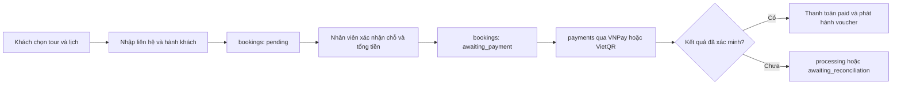

# Danh mục trường dữ liệu – Tour List và Tour Detail

| Mục | Nội dung |
| --- | --- |
| Sprint | Sprint 3 – Technical Design, Coding & QA |
| WBS | 3.1.1 – Rà soát yêu cầu Tour List/Detail; chốt trường dữ liệu |
| Người phụ trách | Lê Trung Phong |
| Căn cứ | SRS v0.1, bảng FR/NFR tuần 2, wireframe UIEx1/UIEx2, ERD `docs/diagram/localtour-erd.drawio` và schema `src/database/01_schema.sql` trên nhánh `main` |
| Trạng thái | Hợp đồng dữ liệu đã đồng bộ với schema 26 bảng. Các khóa JSON và route là thiết kế để triển khai; `main` hiện chưa có controller, model, procedure hoặc seed. |

## 1. Nguyên tắc đọc tài liệu

- **Nguồn dữ liệu** dùng đúng tên `bảng.cột` trong `src/database/01_schema.sql`.
- **Khóa JSON** là tên đề xuất cho API. Chỉ được xem là đã triển khai khi source route/controller tương ứng được thêm vào `main`.
- Dữ liệu `NULL` hoặc chuỗi rỗng hiển thị **“Chưa cập nhật”**; không lấy dữ liệu của tour khác và không tự suy diễn.
- Các bảng có chức năng gần nhau phải chốt một nguồn chuẩn trước khi viết query; không đọc đồng thời rồi trộn dữ liệu.

## 2. Khách hàng, đặt tour và thanh toán

Schema hiện tại hỗ trợ cả tài khoản khách và guest checkout:

- `users.role = 'customer'` dành cho chức năng gắn với tài khoản như lưu tour và nhận thông báo.
- Đặt tour không bắt buộc đăng nhập. `bookings.contact_name`, `contact_email`, `contact_phone` lưu thông tin người đặt; `passengers` lưu người tham gia.
- Khách không đăng nhập tra cứu đơn bằng `bookings.code` kết hợp email hoặc số điện thoại đã dùng khi đặt.
- Sau khi nhân viên xác nhận chỗ và chuyển booking sang `awaiting_payment`, giao dịch được tạo trong `payments` và liên kết bằng `payments.booking_id`.
- VNPay trả sự kiện vào `payment_events`; VietQR chuyển sang `awaiting_reconciliation` để nhân viên đối chiếu; hoàn tiền nằm trong `refunds`.

`bookings` hiện không có `user_id`. Vì vậy tài khoản khách chưa thể tự động có danh sách “Đặt chỗ của tôi”. Nếu chức năng này được triển khai, cần thêm `bookings.user_id NULL` hoặc một bảng liên kết; guest checkout vẫn phải hoạt động khi giá trị đó là `NULL`.

## 3. Tour List – màn hình Bảng tin (UIEx1)

### 3.1. Trường trên thẻ tour

| Mã | Trường | Khóa JSON đề xuất | Nguồn trong schema | Trạng thái / quy tắc |
| --- | --- | --- | --- | --- |
| L01 | Mã và liên kết chi tiết | `tour_id`, `url` | `tours.id` | UUID `CHAR(36)`; URL dạng `/tours/{uuid}`. |
| L02 | Tên tour | `title` | `tours.title` | Bắt buộc. |
| L03 | Mô tả ngắn | `excerpt` | Đoạn đầu `tours.description` | Cắt ở tầng trình bày; không lưu thêm cột tóm tắt. |
| L04 | Nhà tổ chức | `provider_name` | `providers.business_name` qua `tours.provider_id` | Tour công khai chỉ lấy nhà cung cấp `approved` có tài khoản `active`. |
| L05 | Điểm đến | `destination_id`, `destination_name` | `tours.destination_id → destinations.id`; `tours.destination` là dữ liệu chữ tương thích | Ưu tiên `destinations.name`; khi `destination_id IS NULL` mới dùng `tours.destination`. |
| L06 | Loại hình | `category_id`, `category_name` | `tours.category_id → categories.id` | Có trong schema mới; `NULL` hiện “Chưa cập nhật”. |
| L07 | Thời điểm bài đăng | `published_at` | `tour_posts.published_at` | Chỉ dùng khi bảng tin được xây theo bài đăng `published`; tour chưa có bài đăng không có nhãn thời gian. |
| L08 | Ảnh bìa | `cover_image_url`, `cover_caption` | `tour_images.url`, `alt_text`; ảnh có `sort_order` nhỏ nhất | Không có ảnh hiện “Chưa cập nhật ảnh”. |
| L09 | Thời lượng | `duration_minutes`, `duration_text` | `tours.duration_minutes` | Hiển thị theo giờ và phút. |
| L10 | Nơi khởi hành | `pickup_mode`, `meeting_point`, `departure_text` | `tours.pickup_mode`, `meeting_point` | `hotel_pickup` hiện “Đón tại khách sạn”; `meeting_point` hiện tên điểm hẹn. |
| L11 | Giá từ | `from_price_vnd`, `price_text` | Giá vé `adult` nhỏ nhất trong `ticket_types` của lịch đặt được | Chỉ xét vé `active`, lịch `open`, còn chỗ và chưa khởi hành. |
| L12 | Lần khởi hành gần nhất | `next_starts_at` | `schedules.starts_at` | Lấy lịch đặt được sớm nhất. |
| L13 | Nhóm tối đa | `max_group_size` | `tours.max_group_size` | Có thể chỉ hiển thị ở trang chi tiết. |
| L14 | Ngôn ngữ | `languages_text` | `tours.language_codes` | Ví dụ `vi,en` → “Tiếng Việt / Anh”. |
| L15 | Lưu tour | — | `favorite_tours(user_id, tour_id)` | Cần tài khoản khách. |
| L16 | So sánh | — | `comparisons`, `comparison_tours` | Hỗ trợ cả tài khoản và phiên khách qua `session_key`; tối đa 3 tour theo wireframe. |
| L17 | Thích, bình luận, chia sẻ | — | Chưa có bảng phù hợp | `post_comments` và `post_interactions` đã bị bỏ; chưa được phép ghi dữ liệu cho ba thao tác này. |
| L18 | Điểm và số đánh giá | `rating_avg`, `review_count` | **Chưa có nguồn** | Bảng `reviews` đã bị bỏ khỏi schema mới; không được trả số liệu minh họa như dữ liệu thật. |

### 3.2. Tìm kiếm, lọc và sắp xếp

| Điều khiển | Tham số đề xuất | Nguồn / quy tắc |
| --- | --- | --- |
| Tìm kiếm | `q` | Tìm trong `tours.title`, `description`, `destinations.name`/`tours.destination`, `categories.name`, `providers.business_name`. |
| Điểm đến | `destination_id` | Lấy từ `destinations`; không dùng tên làm khóa khi `destination_id` đã có. |
| Loại hình | `category_id` | Lấy từ `categories`. |
| Ngày đi | `date` | Lọc `DATE(schedules.starts_at)`; không dùng bảng `tour_schedules` cùng lúc. |
| Giá tăng/giảm | `price_asc`, `price_desc` | Giá vé người lớn thấp nhất của lịch đặt được; tour chưa có giá xếp cuối. |
| Mới nhất | `newest` | `tour_posts.published_at DESC`, chỉ với bài đăng `published`. |
| Dành cho bạn | `recommended` | Chưa có công thức xếp hạng trong schema; trước khi làm phải chốt tiêu chí, không thể dựa vào đánh giá vì thiếu bảng `reviews`. |
| Đang theo dõi | — | Chưa có bảng quan hệ theo dõi người dùng/nhà tổ chức. |

## 4. Tour Detail – màn hình Chi tiết tour (UIEx2)

| Mã | Khu vực | Nguồn trong schema | Quy tắc |
| --- | --- | --- | --- |
| D01 | Breadcrumb | `destinations.name`, `categories.name`, `tours.title` | Thành phần thiếu được bỏ khỏi breadcrumb. |
| D02 | Tiêu đề và nhà tổ chức | `tours.title`, `providers.business_name` | Chỉ tour và nhà cung cấp đã duyệt. |
| D03 | Thư viện ảnh | `tour_images` | Sắp theo `sort_order`, rồi `id`. |
| D04 | Mô tả | `tours.description` | Không lấy mô tả từ tour khác. |
| D05 | Thời lượng, nhóm, ngôn ngữ | `duration_minutes`, `max_group_size`, `language_codes` | Định dạng ở tầng trình bày. |
| D06 | Điểm đón/trả | `pickup_mode`, `meeting_point`, `dropoff_point` | Trường thiếu hiện “Chưa cập nhật”. |
| D07 | Phương tiện, hướng dẫn viên | `transport`, `guide_info` | Trường thiếu hiện “Chưa cập nhật”. |
| D08 | Lịch trình | `itinerary_stops` **hoặc** `tour_itinerary_items` | Phải chốt một nguồn. Wireframe có giờ bắt đầu nên hiện phù hợp với `tour_itinerary_items.start_time`; `itinerary_stops` phù hợp lịch trình theo chặng và thời lượng. |
| D09 | Bao gồm/không bao gồm | `tour_inclusions` **hoặc** `tours.included_summary`, `excluded_summary` | Phải chốt một nguồn; không trộn hai bộ nếu nội dung khác nhau. |
| D10 | Lịch khởi hành | `schedules` | Nguồn đề xuất vì gắn trực tiếp với `ticket_types` và `bookings`. |
| D11 | Loại vé và giá | `ticket_types` | Chỉ vé `active` của lịch được chọn. |
| D12 | Phụ thu/tùy chọn | `tour_extras` | Không tự cộng vào tổng vé khi chưa chọn và chưa đủ điều kiện. |
| D13 | Chính sách | `cancellation_policies`, các cột `document_terms`, `meal_terms`, `voucher_terms`, `reschedule_terms` | Chính sách hủy lấy `version` lớn nhất của đúng tour. |
| D14 | Tạm tính | `ticket_types.price_vnd × số lượng` | Chỉ là tạm tính; tổng chính thức lưu ở `bookings.total_vnd`. |
| D15 | Đặt tour | `bookings`, `booking_lines`, `passengers` | Guest checkout được hỗ trợ; kiểm tra chỗ ở phía máy chủ trước khi lưu. |
| D16 | Lưu/so sánh | `favorite_tours`, `comparisons`, `comparison_tours` | Lưu cần tài khoản; so sánh có thể dùng `session_key`. |
| D17 | Đánh giá | **Chưa có nguồn** | Wireframe có đánh giá nhưng schema đã bỏ `reviews`; phải khôi phục bảng/nguồn hợp lệ hoặc ẩn khu vực này. |

## 5. Quyết định nguồn dữ liệu cần chốt

Schema hiện có ba cặp mô hình trùng chức năng:

| Chức năng | Nguồn A | Nguồn B | Khuyến nghị cho flow mới |
| --- | --- | --- | --- |
| Lịch trình | `itinerary_stops` | `tour_itinerary_items` | Chọn một bảng; nếu giữ giờ bắt đầu như wireframe thì dùng `tour_itinerary_items`. |
| Bao gồm/không bao gồm | `tours.included_summary`, `excluded_summary` | `tour_inclusions` | Dùng `tour_inclusions` cho dữ liệu có cấu trúc; giữ cột tổng hợp chỉ để tương thích khi di trú. |
| Lịch khởi hành | `schedules` | `tour_schedules` | Dùng `schedules` vì `ticket_types` và `bookings` đang tham chiếu mô hình này. |

Không viết API đọc cả hai nguồn trong cùng một chức năng trước khi có quy tắc di trú và nguồn ưu tiên rõ ràng.

## 6. Khoảng trống giữa schema và wireframe

- Wireframe hiển thị điểm/số đánh giá nhưng schema không có `reviews`.
- Wireframe có Thích/Bình luận/Chia sẻ nhưng schema không có `post_interactions` hoặc `post_comments`.
- Wireframe có “Đặt chỗ của tôi”, nhưng `bookings` chưa liên kết `users`.
- `users.role = 'customer'`, `favorite_tours` và `notifications` cho thấy tài khoản khách đã quay lại phạm vi dữ liệu; các tài liệu không được tiếp tục ghi “khách không có tài khoản”.
- `tour_posts`, `favorite_tours`, `notifications`, `comparisons` và `comparison_tours` đã có trong schema, nhưng `main` chưa có route/controller để sử dụng.

Các khoảng trống trên phải được chốt ở schema hoặc wireframe trước khi coi Tour List/Tour Detail là đã triển khai đầy đủ.
