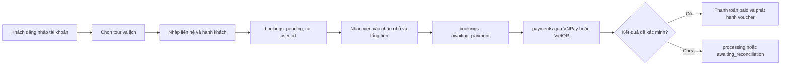

# Danh mục trường dữ liệu – Tour List và Tour Detail

| Mục | Nội dung |
| --- | --- |
| Sprint | Sprint 3 – Technical Design, Coding & QA |
| WBS | 3.1.1 – Rà soát yêu cầu Tour List/Detail; chốt trường dữ liệu |
| Người phụ trách | Lê Trung Phong |
| Căn cứ | SRS v0.1, bảng FR/NFR tuần 2, wireframe UIEx1/UIEx2, ERD `docs/diagram/localtour-erd.drawio` và schema `src/database/01_schema.sql` |
| Trạng thái | **Đã chốt.** Khớp schema 27 bảng. Cập nhật 23/10/2026: thêm tài khoản khách hàng (đăng ký, đăng nhập, đăng xuất) và chế độ khách. |

## 1. Nguyên tắc đọc tài liệu

- **Nguồn dữ liệu** dùng đúng tên `bảng.cột` trong `src/database/01_schema.sql`.
- **Khóa JSON** là tên đã chốt cho API. Route và cấu trúc phản hồi xem [03 – Route và quy ước lỗi](03-route-va-quy-uoc-loi.md).
- Dữ liệu `NULL` hoặc chuỗi rỗng hiển thị **“Chưa cập nhật”**; không lấy dữ liệu của tour khác và không tự suy diễn.
- Mỗi chức năng chỉ đọc một nguồn (mục 5); không đọc đồng thời hai bảng rồi trộn dữ liệu.
- Chức năng chưa làm trong Sprint 3 hiện nút bị tắt kèm nhãn **“Sắp có”** và không ghi dữ liệu.

## 2. Khách hàng, tài khoản, đặt tour và thanh toán

Khách hàng cần tài khoản để đặt tour:

- **Chế độ khách** (chưa đăng nhập): chỉ xem danh sách và chi tiết tour, không đặt tour.
- `users.role = 'customer'` là tài khoản khách hàng, tự tạo ở trang Đăng ký. Trường và quy tắc ở mục 2.1.
- `bookings.user_id` bắt buộc (khóa ngoại tới `users.id`): mỗi đơn thuộc đúng một tài khoản. Khách xem lại đơn của mình qua tài khoản.
- `bookings.contact_name`, `contact_email`, `contact_phone` lưu người liên hệ của đơn (mặc định lấy từ tài khoản, có thể sửa khi đặt cho người khác); `passengers` lưu người tham gia.
- Sau khi nhân viên xác nhận chỗ và chuyển booking sang `awaiting_payment`, giao dịch được tạo trong `payments` và liên kết bằng `payments.booking_id`.
- VNPay trả sự kiện vào `payment_events`; VietQR chuyển sang `awaiting_reconciliation` để nhân viên đối chiếu; hoàn tiền nằm trong `refunds`.

Sprint 3 làm đăng ký, đăng nhập, đăng xuất và chế độ khách. Đặt tour, thanh toán, Thích/Bình luận/Chia sẻ, Lưu tour và So sánh để Sprint sau.

### 2.1. Trường tài khoản khách hàng

| Mã | Trường | Khóa form / session | Nguồn trong schema | Quy tắc |
| --- | --- | --- | --- | --- |
| A01 | Họ tên | `name` | `users.name` | Bắt buộc, tối đa 100 ký tự. Hiện ở header (chữ cái đầu và tên) và là tên người đánh giá. |
| A02 | Email | `email` | `users.email` (duy nhất) | Bắt buộc, đúng định dạng, tối đa 150 ký tự, lưu chữ thường. Trùng → “Email này đã được dùng.” |
| A03 | Số điện thoại | `phone` | `users.phone` | Không bắt buộc; 8–20 ký tự gồm chữ số và khoảng trắng, có thể có dấu `+` ở đầu. |
| A04 | Mật khẩu | `password`, `password_confirm` | `users.password_hash` | Tối thiểu 8 ký tự, tối đa 72 byte (chữ có dấu tính 2–3 byte), nhập lại phải khớp. Chỉ lưu chuỗi băm của `password_hash()`; mật khẩu không được trả về hay điền lại vào form. |
| A05 | Vai trò, trạng thái | — | `users.role`, `users.status` | Đăng ký luôn tạo `customer`, `active`. Đăng nhập chỉ nhận `customer`, `active` và `password_hash` khác `NULL`. |
| A06 | Phiên đăng nhập | `user_id`, `name`, `email`, `role` | Session PHP | Không lưu mật khẩu trong session. |

Tài khoản trong dữ liệu mẫu có `password_hash = NULL` nên không đăng nhập được. Muốn thử đăng nhập thì tự đăng ký tài khoản mới ở `/register`.

### 2.2. Giao diện theo trạng thái đăng nhập

| Vị trí | Chế độ khách | Đã đăng nhập |
| --- | --- | --- |
| Header | Liên kết “Đăng nhập” (`/login`) và nút “Đăng ký” (`/register`) | Chữ cái đầu, tên tài khoản và nút “Đăng xuất” |
| Thẻ đặt tour (trang chi tiết) | Liên kết “Đăng nhập để đặt tour” tới `/login?next=/tours/{id}` và ghi chú “Bạn đang xem với tư cách khách. Đăng nhập để đặt tour.” | Nút “Đặt tour” bị tắt, nhãn “Sắp có” |
| Thích, Bình luận, Chia sẻ, Lưu tour, So sánh | Nút bị tắt, nhãn “Sắp có” | Nút bị tắt, nhãn “Sắp có” |
| Trang đăng nhập / đăng ký | Liên kết “Tiếp tục với tư cách khách” về `/tours` | Chuyển về `/tours` |

## 3. Tour List – màn hình Bảng tin (UIEx1)

### 3.1. Trường trên thẻ tour

| Mã | Trường | Khóa JSON | Nguồn trong schema | Trạng thái / quy tắc |
| --- | --- | --- | --- | --- |
| L01 | Mã và liên kết chi tiết | `tour_id`, `url` | `tours.id` | UUID `CHAR(36)`; URL dạng `/tours/{uuid}`. |
| L02 | Tên tour | `title` | `tours.title` | Bắt buộc. |
| L03 | Mô tả ngắn | `excerpt` | Đoạn đầu `tours.description` | Cắt ở tầng trình bày; không lưu thêm cột tóm tắt. |
| L04 | Nhà tổ chức | `provider_name` | `providers.business_name` qua `tours.provider_id` | Tour công khai chỉ lấy nhà cung cấp `approved` có tài khoản `active`. |
| L05 | Điểm đến | `destination_id`, `destination_name` | `tours.destination_id → destinations.id`; `tours.destination` là dữ liệu chữ tương thích | Ưu tiên `destinations.name`; khi `destination_id IS NULL` mới dùng `tours.destination`. |
| L06 | Loại hình | `category_id`, `category_name` | `tours.category_id → categories.id` | `NULL` hiện “Chưa cập nhật”. |
| L07 | Thời điểm bài đăng | — | `tour_posts.published_at` | Không làm trong Sprint 3: `tour_posts` để trống, API không trả `published_at`. |
| L08 | Ảnh bìa | `cover_image_url`, `cover_caption` | `tour_images.url`, `alt_text`; ảnh có `sort_order` nhỏ nhất | Không có ảnh hiện “Chưa cập nhật ảnh”. `alt_text` trống thì chú thích là tên tour. |
| L09 | Thời lượng | `duration_minutes`, `duration_text` | `tours.duration_minutes` | Hiển thị theo giờ và phút. |
| L10 | Nơi khởi hành | `pickup_mode`, `meeting_point`, `pickup_text`, `departure_text` | `tours.pickup_mode`, `meeting_point` | `hotel_pickup` hiện “Đón tại khách sạn”; `meeting_point` hiện tên điểm hẹn. |
| L11 | Giá từ | `from_price_vnd`, `price_text` | Giá vé `adult` nhỏ nhất trong `ticket_types` của lịch đặt được | Chỉ xét vé `active`, lịch `open`, còn chỗ và chưa khởi hành. Không có giá → `null`, hiện “Chưa cập nhật”. |
| L12 | Lần khởi hành gần nhất | `next_starts_at`, `next_departure_text` | `schedules.starts_at` | Lấy lịch đặt được sớm nhất; `next_departure_text` dạng `dd/mm/yyyy · HH:MM`. |
| L13 | Nhóm tối đa | `max_group_size` | `tours.max_group_size` | Có thể chỉ hiển thị ở trang chi tiết. |
| L14 | Ngôn ngữ | `languages_text` | `tours.language_codes` | Ví dụ `vi,en` → “Tiếng Việt / Anh”. |
| L15 | Lưu tour | — | `favorite_tours(user_id, tour_id)` | Cần tài khoản. Sprint 3: nút bị tắt, nhãn “Sắp có”; bảng để trống. |
| L16 | So sánh | — | `comparisons`, `comparison_tours` | Tối đa 3 tour theo wireframe. Sprint 3: nút bị tắt, nhãn “Sắp có”; bảng để trống. |
| L17 | Thích, bình luận, chia sẻ | — | Không có bảng | `post_comments` và `post_interactions` đã bỏ. Nút bị tắt, nhãn “Sắp có”; không ghi dữ liệu. |
| L18 | Điểm và số đánh giá | `rating_avg`, `rating_text`, `review_count` | `reviews.rating` của đánh giá `moderation_status = 'approved'` | Điểm trung bình làm tròn 1 chữ số (`4,8`). Chưa có đánh giá đã duyệt → `rating_avg`, `rating_text` là `null`, `review_count = 0`. |

### 3.2. Tìm kiếm, lọc và sắp xếp

| Điều khiển | Tham số | Nguồn / quy tắc |
| --- | --- | --- |
| Tìm kiếm | `q` | Tối đa 100 ký tự. Tìm trong `tours.title`, `description`, `destinations.name`/`tours.destination`, `categories.name`, `providers.business_name`. |
| Điểm đến | `destination_id` | Lấy từ `destinations` (`/api/destinations`); lọc theo id, không lọc theo tên. Liên kết ở thanh bên dạng `?destination_id=<uuid>`. |
| Loại hình | `category_id` | Lấy từ `categories` (`/api/categories`); lọc theo id. |
| Ngày đi | `date` | Không làm trong Sprint 3. |
| Nổi bật (Dành cho bạn) | `recommended` | Mặc định. Tour có đánh giá đã duyệt trước, điểm trung bình giảm dần, rồi số đánh giá giảm dần. |
| Sắp khởi hành | `upcoming` | Lịch đặt được sớm nhất trước; tour chưa có lịch xếp cuối. |
| Giá tăng/giảm | `price_asc`, `price_desc` | Giá vé người lớn thấp nhất của lịch đặt được; tour chưa có giá xếp cuối. |
| Mới nhất | `newest` | Không làm trong Sprint 3 (`tour_posts` để trống). |
| Đang theo dõi | — | Không thuộc phạm vi; chưa có bảng quan hệ theo dõi người dùng/nhà tổ chức. |

Cùng thứ hạng thì xếp theo tên tour. Giá trị `sort` khác bốn giá trị trên được coi là `recommended`.

## 4. Tour Detail – màn hình Chi tiết tour (UIEx2)

| Mã | Khu vực | Nguồn trong schema | Quy tắc |
| --- | --- | --- | --- |
| D01 | Breadcrumb | `destinations.name`, `categories.name`, `tours.title` | Điểm đến và loại hình liên kết theo id (`/tours?destination_id=…`, `/tours?category_id=…`). Thành phần thiếu được bỏ khỏi breadcrumb. |
| D02 | Tiêu đề và nhà tổ chức | `tours.title`, `providers.business_name` | Chỉ tour và nhà cung cấp đã duyệt. |
| D03 | Thư viện ảnh | `tour_images` | Sắp theo `sort_order`, rồi `id`. |
| D04 | Mô tả | `tours.description` | Không lấy mô tả từ tour khác. |
| D05 | Thời lượng, nhóm, ngôn ngữ, loại hình | `duration_minutes`, `max_group_size`, `language_codes`, `categories.name` | Định dạng ở tầng trình bày; dòng “Loại hình” thiếu hiện “Chưa cập nhật”. |
| D06 | Điểm đón/trả | `pickup_mode`, `meeting_point`, `dropoff_point` | Trường thiếu hiện “Chưa cập nhật”. |
| D07 | Phương tiện, hướng dẫn viên | `transport`, `guide_info` | Trường thiếu hiện “Chưa cập nhật”. |
| D08 | Lịch trình | `tour_itinerary_items` | Đã chốt. Sắp theo `sort_order`, rồi `id`; hiện giờ `start_time` (HH:MM) khi có, rồi mô tả. `itinerary_stops` để trống, không dùng. |
| D09 | Dịch vụ bao gồm/không bao gồm | `tour_inclusions` | Đã chốt. Hai danh sách: bao gồm (`is_included = 1`) và không bao gồm (`0`), theo `sort_order`. `tours.included_summary`, `excluded_summary` để `NULL`, không dùng. |
| D10 | Lịch khởi hành | `schedules` | Đã chốt, vì gắn trực tiếp với `ticket_types` và `bookings`. `tour_schedules` để trống, không dùng. |
| D11 | Loại vé và giá | `ticket_types` | Chỉ vé `active` của lịch được chọn. |
| D12 | Phụ thu/tùy chọn | `tour_extras` | Không tự cộng vào tổng vé khi chưa chọn và chưa đủ điều kiện. |
| D13 | Chính sách | `cancellation_policies`, các cột `document_terms`, `meal_terms`, `voucher_terms`, `reschedule_terms` | Chính sách hủy lấy `version` lớn nhất của đúng tour. |
| D14 | Tạm tính | `ticket_types.price_vnd × số lượng` | Chỉ là tạm tính; tổng chính thức lưu ở `bookings.total_vnd`. |
| D15 | Đặt tour | `bookings` (`user_id` bắt buộc), `booking_lines`, `passengers` | Cần đăng nhập. Sprint 3: khách chưa đăng nhập thấy liên kết “Đăng nhập để đặt tour”; đã đăng nhập thấy nút “Đặt tour” bị tắt, nhãn “Sắp có” (mục 2.2). Khi làm: kiểm tra chỗ ở phía máy chủ trước khi lưu. |
| D16 | Lưu, so sánh, thích, bình luận, chia sẻ | `favorite_tours`, `comparisons`, `comparison_tours` | Sprint 3: nút bị tắt, nhãn “Sắp có”; không ghi dữ liệu. |
| D17 | Đánh giá | `reviews` → `bookings.user_id` → `users.name` | Chỉ đánh giá `approved`, chuyến đi gần nhất trước, tối đa 5 đánh giá. Mỗi đơn tối đa một đánh giá (`reviews.booking_id` duy nhất); tên người đánh giá là `users.name` của chủ đơn. |

## 5. Quyết định nguồn dữ liệu (đã chốt)

Schema có ba cặp mô hình trùng chức năng. Mỗi cặp chỉ đọc một nguồn:

| Chức năng | Nguồn A | Nguồn B | Quyết định |
| --- | --- | --- | --- |
| Lịch trình | `itinerary_stops` | `tour_itinerary_items` | Dùng `tour_itinerary_items` vì có giờ bắt đầu như wireframe. `itinerary_stops` để trống. |
| Bao gồm/không bao gồm | `tours.included_summary`, `excluded_summary` | `tour_inclusions` | Dùng `tour_inclusions` cho dữ liệu có cấu trúc. Hai cột summary để `NULL`. |
| Lịch khởi hành | `schedules` | `tour_schedules` | Dùng `schedules` vì `ticket_types` và `bookings` tham chiếu mô hình này. `tour_schedules` để trống. |

Bảng và cột không dùng vẫn giữ trong schema; không viết API đọc chúng.

## 6. Khoảng trống giữa schema và wireframe (đã xử lý)

- Điểm/số đánh giá: đã khôi phục `reviews`; tên người đánh giá lấy từ `users.name` của tài khoản đặt đơn.
- Thích/Bình luận/Chia sẻ: không bổ sung bảng (`post_comments`, `post_interactions` đã bỏ); nút hiện “Sắp có”.
- “Đặt chỗ của tôi”: `bookings.user_id` bắt buộc nên lọc được đơn theo tài khoản; màn hình làm ở Sprint sau.
- Tài khoản khách: Sprint 3 làm đăng ký, đăng nhập, đăng xuất; khách chưa đăng nhập chỉ xem tour.
- Điểm đến, loại hình: lấy từ bảng `destinations`, `categories` và lọc theo id.
- `tour_posts`, `favorite_tours`, `notifications`, `comparisons` và `comparison_tours` có trong schema nhưng để trống, chưa có route.
- Lọc theo ngày (`date`) và sắp xếp Mới nhất (`newest`) không làm trong Sprint 3.

Tour List/Tour Detail của Sprint 3 làm theo các quyết định trên; phần “Sắp có” để Sprint sau.
