# Lược đồ dữ liệu – db_localtour

| Mục | Nội dung |
| --- | --- |
| Sprint | Sprint 3 – Technical Design, Coding & QA |
| WBS | 3.1.2 – Thiết kế lược đồ Tour, Provider, Schedule và script mẫu |
| Người phụ trách | Nguyễn Minh Thức |
| Thời gian theo kế hoạch | 22–23/10/2026 (1,5 giờ công) |
| Căn cứ | ERD của nhóm `docs/diagram/localtour-erd.drawio` (26 bảng); bảng yêu cầu FR/NFR (Bài tập nhóm tuần 2); [01 – Danh mục trường dữ liệu](01-truong-du-lieu.md), mục 5 (nguồn của ba cặp bảng trùng chức năng). Nhóm chốt lược đồ 27 bảng: 26 bảng của ERD và bảng `reviews` được giữ lại vì trang danh sách và trang chi tiết có hiển thị đánh giá. Khách hàng có tài khoản và phải đăng nhập mới đặt được tour. |
| Script | `src/database/01_schema.sql`, `src/database/02_seed.sql`, `src/database/03_procedures_LTP.sql`, `src/database/04_procedures_NMT.sql`, `src/database/05_procedures_NTK.sql`, `src/database/06_procedures_NTK_account.sql`; file gộp `src/database/db_localtour.sql` |
| Tài liệu liên quan | [01 – Danh mục trường dữ liệu](01-truong-du-lieu.md), [03 – Route và quy ước lỗi](03-route-va-quy-uoc-loi.md), `src/database/README.md` |
| Tiêu chí nghiệm thu | Schema SQL chạy không lỗi; khóa chính/khóa ngoại hợp lý; có dữ liệu tối thiểu 6 tour để kiểm thử. |

## 1. Tổng quan

- Hệ quản trị: MySQL chạy qua XAMPP (MariaDB 10.4); script tương thích MySQL 8.
- Database `db_localtour`, bảng mã `utf8mb4`, collation `utf8mb4_unicode_ci` để lưu đúng tiếng Việt có dấu.
- Engine InnoDB cho mọi bảng để dùng được khóa ngoại.
- 27 bảng, chia thành 9 nhóm theo đúng các phần của `01_schema.sql` (bảng dưới đây).
- Khách hàng có tài khoản (`users.role = 'customer'`). Khách chưa đăng nhập (chế độ khách) chỉ xem danh sách và chi tiết tour; muốn đặt tour phải đăng nhập, nên mỗi đơn đặt thuộc đúng một tài khoản (`bookings.user_id` bắt buộc). Chi tiết ở mục 7.2.
- Sprint 3 đọc 14 bảng để hiển thị danh sách, chi tiết tour và để đăng nhập; chỉ ghi vào một bảng là `users` (đăng ký tài khoản). 13 bảng còn lại được tạo sẵn để Sprint sau không phải đổi lược đồ (mục 1.1).
- Ba cặp bảng trùng chức năng chỉ đọc một nguồn (mục 1.2).
- Ứng dụng PHP không đọc bảng trực tiếp. Mọi truy xuất đi qua stored procedure có tên bắt đầu bằng tiền tố của người phụ trách: `LTP_sp_…`, `NMT_sp_…`, `NTK_sp_…` (mục 10; xem thêm [03 – Route và quy ước lỗi](03-route-va-quy-uoc-loi.md)).
- `01_schema.sql` là bản gốc của lược đồ, mỗi bảng và mỗi cột thêm mới có ghi chú FR mà nó phục vụ. Thức vẽ lại ERD chính thức từ file này.

| Nhóm (phần trong `01_schema.sql`) | Số bảng | Bảng |
| --- | --- | --- |
| 2. Tài khoản & nhà cung cấp | 2 | `users`, `providers` |
| 3. Danh mục tour | 2 | `destinations`, `categories` |
| 4. Tour & nội dung tour | 7 | `tours`, `tour_images`, `itinerary_stops`, `tour_extras`, `tour_itinerary_items`, `tour_inclusions`, `tour_schedules` |
| 5. Lịch khởi hành, vé & chính sách | 3 | `schedules`, `ticket_types`, `cancellation_policies` |
| 6. Đặt chỗ | 3 | `bookings`, `booking_lines`, `passengers` |
| 7. Giao dịch | 3 | `payments`, `payment_events`, `refunds` |
| 8. Đánh giá | 1 | `reviews` |
| 9. Khám phá, yêu thích, so sánh & thông báo | 5 | `tour_posts`, `favorite_tours`, `notifications`, `comparisons`, `comparison_tours` |
| 10. Nhật ký | 1 | `admin_logs` |

### 1.1. Ánh xạ thực thể → bảng SQL

"Mọi procedure tour" là các procedure của file `03`, `04`, `05`: procedure nào cũng nối `tours`, `providers`, `users` để áp dụng điều kiện công khai (mục 7.1).

| Nhóm | Thực thể | Bảng SQL | Dùng ở Sprint 3 | Procedure đọc |
| --- | --- | --- | --- | --- |
| Tài khoản & nhà cung cấp | NGƯỜI_DÙNG | `users` | Đọc và ghi: đăng ký, đăng nhập tài khoản khách hàng; tên người đánh giá; trạng thái tài khoản của nhà cung cấp. | `NTK_sp_customer_register` (ghi), `NTK_sp_user_find_by_email`, `NTK_sp_tour_review_list`; mọi procedure tour |
| Tài khoản & nhà cung cấp | NHÀ_CUNG_CẤP | `providers` | Đọc: tên hiển thị, trạng thái duyệt, ngày duyệt. | Mọi procedure tour |
| Danh mục tour | ĐIỂM_ĐẾN | `destinations` | Đọc: bộ lọc điểm đến, thanh bên, breadcrumb, tên điểm đến của tour. | `LTP_sp_destination_list`, `LTP_sp_tour_list`, `NMT_sp_tour_detail` |
| Danh mục tour | LOẠI_HÌNH | `categories` | Đọc: bộ lọc "Loại hình", breadcrumb, dòng "Loại hình" ở trang chi tiết. | `LTP_sp_category_list`, `LTP_sp_tour_list`, `NMT_sp_tour_detail` |
| Tour & nội dung tour | TOUR | `tours` | Đọc, kể cả 7 cột thông tin thêm theo bảng FR. Không đọc `included_summary`, `excluded_summary` (để `NULL`, mục 1.2) và 3 cột NFR-07. | Mọi procedure tour |
| Tour & nội dung tour | ẢNH_TOUR | `tour_images` | Đọc: ảnh bìa và thư viện ảnh của chính tour. | `NMT_sp_tour_image_list`, `LTP_sp_tour_list` (ảnh bìa) |
| Tour & nội dung tour | ĐIỂM_LỊCH_TRÌNH | `itinerary_stops` | Không dùng, để trống (mục 1.2). | – |
| Tour & nội dung tour | PHỤ_THU / HOẠT_ĐỘNG_TÙY_CHỌN | `tour_extras` | Đọc: phụ thu và hoạt động tùy chọn, giá tách riêng. | `NTK_sp_tour_extra_list` |
| Tour & nội dung tour | LỊCH_TRÌNH_TOUR | `tour_itinerary_items` | Đọc: lịch trình theo `sort_order`, có giờ bắt đầu khi dữ liệu có ghi. | `NTK_sp_tour_itinerary_list` |
| Tour & nội dung tour | BAO_GỒM_TOUR | `tour_inclusions` | Đọc: danh sách đã bao gồm / không bao gồm. | `NTK_sp_tour_inclusion_list` |
| Tour & nội dung tour | LỊCH_TOUR | `tour_schedules` | Không dùng, để trống (mục 1.2). | – |
| Lịch, vé & chính sách | LỊCH_KHỞI_HÀNH | `schedules` | Đọc: lịch còn đặt được, số chỗ còn; ngày đi tour của đánh giá. | `NMT_sp_tour_schedule_list`, `NMT_sp_tour_ticket_list`, `LTP_sp_tour_list`, `NMT_sp_tour_detail`, `NTK_sp_tour_review_list` |
| Lịch, vé & chính sách | VÉ_THEO_LỊCH | `ticket_types` | Đọc: giá theo loại vé của từng lịch. | `NMT_sp_tour_ticket_list`, `NMT_sp_tour_schedule_list`, `LTP_sp_tour_list`, `NMT_sp_tour_detail` |
| Lịch, vé & chính sách | CHÍNH_SÁCH_HỦY | `cancellation_policies` | Đọc: phiên bản mới nhất. | `NTK_sp_tour_cancellation_policy` |
| Đặt chỗ | ĐƠN_ĐẶT_TOUR | `bookings` | Đọc gián tiếp: tài khoản đặt đơn (tên người đánh giá) và lịch của đơn (ngày đi tour). Sprint 3 chưa tạo đơn. | `NTK_sp_tour_review_list` |
| Đặt chỗ | DÒNG_ĐƠN | `booking_lines` | Tạo sẵn, dùng ở Sprint sau (đặt tour). | – |
| Đặt chỗ | HÀNH_KHÁCH | `passengers` | Tạo sẵn, dùng ở Sprint sau (đặt tour). | – |
| Giao dịch | THANH_TOÁN | `payments` | Tạo sẵn, dùng ở Sprint sau (thanh toán). | – |
| Giao dịch | SỰ_KIỆN_THANH_TOÁN | `payment_events` | Tạo sẵn, dùng ở Sprint sau (thanh toán). | – |
| Giao dịch | HOÀN_TIỀN | `refunds` | Tạo sẵn, dùng ở Sprint sau (hủy đơn, hoàn tiền). | – |
| Đánh giá | ĐÁNH_GIÁ | `reviews` | Đọc: chỉ đánh giá đã duyệt; điểm trung bình và số đánh giá. | `NTK_sp_tour_review_list`, `LTP_sp_tour_list`, `NMT_sp_tour_detail` |
| Khám phá & thông báo | BÀI_ĐĂNG_TOUR | `tour_posts` | Tạo sẵn, để trống. | – |
| Khám phá & thông báo | TOUR_YÊU_THÍCH | `favorite_tours` | Tạo sẵn, để trống (nút "Lưu tour" hiện "Sắp có"). | – |
| Khám phá & thông báo | THÔNG_BÁO | `notifications` | Tạo sẵn, để trống. | – |
| Khám phá & thông báo | BỘ_SO_SÁNH | `comparisons` | Tạo sẵn, để trống (nút "So sánh" hiện "Sắp có"). | – |
| Khám phá & thông báo | TOUR_TRONG_BỘ_SO_SÁNH | `comparison_tours` | Tạo sẵn, để trống. | – |
| Nhật ký | NHẬT_KÝ_QUẢN_TRỊ | `admin_logs` | Tạo sẵn, để trống (NFR-09, dùng khi có trang quản trị). | – |

`bookings` luôn có dữ liệu mẫu vì mỗi đánh giá phải gắn với một đơn đặt đã hoàn thành của một tài khoản khách hàng; số dòng của các bảng đặt chỗ và giao dịch xem phần đầu `02_seed.sql`. Tám bảng `itinerary_stops`, `tour_schedules`, `tour_posts`, `favorite_tours`, `notifications`, `comparisons`, `comparison_tours`, `admin_logs` để trống. Không màn hình nào của Sprint 3 hiển thị dữ liệu của các bảng tạo sẵn.

### 1.2. Ba cặp bảng trùng chức năng

Lược đồ có ba cặp bảng (hoặc cột) cùng lưu một loại thông tin. Theo [01 – Danh mục trường dữ liệu](01-truong-du-lieu.md), mục 5, mỗi chức năng chỉ đọc một nguồn, không đọc cả hai rồi trộn dữ liệu.

| Chức năng | Nguồn được đọc | Giữ trong lược đồ nhưng không dùng | Lý do chọn |
| --- | --- | --- | --- |
| Lịch trình | `tour_itinerary_items` (`NTK_sp_tour_itinerary_list`) | `itinerary_stops` | Wireframe chi tiết tour có giờ bắt đầu của từng mục; chỉ `tour_itinerary_items` có cột `start_time`. |
| Đã bao gồm / không bao gồm | `tour_inclusions` (`NTK_sp_tour_inclusion_list`) | `tours.included_summary`, `tours.excluded_summary` | Mỗi mục một dòng, có cờ `is_included` và thứ tự riêng; không phải tách chuỗi theo dòng. |
| Lịch khởi hành | `schedules` | `tour_schedules` | `ticket_types` và `bookings` tham chiếu `schedules`. |

Nguồn không dùng vẫn nằm trong lược đồ nhưng không có dữ liệu mẫu (hai cột summary để `NULL`) và không procedure nào đọc.

### 1.3. Bảng đã bỏ

| Bảng (ERD trang 02 "Khám phá & vận hành") | Lý do bỏ |
| --- | --- |
| `post_comments` (BÌNH_LUẬN), `post_interactions` (TƯƠNG_TÁC_BÀI) | Các nút Thích / Bình luận / Chia sẻ trên giao diện chỉ hiện "Sắp có". Sprint 3 không ghi dữ liệu nào cho ba thao tác này nên chưa cần bảng. |

`01_schema.sql` vẫn `DROP TABLE IF EXISTS` hai bảng này để import đè lên bản cũ không bị lỗi và không còn bảng thừa.

## 2. Sơ đồ quan hệ (ERD)

Sơ đồ dưới đây vẽ 27 bảng và 32 khóa ngoại đúng theo `01_schema.sql`. Để sơ đồ dễ đọc, mỗi bảng chỉ ghi khóa chính, khóa ngoại và cột duy nhất; đủ cột xem mục 4. `PK` = khóa chính, `FK` = khóa ngoại, `UK` = giá trị duy nhất. "N" được hiểu là 0..N (ví dụ tour mới tạo chưa có lịch). ERD chính thức dạng hình do Thức vẽ lại từ `01_schema.sql`; khi hình và script lệch nhau thì theo script.

```mermaid
erDiagram
    users ||--o| providers : "là nhà cung cấp"
    users ||--o{ bookings : "đặt"
    users ||--o{ tour_posts : "viết"
    users ||--o{ favorite_tours : "lưu"
    users ||--o{ notifications : "nhận"
    users |o--o{ comparisons : "tạo"
    users ||--o{ admin_logs : "thực hiện"
    providers ||--o{ tours : "tổ chức"
    destinations |o--o{ tours : "là điểm đến"
    categories |o--o{ tours : "phân loại"
    tours ||--o{ tour_images : "có ảnh"
    tours ||--o{ tour_itinerary_items : "có lịch trình"
    tours ||--o{ itinerary_stops : "có chặng (không dùng)"
    tours ||--o{ tour_inclusions : "có dịch vụ"
    tours ||--o{ tour_extras : "có phụ thu, tùy chọn"
    tours ||--o{ tour_schedules : "có lịch cũ (không dùng)"
    tours ||--o{ schedules : "có lịch"
    tours ||--o{ cancellation_policies : "có chính sách hủy"
    schedules ||--o{ ticket_types : "bán vé"
    schedules ||--o{ bookings : "được đặt"
    bookings ||--o{ booking_lines : "gồm dòng"
    ticket_types ||--o{ booking_lines : "được chọn"
    bookings ||--o{ passengers : "có hành khách"
    bookings ||--o{ payments : "được thanh toán"
    payments ||--o{ payment_events : "nhận sự kiện"
    payments ||--o{ refunds : "được hoàn"
    bookings ||--o| reviews : "được đánh giá"
    tours ||--o{ reviews : "nhận"
    tours ||--o{ tour_posts : "có bài đăng"
    tours ||--o{ favorite_tours : "được lưu"
    comparisons ||--o{ comparison_tours : "gồm"
    tours ||--o{ comparison_tours : "được so sánh"

    users {
        char36 id PK
        varchar email UK
    }
    providers {
        char36 id PK
        char36 user_id FK, UK
    }
    destinations {
        char36 id PK
        varchar name UK
        varchar slug UK
    }
    categories {
        char36 id PK
        varchar name UK
        varchar slug UK
    }
    tours {
        char36 id PK
        char36 provider_id FK
        char36 destination_id FK "có thể NULL"
        char36 category_id FK "có thể NULL"
    }
    tour_images {
        char36 id PK
        char36 tour_id FK
    }
    itinerary_stops {
        char36 id PK
        char36 tour_id FK
    }
    tour_extras {
        char36 id PK
        char36 tour_id FK
    }
    tour_itinerary_items {
        char36 id PK
        char36 tour_id FK
    }
    tour_inclusions {
        char36 id PK
        char36 tour_id FK
    }
    tour_schedules {
        char36 id PK
        char36 tour_id FK, UK
        date departure_date UK
        time start_time UK
    }
    schedules {
        char36 id PK
        char36 tour_id FK
    }
    ticket_types {
        char36 id PK
        char36 schedule_id FK
    }
    cancellation_policies {
        char36 id PK
        char36 tour_id FK, UK
        int version UK
    }
    bookings {
        char36 id PK
        char36 user_id FK
        char36 schedule_id FK
        varchar code UK
    }
    booking_lines {
        char36 id PK
        char36 booking_id FK
        char36 ticket_type_id FK
    }
    passengers {
        char36 id PK
        char36 booking_id FK
    }
    payments {
        char36 id PK
        char36 booking_id FK
    }
    payment_events {
        char36 id PK
        char36 payment_id FK
        varchar provider_event_id UK
    }
    refunds {
        char36 id PK
        char36 payment_id FK
    }
    reviews {
        char36 id PK
        char36 booking_id FK, UK
        char36 tour_id FK
    }
    tour_posts {
        char36 id PK
        char36 tour_id FK
        char36 author_user_id FK
    }
    favorite_tours {
        char36 id PK
        char36 user_id FK, UK
        char36 tour_id FK, UK
    }
    notifications {
        char36 id PK
        char36 recipient_user_id FK
    }
    comparisons {
        char36 id PK
        char36 user_id FK "có thể NULL"
    }
    comparison_tours {
        char36 id PK
        char36 comparison_id FK, UK
        char36 tour_id FK, UK
    }
    admin_logs {
        char36 id PK
        char36 actor_user_id FK
    }
```

Đọc sơ đồ:

- Dấu `UK` trên nhiều cột của cùng một bảng là một khóa duy nhất ghép: `cancellation_policies (tour_id, version)`, `tour_schedules (tour_id, departure_date, start_time)`, `favorite_tours (user_id, tour_id)`, `comparison_tours (comparison_id, tour_id)`. Riêng `destinations` và `categories` có hai khóa duy nhất riêng (`name` và `slug`).
- Quan hệ 1 – 0..1: mỗi tài khoản có tối đa một hồ sơ nhà cung cấp (`providers.user_id` duy nhất); mỗi đơn đặt có tối đa một đánh giá (`reviews.booking_id` duy nhất).
- Ba khóa ngoại cho phép `NULL` (đầu `|o` ở phía bảng cha): `tours.destination_id`, `tours.category_id` (tour chưa gắn điểm đến / loại hình) và `comparisons.user_id` (bộ so sánh của phiên chưa đăng nhập). Mọi khóa ngoại khác là `NOT NULL`.
- `bookings.user_id` bắt buộc: mỗi đơn thuộc một tài khoản khách hàng. `reviews` không có cột người dùng riêng; người đánh giá là chủ tài khoản của đơn (`reviews.booking_id` → `bookings.user_id` → `users`).

## 3. Quy ước kiểu dữ liệu

### 3.1. Ánh xạ kiểu ERD → MySQL

| Kiểu trên ERD | Kiểu MySQL | Ghi chú |
| --- | --- | --- |
| UUID | `CHAR(36)` | Mọi khóa chính là cột `id CHAR(36)` chứa UUID dạng chữ thường, ví dụ `c0000000-0000-4000-8000-000000000001`. Không dùng `AUTO_INCREMENT`. Khóa ngoại cùng kiểu. |
| varchar | `VARCHAR(n)` | Độ dài `n` ghi ở mục 4. |
| text | `TEXT` | |
| int / smallint | `INT` / `SMALLINT` | |
| bigint | `BIGINT` | Tiền VND, số nguyên đồng. |
| boolean | `BOOLEAN` (= `TINYINT(1)`) | |
| date | `DATE` | `tours.verified_at`, `tour_schedules.departure_date`. |
| time | `TIME` | Giờ trong ngày, không kèm ngày: `tour_itinerary_items.start_time`, `tour_schedules.start_time`. |
| timestamp | `DATETIME` | MariaDB 10.4 tự gắn `ON UPDATE CURRENT_TIMESTAMP` cho cột `TIMESTAMP NOT NULL` đầu tiên và `TIMESTAMP` chỉ lưu được tới năm 2038; `DATETIME` giữ đúng giá trị được ghi. Các cột `created_at` có `DEFAULT CURRENT_TIMESTAMP`. |
| enum | `ENUM(...)` | Giá trị ở mục 3.2. |
| Dấu `?` sau kiểu | `NULL` | Cột không có `?` là `NOT NULL`. Cột thêm theo bảng FR đều `NULL` (= chưa cập nhật), trừ `verification_status`. |

### 3.2. Giá trị enum

ERD chỉ ghi một phần giá trị (ví dụ `pending/confirmed/...`). Trạng thái đơn đặt và thanh toán lấy theo bảng FR (FR-11, FR-17 và quy trình BPMN); phần còn lại do nhóm chốt như sau.

| Cột | Giá trị | Mặc định |
| --- | --- | --- |
| `users.role` | `admin` (Quản trị viên), `support` (Nhân viên hỗ trợ khách hàng), `provider` (tài khoản của nhà cung cấp), `customer` (tài khoản khách hàng) | Không có, bắt buộc nhập |
| `users.status` | `active`, `locked` | `active` |
| `providers.approval_status` | `pending`, `approved`, `rejected` | `pending` |
| `tours.pickup_mode` | `meeting_point` (khách tự đến điểm hẹn), `hotel_pickup` (đón tại khách sạn) | Không có, bắt buộc nhập |
| `tours.verification_status` | `unverified` (chưa xác minh), `verified` (đã xác minh) | `unverified` |
| `tours.approval_status` | `draft`, `pending`, `approved`, `rejected` | `draft` |
| `tour_extras.kind` | `surcharge` (Phụ thu), `optional` (Hoạt động tùy chọn) | Không có, bắt buộc nhập |
| `tour_schedules.status` | `open`, `full`, `cancelled` (bảng không dùng) | `open` |
| `schedules.status` | `open`, `full`, `cancelled`, `completed` | `open` |
| `bookings.status` | `pending` (Chờ xác nhận), `awaiting_payment` (Chờ thanh toán), `confirmed` (Đã xác nhận), `rejected` (Từ chối), `cancelled` (Đã hủy), `completed` (Đã hoàn thành) | `pending` |
| `passengers.age_group` | `adult`, `child`, `infant` | Không có |
| `payments.method` | `vnpay`, `vietqr` | Không có |
| `payments.status` | `pending` (Chưa thanh toán), `processing` (Đang xử lý), `awaiting_reconciliation` (Chờ đối chiếu), `paid` (Thành công), `failed` (Thất bại) | `pending` |
| `refunds.status` | `requested`, `approved`, `rejected`, `completed` | `requested` |
| `reviews.moderation_status` | `pending`, `approved`, `rejected` | `pending` |
| `tour_posts.status` | `draft`, `published` (bảng chưa dùng) | `draft` |

Ghi chú:

- `customer` là tài khoản khách hàng. Trang đăng ký chỉ tạo tài khoản `customer`, trang đăng nhập chỉ nhận tài khoản `customer`. Ba vai trò còn lại dành cho trang quản trị và trang nhà cung cấp sau này.
- `completed` không có trong bảng FR mà đến từ quy tắc trên ERD "đánh giá thuộc đơn đã hoàn thành": chỉ đơn `completed` mới có đánh giá.
- `payments.method` chỉ có hai phương thức của FR-17 (VNPay, VietQR); không có trả sau.
- `payments.status` không có `expired` hay `refunded`: tiền hoàn được ghi riêng ở bảng `refunds`, đơn quá hạn thanh toán chuyển sang `cancelled`.

`ticket_types.name` không phải enum mà là `VARCHAR(50)` (`adult`, `child`, …) để Sprint sau thêm loại vé mới không phải sửa bảng.

## 4. Mô tả từng bảng

Mọi bảng có cột đầu tiên `id CHAR(36)`, khóa chính; các bảng dưới đây chỉ liệt kê những cột sau `id`. Mọi khóa ngoại là `CHAR(36)` và `NOT NULL`, trừ `tours.destination_id`, `tours.category_id`, `comparisons.user_id`.

Bảng Sprint 3 đọc được mô tả đủ từng cột. Bảng tạo sẵn chưa dùng được tóm tắt trong một bảng ở cuối nhóm: mọi cột `NOT NULL` trừ khi ghi `NULL`; khóa ngoại trỏ tới `id` của bảng ghi sau dấu →.

### 4.1. Tài khoản và nhà cung cấp

#### `users` – Người dùng (NGƯỜI_DÙNG)

Tài khoản khách hàng, nhân viên và nhà cung cấp (FR-13, NFR-04). Sprint 3 chỉ tạo và đăng nhập tài khoản `customer` (mục 7.2).

| Cột | Kiểu | Ràng buộc | Ý nghĩa |
| --- | --- | --- | --- |
| `email` | VARCHAR(150) | NOT NULL, UNIQUE | Email đăng nhập, lưu chữ thường (PHP và hai procedure tài khoản đều đổi về chữ thường trước khi ghi và khi tìm). Collation `utf8mb4_unicode_ci` không phân biệt hoa thường nên hai email chỉ khác hoa thường cũng bị coi là trùng. |
| `password_hash` | VARCHAR(255) | NULL | Chuỗi do `password_hash()` của PHP tạo (bcrypt, `PASSWORD_DEFAULT`); không bao giờ lưu mật khẩu gốc. Độ dài 255 để vẫn đủ chỗ khi PHP đổi thuật toán mặc định. `NULL` = chưa đặt mật khẩu, không đăng nhập được; mọi tài khoản mẫu để `NULL`. |
| `name` | VARCHAR(100) | NOT NULL | Tên hiển thị: header hiện chữ cái đầu và tên; cũng là tên người đánh giá. |
| `phone` | VARCHAR(20) | NULL | Số điện thoại, không bắt buộc khi đăng ký. |
| `role` | ENUM | NOT NULL | `admin`, `support`, `provider` hoặc `customer`. |
| `status` | ENUM | NOT NULL, DEFAULT 'active' | `locked` → không đăng nhập được; nếu là tài khoản của nhà cung cấp thì mọi tour của nhà cung cấp đó bị ẩn. |

#### `providers` – Nhà cung cấp (NHÀ_CUNG_CẤP)

| Cột | Kiểu | Ràng buộc | Ý nghĩa |
| --- | --- | --- | --- |
| `user_id` | CHAR(36) | FK → `users`, UNIQUE | Tài khoản sở hữu hồ sơ nhà cung cấp. |
| `business_name` | VARCHAR(150) | NOT NULL | Tên hiển thị "Tổ chức bởi …"; có trong phạm vi tìm kiếm. |
| `contact_phone` | VARCHAR(20) | NOT NULL | Số liên hệ. Chưa hiển thị ở Sprint 3. |
| `approval_status` | ENUM | NOT NULL, DEFAULT 'pending' | Chỉ `approved` được công khai. |
| `approved_at` | DATETIME | NULL | Thời điểm LocalTour duyệt nhà cung cấp; trang chi tiết hiện "Đối tác của LocalTour từ …". |

### 4.2. Danh mục tour

#### `destinations` – Điểm đến (ĐIỂM_ĐẾN)

Nguồn của bộ lọc điểm đến và thanh bên (FR-06). Tour được lọc theo `tours.destination_id`.

| Cột | Kiểu | Ràng buộc | Ý nghĩa |
| --- | --- | --- | --- |
| `name` | VARCHAR(100) | NOT NULL, UNIQUE | Tên điểm đến, ví dụ "Hà Nội". |
| `slug` | VARCHAR(100) | NOT NULL, UNIQUE | Tên viết không dấu, ví dụ `ha-noi`. `/api/destinations` có trả về, nhưng bộ lọc và đường dẫn dùng `id`. |
| `sort_order` | INT | NOT NULL, DEFAULT 0 | Thứ tự hiển thị (nhỏ trước); cùng thứ tự thì theo tên. |

#### `categories` – Loại hình (LOẠI_HÌNH)

Nguồn của bộ lọc "Loại hình", ví dụ Ẩm thực, Đi bộ khám phá. Tour được lọc theo `tours.category_id`.

| Cột | Kiểu | Ràng buộc | Ý nghĩa |
| --- | --- | --- | --- |
| `name` | VARCHAR(100) | NOT NULL, UNIQUE | Tên loại hình. Hiện ở bộ lọc, breadcrumb và dòng "Loại hình" của trang chi tiết. Danh sách sắp theo tên. |
| `slug` | VARCHAR(100) | NOT NULL, UNIQUE | Tên viết không dấu. `/api/categories` có trả về, nhưng bộ lọc và đường dẫn dùng `id`. |

### 4.3. Tour và nội dung tour

#### `tours` – Tour (TOUR)

| Cột | Kiểu | Ràng buộc | Ý nghĩa |
| --- | --- | --- | --- |
| `provider_id` | CHAR(36) | FK → `providers` | Nhà tổ chức. |
| `destination_id` | CHAR(36) | NULL, FK → `destinations` | Điểm đến. `NULL` = chưa cập nhật. |
| `category_id` | CHAR(36) | NULL, FK → `categories` | Loại hình. `NULL` = chưa cập nhật, giao diện hiện "Chưa cập nhật". |
| `title` | VARCHAR(200) | NOT NULL | Tên tour. |
| `description` | TEXT | NOT NULL | Mô tả đầy đủ, các đoạn cách nhau bằng một dòng trống. Đoạn đầu được cắt làm mô tả ngắn trên thẻ tour. |
| `destination` | VARCHAR(100) | NOT NULL | Tên điểm đến dạng chữ, ví dụ "Hà Nội", giữ để tương thích. Giao diện ưu tiên `destinations.name`, chỉ dùng cột này khi `destination_id` là `NULL`. |
| `duration_minutes` | INT | NOT NULL | Thời lượng tính bằng phút (240 = 4 giờ). |
| `max_group_size` | INT | NOT NULL | Số khách tối đa mỗi nhóm. |
| `language_codes` | VARCHAR(50) | NOT NULL | Mã ngôn ngữ hướng dẫn, cách nhau bằng dấu phẩy, ví dụ `vi,en`. |
| `pickup_mode` | ENUM | NOT NULL | Cách đón khách. |
| `meeting_point` | VARCHAR(255) | NULL | Điểm hẹn khi `meeting_point`; khu vực đón khi `hotel_pickup`. |
| `included_summary` | TEXT | NULL | Không dùng, để `NULL`. Danh sách đã bao gồm nằm ở `tour_inclusions` (mục 1.2). |
| `transport` | VARCHAR(255) | NULL | FR-02 phương tiện. |
| `guide_info` | VARCHAR(255) | NULL | FR-02 hướng dẫn viên. |
| `dropoff_point` | VARCHAR(255) | NULL | FR-02 điểm trả khách. |
| `excluded_summary` | TEXT | NULL | Không dùng, để `NULL`. Danh sách không bao gồm nằm ở `tour_inclusions`. |
| `document_terms` | TEXT | NULL | FR-05 giấy tờ. |
| `meal_terms` | TEXT | NULL | FR-05 ăn uống. |
| `voucher_terms` | TEXT | NULL | FR-05 voucher. |
| `reschedule_terms` | TEXT | NULL | FR-05 đổi lịch. |
| `source_url` | VARCHAR(500) | NULL | NFR-07 nguồn tham khảo. |
| `verified_at` | DATE | NULL | NFR-07 ngày xác minh gần nhất. |
| `verification_status` | ENUM | NOT NULL, DEFAULT 'unverified' | NFR-07 trạng thái xác minh. Thiếu nguồn hoặc ngày thì để `unverified`, không gán ngày giả. |
| `approval_status` | ENUM | NOT NULL, DEFAULT 'draft' | Chỉ `approved` được công khai. |

10 cột `transport`, `guide_info`, `dropoff_point`, `document_terms`, `meal_terms`, `voucher_terms`, `reschedule_terms`, `source_url`, `verified_at`, `verification_status` là phần thêm theo bảng FR. `NULL` = chưa cập nhật, giao diện hiện "Chưa cập nhật". 7 cột FR-02/05 được `NMT_sp_tour_detail` trả về; 3 cột NFR-07 chỉ dành cho trang quản trị sau này.

#### `tour_images` – Ảnh tour (ẢNH_TOUR)

| Cột | Kiểu | Ràng buộc | Ý nghĩa |
| --- | --- | --- | --- |
| `tour_id` | CHAR(36) | FK → `tours` | Tour sở hữu ảnh. Mỗi dòng ảnh chỉ thuộc một tour. |
| `url` | VARCHAR(255) | NOT NULL | Đường dẫn ảnh. Dữ liệu mẫu dùng đường dẫn tương đối trong `src/public/assets/`, ví dụ `img/tours/hanoi-1.svg`; link `http(s)://` được giữ nguyên. |
| `alt_text` | VARCHAR(255) | NULL | Mô tả ngắn của ảnh, dùng làm chú thích và văn bản thay thế; `NULL` thì dùng tên tour. |
| `sort_order` | INT | NOT NULL | Thứ tự hiển thị. Ảnh có `sort_order` nhỏ nhất là ảnh bìa trên thẻ tour. |
|  |  | INDEX (`tour_id`, `sort_order`) | Lấy ảnh của một tour theo đúng thứ tự. |

#### `tour_itinerary_items` – Lịch trình tour (LỊCH_TRÌNH_TOUR)

Nguồn lịch trình của trang chi tiết (FR-03).

| Cột | Kiểu | Ràng buộc | Ý nghĩa |
| --- | --- | --- | --- |
| `tour_id` | CHAR(36) | FK → `tours` | Tour sở hữu lịch trình. |
| `start_time` | TIME | NULL | Giờ bắt đầu của mục, giao diện hiện dạng HH:MM. `NULL` = mục không ghi giờ, chỉ hiện mô tả (FR-03: chỉ hiện giờ khi dữ liệu có ghi). |
| `description` | VARCHAR(255) | NOT NULL | Nội dung mục lịch trình. |
| `sort_order` | INT | NOT NULL, DEFAULT 0 | Thứ tự hiển thị; cùng thứ tự thì theo `id`. |
|  |  | INDEX (`tour_id`, `sort_order`) | Lấy lịch trình của một tour theo đúng thứ tự. |

#### `tour_inclusions` – Dịch vụ bao gồm (BAO_GỒM_TOUR)

Danh sách "Đã bao gồm" và "Không bao gồm" của mục "Dịch vụ" (FR-04).

| Cột | Kiểu | Ràng buộc | Ý nghĩa |
| --- | --- | --- | --- |
| `tour_id` | CHAR(36) | FK → `tours` | Tour áp dụng. |
| `item_text` | VARCHAR(150) | NOT NULL | Tên dịch vụ, ví dụ "Vé tham quan". |
| `is_included` | BOOLEAN | NOT NULL, DEFAULT TRUE | `TRUE` = đã bao gồm, `FALSE` = không bao gồm. |
| `sort_order` | INT | NOT NULL, DEFAULT 0 | Thứ tự trong cùng nhóm; cùng thứ tự thì theo `id`. |
|  |  | INDEX (`tour_id`, `sort_order`) | Lấy dịch vụ của một tour theo thứ tự. |

#### `tour_extras` – Phụ thu và hoạt động tùy chọn (theo bảng FR)

Khoản phát sinh ngoài giá tour (FR-04 phụ thu / hoạt động tùy chọn, FR-10 giá tách riêng). Không bao giờ được cộng vào giá "Từ", phần tạm tính hay `bookings.total_vnd`.

| Cột | Kiểu | Ràng buộc | Ý nghĩa |
| --- | --- | --- | --- |
| `tour_id` | CHAR(36) | FK → `tours` | Tour áp dụng. |
| `kind` | ENUM | NOT NULL | `surcharge` = phụ thu, `optional` = hoạt động tùy chọn. |
| `name` | VARCHAR(200) | NOT NULL | Tên khoản, ví dụ "Phụ thu ngày lễ". |
| `price_vnd` | BIGINT | NULL | Giá; `NULL` = chưa cập nhật, giao diện hiện "Giá: Chưa cập nhật". |
| `price_unit` | VARCHAR(50) | NULL | Đơn vị tính, ví dụ `người`, `nhóm`, `xe`; `NULL` thì chỉ hiện giá. |
| `conditions` | TEXT | NULL | Điều kiện áp dụng; `NULL` thì không hiện. |
| `sort_order` | INT | NOT NULL, DEFAULT 0 | Thứ tự hiển thị trong cùng loại. |
|  |  | INDEX (`tour_id`, `sort_order`) | Lấy các khoản của một tour theo thứ tự. |

#### Bảng không dùng ở Sprint 3

| Bảng (ERD) | Cột sau `id` | Ghi chú |
| --- | --- | --- |
| `itinerary_stops` (ĐIỂM_LỊCH_TRÌNH) | `tour_id` → `tours`; `stop_order` INT; `title` VARCHAR(200); `description` TEXT NULL; `duration_minutes` INT NULL; INDEX (`tour_id`, `stop_order`) | Lịch trình theo chặng và thời lượng. Không dùng: lịch trình đọc từ `tour_itinerary_items` (mục 1.2). Để trống. |
| `tour_schedules` (LỊCH_TOUR) | `tour_id` → `tours`; `departure_date` DATE; `start_time` TIME; `seats_total` INT; `seats_booked` INT, DEFAULT 0; `status` ENUM, DEFAULT 'open'; UNIQUE (`tour_id`, `departure_date`, `start_time`); INDEX (`status`, `departure_date`) | Lịch theo ngày và giờ của thiết kế trước. Không dùng: lịch khởi hành và vé nằm ở `schedules` / `ticket_types`. Để trống. |

### 4.4. Lịch khởi hành, vé và chính sách

#### `schedules` – Lịch khởi hành (LỊCH_KHỞI_HÀNH)

| Cột | Kiểu | Ràng buộc | Ý nghĩa |
| --- | --- | --- | --- |
| `tour_id` | CHAR(36) | FK → `tours` | Tour sở hữu. |
| `starts_at` | DATETIME | NOT NULL | Ngày giờ bắt đầu. |
| `ends_at` | DATETIME | NOT NULL | Ngày giờ kết thúc. |
| `capacity` | INT | NOT NULL | Tổng số chỗ của lịch. |
| `remaining` | INT | NOT NULL | Số chỗ còn lại, không vượt quá `capacity`. Sprint 3 chỉ có trong dữ liệu mẫu; Sprint sau giảm khi có đơn đặt. |
| `status` | ENUM | NOT NULL, DEFAULT 'open' | Chỉ `open` có thể đặt được. |

#### `ticket_types` – Vé theo lịch (VÉ_THEO_LỊCH)

| Cột | Kiểu | Ràng buộc | Ý nghĩa |
| --- | --- | --- | --- |
| `schedule_id` | CHAR(36) | FK → `schedules` | Lịch bán loại vé này. Giá gắn với từng lịch, nên cùng một tour có thể có giá khác nhau theo ngày. |
| `name` | VARCHAR(50) | NOT NULL | Mã loại vé: `adult`, `child`… Giao diện đổi thành "Người lớn", "Trẻ em". |
| `min_age` | INT | NULL | Tuổi tối thiểu; `NULL` = không giới hạn. |
| `max_age` | INT | NULL | Tuổi tối đa; `NULL` = không giới hạn. |
| `price_vnd` | BIGINT | NOT NULL | Giá mỗi vé (VND). |
| `active` | BOOLEAN | NOT NULL, DEFAULT TRUE | `FALSE` = ngừng bán, không hiển thị. |

#### `cancellation_policies` – Chính sách hủy (CHÍNH_SÁCH_HỦY)

| Cột | Kiểu | Ràng buộc | Ý nghĩa |
| --- | --- | --- | --- |
| `tour_id` | CHAR(36) | FK → `tours` | Tour áp dụng. |
| `free_before_hours` | INT | NULL | Hủy miễn phí nếu trước giờ khởi hành ít nhất số giờ này; `NULL` = không có mốc miễn phí. |
| `refund_percent` | SMALLINT | NOT NULL | Phần trăm tiền được hoàn khi hủy sau mốc miễn phí (0–100). |
| `terms` | TEXT | NOT NULL | Điều khoản dạng văn bản. |
| `version` | INT | NOT NULL | Phiên bản. Đổi chính sách thì thêm bản mới, không sửa bản cũ, vì đơn đặt lưu `policy_version`. Trang chi tiết hiện phiên bản lớn nhất. |
|  |  | UNIQUE (`tour_id`, `version`) | Một tour không có hai chính sách cùng số phiên bản. |

### 4.5. Đặt chỗ

#### `bookings` – Đơn đặt tour (ĐƠN_ĐẶT_TOUR)

Mỗi đơn thuộc đúng một tài khoản khách hàng (`user_id`); khách chưa đăng nhập không đặt được tour. Sprint 3 chưa tạo đơn (nút "Đặt tour" hiện "Sắp có"); bảng chỉ được đọc để lấy tên người đánh giá và ngày đi tour.

| Cột | Kiểu | Ràng buộc | Ý nghĩa |
| --- | --- | --- | --- |
| `user_id` | CHAR(36) | FK → `users` | Tài khoản khách hàng đặt đơn, bắt buộc. Khách xem lại đơn của mình qua tài khoản (Sprint sau). Chủ tài khoản cũng là người đánh giá của đơn. |
| `schedule_id` | CHAR(36) | FK → `schedules` | Lịch được đặt. |
| `code` | VARCHAR(20) | NOT NULL, UNIQUE | Mã đơn đưa cho khách, ví dụ `LT123456`. |
| `contact_name`, `contact_email`, `contact_phone` | VARCHAR(100), VARCHAR(150), VARCHAR(20) | NOT NULL | Người liên hệ của đơn, lưu lại lúc đặt: mặc định lấy từ tài khoản, khách có thể sửa khi đặt cho người khác. ERD ghi gộp `contact_name/email/phone`, khi tạo bảng tách thành ba cột. |
| `status` | ENUM | NOT NULL, DEFAULT 'pending' | Trạng thái đơn. Chỉ đơn `completed` mới được đánh giá. |
| `total_vnd` | BIGINT | NOT NULL | Tổng tiền vé (tổng `line_total_vnd`), không gồm `tour_extras`. |
| `policy_version` | INT | NOT NULL | Phiên bản chính sách hủy tại thời điểm đặt. |
| `hold_expires_at` | DATETIME | NULL | Hạn giữ chỗ khi đơn đang chờ thanh toán; `NULL` = không giữ chỗ. |

#### Bảng dùng ở Sprint sau (đặt tour)

| Bảng (ERD) | Cột sau `id` | Ghi chú |
| --- | --- | --- |
| `booking_lines` (DÒNG_ĐƠN) | `booking_id` → `bookings`; `ticket_type_id` → `ticket_types`; `quantity` INT; `unit_price_vnd` BIGINT; `line_total_vnd` BIGINT | Mỗi loại vé trong đơn một dòng. Giá được chụp lại lúc đặt; `line_total_vnd = quantity × unit_price_vnd`. |
| `passengers` (HÀNH_KHÁCH) | `booking_id` → `bookings`; `full_name` VARCHAR(100); `age_group` ENUM; `special_request` TEXT NULL | Mỗi người tham gia tour một dòng (người đặt thường là khách đầu tiên). `special_request`: ăn chay, dị ứng… |

### 4.6. Giao dịch (dùng ở Sprint sau)

Ba bảng này chưa được procedure nào của Sprint 3 đọc, nên chỉ tóm tắt.

| Bảng (ERD) | Cột sau `id` | Ghi chú |
| --- | --- | --- |
| `payments` (THANH_TOÁN) | `booking_id` → `bookings`; `method` ENUM; `provider_txn_id` VARCHAR(100) NULL; `amount_vnd` BIGINT; `status` ENUM, DEFAULT 'pending'; `expires_at` DATETIME NULL | Một đơn có thể có nhiều lần thanh toán (ví dụ lần đầu thất bại). `provider_txn_id` là mã giao dịch phía cổng thanh toán. Luồng VietQR dừng ở `awaiting_reconciliation` (chờ nhân viên đối chiếu) hoặc `paid`. |
| `payment_events` (SỰ_KIỆN_THANH_TOÁN) | `payment_id` → `payments`; `provider_event_id` VARCHAR(100) UNIQUE; `result_code` VARCHAR(20); `verified` BOOLEAN, DEFAULT FALSE; `received_at` DATETIME | Thông báo cổng thanh toán gửi về. Mã sự kiện duy nhất để một thông báo không bị xử lý hai lần; `verified` = đã kiểm tra chữ ký. |
| `refunds` (HOÀN_TIỀN) | `payment_id` → `payments`; `amount_vnd` BIGINT; `reason` VARCHAR(255); `status` ENUM, DEFAULT 'requested'; `requested_at` DATETIME | Yêu cầu hoàn tiền cho một khoản thanh toán. |

### 4.7. Đánh giá

#### `reviews` – Đánh giá (ĐÁNH_GIÁ)

| Cột | Kiểu | Ràng buộc | Ý nghĩa |
| --- | --- | --- | --- |
| `booking_id` | CHAR(36) | FK → `bookings`, UNIQUE | Đơn đã đi tour; mỗi đơn tối đa một đánh giá. Người đánh giá là chủ tài khoản của đơn (`bookings.user_id`), tên hiển thị là `users.name`. |
| `tour_id` | CHAR(36) | FK → `tours` | Tour được đánh giá, là tour của lịch trong đơn. |
| `rating` | SMALLINT | NOT NULL, giá trị 1–5 | Điểm đánh giá. |
| `content` | TEXT | NOT NULL | Nội dung nhận xét. |
| `moderation_status` | ENUM | NOT NULL, DEFAULT 'pending' | Chỉ `approved` được hiển thị và tính điểm. |

`reviews` không có cột người dùng riêng: người đánh giá luôn được suy ra từ đơn, nên không có đánh giá của người chưa đặt tour. Sprint 3 chỉ đọc đánh giá, chưa có chức năng gửi đánh giá.

### 4.8. Khám phá, yêu thích, so sánh và thông báo (để trống)

Các nút "Lưu tour" và "So sánh" trên giao diện hiện "Sắp có"; năm bảng dưới đây để trống, chưa procedure nào đọc.

| Bảng (ERD) | Cột sau `id` | Ghi chú |
| --- | --- | --- |
| `tour_posts` (BÀI_ĐĂNG_TOUR) | `tour_id` → `tours`; `author_user_id` → `users`; `caption` TEXT; `published_at` DATETIME NULL; `status` ENUM, DEFAULT 'draft'; INDEX (`status`, `published_at`) | Bài đăng giới thiệu tour trên bảng tin; chỉ bài `published` được công khai. Vì chưa có bài đăng nên Sprint 3 không có sắp xếp "Mới nhất" (`newest`) và không có nhãn thời gian bài đăng. |
| `favorite_tours` (TOUR_YÊU_THÍCH) | `user_id` → `users`; `tour_id` → `tours`; `created_at` DATETIME, DEFAULT CURRENT_TIMESTAMP; UNIQUE (`user_id`, `tour_id`) | Tour khách đã lưu; mỗi cặp tài khoản – tour chỉ một dòng. |
| `notifications` (THÔNG_BÁO) | `recipient_user_id` → `users`; `type` VARCHAR(50); `payload_ref` VARCHAR(255) NULL; `read_at` DATETIME NULL; `created_at` DATETIME, DEFAULT CURRENT_TIMESTAMP; INDEX (`recipient_user_id`, `created_at`), INDEX (`recipient_user_id`, `read_at`) | Thông báo gửi tới một tài khoản; `read_at` `NULL` = chưa đọc. `payload_ref` là chuỗi tham chiếu tới nội dung liên quan, không có khóa ngoại. |
| `comparisons` (BỘ_SO_SÁNH) | `user_id` → `users`, NULL; `session_key` VARCHAR(100) NULL; `created_at` DATETIME, DEFAULT CURRENT_TIMESTAMP; INDEX (`user_id`), INDEX (`session_key`) | Một bộ so sánh. `user_id` `NULL` cho phép so sánh trong phiên chưa đăng nhập, khi đó dùng `session_key`. |
| `comparison_tours` (TOUR_TRONG_BỘ_SO_SÁNH) | `comparison_id` → `comparisons`; `tour_id` → `tours`; `sort_order` INT, DEFAULT 0; UNIQUE (`comparison_id`, `tour_id`) | Tour trong một bộ so sánh; một tour không lặp lại trong cùng bộ. Wireframe giới hạn tối đa 3 tour (kiểm tra ở ứng dụng). |

### 4.9. Nhật ký

#### `admin_logs` – Nhật ký quản trị (NHẬT_KÝ_QUẢN_TRỊ)

Ai làm gì với đối tượng nào (NFR-09). Sprint 3 để trống.

| Cột | Kiểu | Ràng buộc | Ý nghĩa |
| --- | --- | --- | --- |
| `actor_user_id` | CHAR(36) | FK → `users` | Nhân viên thực hiện. |
| `target_type`, `target_id` | VARCHAR(50), VARCHAR(36) | NOT NULL | Đối tượng bị tác động, ví dụ `tour` + UUID của tour. ERD ghi gộp `target_type/id`, khi tạo bảng tách thành hai cột. `target_id` không có khóa ngoại vì đối tượng có thể nằm ở nhiều bảng. |
| `action` | VARCHAR(50) | NOT NULL | Thao tác, ví dụ duyệt tour, đổi trạng thái đơn, khóa tài khoản. |
| `created_at` | DATETIME | NOT NULL, DEFAULT CURRENT_TIMESTAMP | Thời điểm thực hiện. |

## 5. Khóa, chỉ mục và lý do

| Đối tượng | Định nghĩa trong `01_schema.sql` | Lý do |
| --- | --- | --- |
| Khóa chính | `id CHAR(36)` (UUID) ở mọi bảng | Theo ERD. UUID không lộ số lượng hay thứ tự bản ghi và tạo được trước khi ghi vào database. Dữ liệu mẫu dùng UUID cố định, dễ đọc. |
| 13 khóa duy nhất | `uq_users_email`, `uq_providers_user`, `uq_destinations_name`, `uq_destinations_slug`, `uq_categories_name`, `uq_categories_slug`, `uq_tour_schedules_tour_date_time (tour_id, departure_date, start_time)`, `uq_policies_tour_version (tour_id, version)`, `uq_bookings_code`, `uq_payment_events_provider_event`, `uq_reviews_booking`, `uq_favorite_tours_user_tour (user_id, tour_id)`, `uq_comparison_tours_comparison_tour (comparison_id, tour_id)` | Theo các dấu UNIQUE trên ERD. `uq_users_email` giúp đăng ký phát hiện email đã dùng; `uq_reviews_booking` bảo đảm mỗi đơn một đánh giá; khóa ghép của chính sách hủy do nhóm thêm để không trùng số phiên bản. |
| 32 khóa ngoại | Mỗi đường nối ở mục 2 là một khóa ngoại, tất cả `ON DELETE RESTRICT ON UPDATE CASCADE` | Không xóa được bản ghi cha khi còn bản ghi con (ví dụ không xóa được tour đã có lịch, tài khoản đã có đơn đặt), giữ lại dữ liệu đơn và thanh toán để đối soát. Sprint 3 chưa có thao tác xóa. `admin_logs.target_id` và `notifications.payload_ref` không có khóa ngoại (mục 4.8, 4.9). |
| Chỉ mục khóa ngoại | `idx_<bảng>_<cột>` trên mỗi cột khóa ngoại, ví dụ `idx_tours_destination_id`, `idx_tours_category_id`, `idx_bookings_user`; một số cột dùng chung khóa duy nhất hoặc chỉ mục ghép bắt đầu bằng cột đó | Phục vụ phép nối và kiểm tra khóa ngoại. Hai chỉ mục `idx_tours_destination_id`, `idx_tours_category_id` còn dùng cho bộ lọc điểm đến, loại hình và cho `tour_count`. |
| `idx_tours_status_destination (approval_status, destination)` | Chỉ mục ghép | Lọc tour `approved` theo tên điểm đến dạng chữ. Bộ lọc của Sprint 3 dùng `destination_id`, nên chỉ mục này chủ yếu còn để tương thích. |
| `idx_schedules_tour_starts (tour_id, starts_at)` | Chỉ mục ghép | Lấy lịch theo tour, sắp theo giờ bắt đầu; tìm lịch sắp tới gần nhất. |
| `idx_tour_images_tour_sort`, `idx_tour_itinerary_items_tour_sort`, `idx_tour_inclusions_tour_sort`, `idx_tour_extras_tour_sort` (đều là `(tour_id, sort_order)`), `idx_itinerary_stops_tour_order (tour_id, stop_order)` | Chỉ mục ghép | Lấy ảnh, lịch trình, dịch vụ, phụ thu / tùy chọn của một tour theo đúng thứ tự; tìm ảnh bìa. |
| `idx_tour_schedules_status_date`, `idx_tour_posts_status_published`, `idx_notifications_recipient_created`, `idx_notifications_recipient_read`, `idx_comparisons_session` | Chỉ mục của bảng chưa dùng | Dành cho truy vấn của Sprint sau: lịch theo ngày, bài đăng mới nhất, thông báo chưa đọc, bộ so sánh theo phiên. |

Quy ước viết script:

- Không có mệnh đề `DEFINER`: import bằng tài khoản nào cũng được; procedure nhận tài khoản đã import làm definer.
- Không dùng `AUTO_INCREMENT`: UUID của dữ liệu mẫu được ghi rõ trong script; procedure ghi dữ liệu tạo UUID mới bằng `UUID()` (Sprint 3 chỉ có `NTK_sp_customer_register`).
- Không dùng ràng buộc `CHECK`: điều kiện như `rating` từ 1 đến 5, `remaining ≤ capacity` được bảo đảm trong dữ liệu mẫu, để script hoạt động giống nhau trên các phiên bản MySQL/MariaDB trong nhóm. Dữ liệu đăng ký được PHP kiểm tra trước khi gọi procedure (mục 7.2); các chức năng ghi của Sprint sau cũng kiểm tra như vậy.
- Không dùng `CREATE OR REPLACE`; dùng `DROP … IF EXISTS` để chạy lại nhiều lần. `01_schema.sql` xóa 27 bảng của lược đồ và 2 bảng đã bỏ (mục 1.3) rồi tạo lại. Trong lúc xóa, script tạm tắt `FOREIGN_KEY_CHECKS` rồi bật lại, nên thứ tự xóa không gây lỗi. Mọi dữ liệu cũ sẽ mất, kể cả tài khoản đã đăng ký. File không có `CREATE DATABASE`/`USE`; phải chọn database `db_localtour` trước khi chạy (file gộp đã có sẵn phần này).
- Tham số chuỗi của procedure được so sánh với `COLLATE utf8mb4_unicode_ci`, tránh lỗi "Illegal mix of collations" khi kết nối dùng collation mặc định khác.
- `NTK_sp_customer_register` là procedure duy nhất ghi dữ liệu (thêm một dòng `users`); các procedure còn lại chỉ đọc (`READS SQL DATA`).
- Procedure khai báo bằng `DELIMITER $$` để import được qua tab Import của phpMyAdmin.

## 6. Giá trị tính toán, không lưu trong bảng

| Giá trị | Cách tính | Nơi tính | Lý do không lưu |
| --- | --- | --- | --- |
| `destination_name` | `destinations.name` của `tours.destination_id`; khi `destination_id` là `NULL` thì dùng `tours.destination` (`COALESCE`). | `LTP_sp_tour_list`, `NMT_sp_tour_detail` | Tên lấy từ bảng danh mục; sửa một chỗ là đúng ở mọi tour. |
| `category_name` | `categories.name` của `tours.category_id`; `NULL` khi tour chưa có loại hình. | `LTP_sp_tour_list`, `NMT_sp_tour_detail` | Như trên. |
| `from_price_vnd` | Giá vé `adult` đang bán thấp nhất trong các lịch còn đặt được của tour. Không lấy giá vé trẻ em thay thế: `NULL` khi không có lịch đặt được hoặc không có vé `adult` đang bán, và tour vào nhóm chưa cập nhật giá. Không cộng `tour_extras`. | `LTP_sp_tour_list`, `NMT_sp_tour_detail`; theo từng lịch trong `NMT_sp_tour_schedule_list` | Giá nằm ở vé của từng lịch; luôn khớp với vé đang bán. |
| `rating_avg` | Trung bình `reviews.rating` của đánh giá `approved`, làm tròn 1 chữ số (DECIMAL(2,1)); `NULL` khi chưa có. | `LTP_sp_tour_list`, `NMT_sp_tour_detail` | Luôn khớp với bảng `reviews` (NFR-11). |
| `review_count` | Số đánh giá `approved` của tour; `0` khi chưa có. | Như trên | Như trên. |
| `next_starts_at` | `starts_at` sớm nhất trong các lịch còn đặt được; `NULL` nếu không có. | `LTP_sp_tour_list`, `NMT_sp_tour_detail` | Phụ thuộc thời điểm hiện tại. |
| `tour_count` | Số tour công khai của từng điểm đến (theo `tours.destination_id`) và từng loại hình (theo `tours.category_id`). Chỉ trả điểm đến / loại hình có ít nhất 1 tour công khai. | `LTP_sp_destination_list`, `LTP_sp_category_list` | Phụ thuộc trạng thái duyệt của tour, nhà cung cấp và tài khoản. |
| `reviewer_name` | `users.name` của tài khoản đặt đơn: `reviews.booking_id` → `bookings.user_id` → `users`. | `NTK_sp_tour_review_list` | Tên đã có ở tài khoản; đổi tên tài khoản thì tên trên đánh giá đổi theo. |
| `tour_date` | `schedules.starts_at` của đơn đặt gắn với đánh giá. | `NTK_sp_tour_review_list` | Ngày đi tour đã có ở lịch của đơn. |
| Mô tả ngắn (`excerpt`) | Đoạn đầu của `tours.description`, tối đa 180 ký tự. | PHP (`TourListController`) | Không cần cột mô tả ngắn riêng. |
| `cover_image_url`, `cover_alt_text` | `url`, `alt_text` của ảnh có `sort_order` nhỏ nhất (cùng thứ tự thì `id` nhỏ nhất) trong `tour_images` của chính tour; `NULL` khi tour chưa có ảnh. | `LTP_sp_tour_list` | Ảnh bìa luôn là ảnh đầu của thư viện ảnh. |
| `departure_text` (nơi khởi hành) | `hotel_pickup` → "Đón tại khách sạn"; có `meeting_point` → điểm hẹn; còn lại → "Chưa cập nhật". | PHP (`departure_text()`) | Lược đồ không có cột nơi khởi hành riêng (mục 12). |
| Giờ lịch trình (`time_text`) | `tour_itinerary_items.start_time` dạng HH:MM; `NULL` thì không hiện giờ. | PHP | Database giữ kiểu `TIME`, định dạng ở tầng trình bày. |
| Hai danh sách dịch vụ (`included`, `excluded`) | Chia các dòng `tour_inclusions` theo `is_included`, giữ thứ tự procedure trả về. | PHP, từ kết quả `NTK_sp_tour_inclusion_list` | Một bảng lưu cả hai nhóm. |

## 7. Quy tắc đọc và ghi dữ liệu

### 7.1. Dữ liệu được công khai

- Một tour được công khai khi đồng thời: `tours.approval_status = 'approved'`, nhà cung cấp có `providers.approval_status = 'approved'` và tài khoản của nhà cung cấp có `users.status = 'active'` (BR-01 trong SRS v0.1).
- Mọi procedure tour đều áp dụng điều kiện này, kể cả các procedure trả danh sách con (lịch, vé, ảnh, lịch trình, dịch vụ, phụ thu / tùy chọn, đánh giá, chính sách hủy) và hai danh sách điểm đến, loại hình. Tour không công khai trả 0 dòng ở mọi procedure, không lộ dữ liệu qua bất kỳ trang hay endpoint nào, và `/tours/{uuid}` của tour đó trả 404.
- Bộ lọc điểm đến và loại hình dùng `id` (`destination_id`, `category_id`), không dùng tên.
- Một lịch khởi hành **còn đặt được** khi đồng thời: `status = 'open'`, `starts_at > NOW()`, `remaining > 0` và có ít nhất một loại vé `active`.
- Chỉ vé `active = TRUE` của lịch còn đặt được được hiển thị và dùng để tính giá.
- Chỉ đánh giá `moderation_status = 'approved'` được hiển thị và được tính vào điểm, số đánh giá.
- Chính sách hủy hiển thị là bản có `version` lớn nhất của tour.
- Ảnh và lịch trình chỉ lấy từ dòng của chính tour đó (`tour_images`, `tour_itinerary_items`), sắp theo `sort_order` rồi `id`. Tour không có dòng nào thì giao diện hiện "Chưa cập nhật", không mượn ảnh hay lịch trình của tour khác (FR-02).
- Dịch vụ lấy từ `tour_inclusions`: đã bao gồm trước, rồi `sort_order`, rồi `id`. Không đọc `tours.included_summary`, `tours.excluded_summary`.
- Phụ thu / tùy chọn sắp theo: phụ thu trước, rồi `sort_order`, rồi `id`. Giá của chúng tách riêng, không bao giờ cộng vào giá tour hay tạm tính.

### 7.2. Tài khoản khách hàng và chế độ khách

Phần việc này thuộc WBS 3.2.8 – Tài khoản khách hàng & chế độ khách (đề xuất). Lược đồ dùng chung bảng `users` cho khách hàng, không có bảng tài khoản riêng.

- **Chế độ khách** (chưa đăng nhập): chỉ xem danh sách và chi tiết tour; không có thao tác nào ghi dữ liệu.
- **Đăng ký** (`/register`, `NTK_sp_customer_register`): PHP kiểm tra dữ liệu trước khi gọi procedure. `name` bắt buộc, tối đa 100 ký tự; `email` hợp lệ, tối đa 150 ký tự, đổi về chữ thường; `phone` không bắt buộc, 8–20 ký tự gồm chữ số, khoảng trắng và dấu `+` ở đầu; mật khẩu tối thiểu 8 ký tự, tối đa 72 byte (giới hạn của bcrypt). Các giới hạn độ dài khớp với cột của `users`. Mật khẩu được băm bằng `password_hash(PASSWORD_DEFAULT)`; procedure chỉ nhận chuỗi đã băm. Procedure luôn tạo `role = 'customer'`, `status = 'active'`; email đã có (kể cả chỉ khác chữ hoa / thường, hoặc là email của tài khoản nhân viên, nhà cung cấp) thì trả `user_id` là `NULL` và trang báo "Email này đã được dùng.".
- **Đăng nhập** (`/login`, `NTK_sp_user_find_by_email`): procedure trả 0 hoặc 1 dòng theo email. PHP chỉ chấp nhận khi `role = 'customer'`, `status = 'active'`, `password_hash` khác `NULL` và `password_verify()` đúng. Sai bất kỳ điều kiện nào đều báo chung một câu "Email hoặc mật khẩu không đúng.", không cho biết email có tồn tại hay không. Tài khoản nhân viên, nhà cung cấp và mọi tài khoản mẫu (`password_hash` là `NULL`) không đăng nhập được qua trang này.
- **Phiên đăng nhập** lưu `user_id`, `name`, `email`, `role`; không lưu `password_hash`. Chỉ `NTK_sp_user_find_by_email` trả cột `password_hash` để PHP kiểm tra; không API nào trả cột này.
- **Đặt tour**: mỗi đơn bắt buộc có `bookings.user_id` là tài khoản khách hàng đang đăng nhập. Sprint 3 chưa tạo đơn: khách đã đăng nhập thấy nút "Đặt tour" bị khóa kèm "Sắp có"; khách chưa đăng nhập thấy liên kết "Đăng nhập để đặt tour".
- **Đánh giá**: `reviews.booking_id` duy nhất nên mỗi đơn có tối đa một đánh giá; người đánh giá là chủ tài khoản của đơn, tên hiển thị là `users.name`.

## 8. Dữ liệu mẫu (`02_seed.sql`)

### 8.1. UUID cố định

UUID được ghi rõ trong script, không sinh ngẫu nhiên, để dữ liệu giống nhau trên mọi máy. Tiền tố UUID của từng bảng, cách đánh số và ý nghĩa của các bản ghi đặc biệt xem phần đầu `02_seed.sql`.

### 8.2. Nội dung

| Nhóm | Nội dung |
| --- | --- |
| Tài khoản | Tài khoản nhân viên (`admin`, `support`), tài khoản của nhà cung cấp và tài khoản khách hàng mẫu (mỗi đơn đặt mẫu thuộc một tài khoản khách hàng, `users.name` trùng `contact_name` của đơn). Mọi tài khoản mẫu có `password_hash` là `NULL` nên không đăng nhập được; người kiểm thử tự tạo tài khoản ở `/register`. |
| Danh mục | Các điểm đến và loại hình; tour gắn `destination_id`, `category_id`. Có điểm đến và loại hình chưa có tour công khai, có tour chưa có loại hình (mục 8.3). |
| Tour và nội dung | Tour công khai (tối thiểu 6 theo tiêu chí nghiệm thu) cùng ảnh, lịch trình (`tour_itinerary_items`), dịch vụ (`tour_inclusions`), phụ thu / tùy chọn và chính sách hủy. |
| Lịch và vé | Lịch sắp tới và lịch đã qua, tính theo ngày import (mục 8.4); vé người lớn và trẻ em theo từng lịch. |
| Đơn đặt và đánh giá | Mỗi đánh giá gắn với một đơn `completed` của một tài khoản khách hàng mẫu. |
| Để trống | `itinerary_stops`, `tour_schedules`, `tour_posts`, `favorite_tours`, `notifications`, `comparisons`, `comparison_tours`, `admin_logs`; hai cột `tours.included_summary`, `tours.excluded_summary` là `NULL`. |

Số dòng của từng bảng xem phần đầu `02_seed.sql`.

### 8.3. Trường hợp biên phục vụ kiểm thử

Dữ liệu mẫu có sẵn các trường hợp dưới đây. Bản ghi cụ thể (tour nào, lịch nào) ghi ở phần đầu `02_seed.sql`.

| Trường hợp | Kết quả mong đợi |
| --- | --- |
| Tour không công khai (chờ duyệt) có lịch mở, ảnh, lịch trình, dịch vụ và đánh giá cao | Không có trong `/api/tours`, không được tính vào `tour_count`; `/tours/{uuid}` trả 404; mọi procedure danh sách con trả 0 dòng. Nếu tour này bị lộ, nó sẽ đứng đầu tab "Nổi bật", nên dễ phát hiện. |
| Tour chưa có đánh giá và không có lịch đặt được | Thẻ hiện "Chưa có đánh giá", "Giá: Chưa cập nhật" và "Chưa có lịch khởi hành sắp tới", xếp cuối mọi kiểu sắp xếp; `from_price_vnd`, `next_starts_at` là `null`; trang chi tiết khóa phần chọn vé. |
| Tour không có ảnh, lịch trình, dịch vụ hoặc phụ thu | Ô xám "Chưa cập nhật ảnh" (`cover_image_url` là `null`); mục tương ứng hiện "Chưa cập nhật"; không mượn của tour khác. |
| Tour thiếu một số cột FR-02/05 | Đúng các dòng đó hiện "Chưa cập nhật"; các dòng khác của cùng tour vẫn có nội dung. |
| Tour chưa có loại hình (`category_id` là `NULL`) | Dòng "Loại hình" hiện "Chưa cập nhật"; tour không thuộc bộ lọc loại hình nào. |
| Điểm đến hoặc loại hình chưa có tour công khai (không có tour, hoặc chỉ có tour chờ duyệt) | Không có trong `/api/destinations`, `/api/categories`, bộ lọc và thanh bên. |
| `destinations.sort_order` khác thứ tự `id` | Danh sách điểm đến sắp theo `sort_order`, không theo `id`. |
| NFR-07 chưa xác minh | Mọi tour: `source_url`, `verified_at` là `NULL`, `verification_status = 'unverified'`; không hiển thị ở Sprint 3. |
| Lịch đã qua, lịch `full`, lịch `open` nhưng hết chỗ, lịch `cancelled` | Không xuất hiện trong lịch khởi hành, không được tính vào giá và lần khởi hành gần nhất. |
| Lịch giá cao hơn | Có trong bảng lịch với giá riêng; giá "Từ" của tour vẫn là giá thấp nhất. |
| Vé ngừng bán (`active = FALSE`) | Lịch đó không có dòng vé này. |
| Tour chỉ bán vé người lớn | Phần chọn vé chỉ có một dòng. |
| Hai lịch cùng ngày khác giờ | Hiện thành hai lựa chọn, giờ sớm trước. |
| Đón tại khách sạn (`hotel_pickup`) | Thẻ và mục Điểm đón hiện "Đón tại khách sạn". |
| Chính sách hủy có hai phiên bản | Trang chi tiết hiện phiên bản lớn nhất. |
| Đánh giá chờ duyệt | Không hiển thị, không được tính vào điểm và số đánh giá. |
| Tên người đánh giá | Là `users.name` của tài khoản đặt đơn tương ứng. |
| Hai ảnh cùng `sort_order`; ảnh chèn lệch thứ tự; ảnh thiếu `alt_text` | Ảnh bìa là ảnh có id nhỏ hơn; thư viện ảnh hiện đúng thứ tự `sort_order`; chú thích của ảnh thiếu mô tả là tên tour. |
| Mục lịch trình chèn lệch thứ tự; mục không ghi giờ | Mục Lịch trình hiện theo `sort_order`; chỉ hiện giờ HH:MM khi `start_time` có giá trị. |
| Dịch vụ có cả hai nhóm, chèn lệch thứ tự; tour không có dòng "không bao gồm" | "Đã bao gồm" và "Không bao gồm" là hai danh sách riêng, mỗi danh sách theo `sort_order`; nhóm không có dòng nào hiện "Chưa cập nhật". |
| Phụ thu chèn sau tùy chọn; khoản thiếu giá, đơn vị hoặc điều kiện | Nhóm "Phụ thu" hiện trước nhóm "Hoạt động tùy chọn"; giá `NULL` → "Giá: Chưa cập nhật"; thiếu đơn vị → "120.000đ · đơn vị chưa cập nhật"; thiếu điều kiện → không có dòng điều kiện. |
| Phụ thu không cộng vào giá | Giá "Từ", giá từng lịch và "Tạm tính tiền vé" không đổi khi tour có phụ thu / tùy chọn. |
| Đăng nhập bằng email của tài khoản mẫu | Luôn báo "Email hoặc mật khẩu không đúng." (`password_hash` là `NULL`). |
| Đăng ký bằng email của tài khoản mẫu, kể cả viết khác chữ hoa / thường | Báo "Email này đã được dùng." |

Căn cứ của thứ tự sắp xếp, dùng cho test case (thứ tự mong đợi của các tour mẫu ghi trong `src/database/README.md`; điểm trung bình và giá "Từ" của từng tour ghi ở phần đầu `02_seed.sql`):

| `sort` | Căn cứ |
| --- | --- |
| `recommended` | `rating_avg` giảm dần; cùng điểm thì `review_count` giảm dần; tour chưa có đánh giá xếp cuối. |
| `upcoming` | `next_starts_at` tăng dần; tour không có lịch đặt được xếp cuối. Thứ tự có thể đổi khi các lịch gần nhất đã qua (mục 8.4). |
| `price_asc` / `price_desc` | `from_price_vnd` tăng / giảm dần; tour chưa có giá xếp cuối. |

Cùng hạng thì theo tên tour, rồi `id`. Thứ tự tên dùng collation `utf8mb4_unicode_ci` ("Ẩm thực…" đứng trước "Làng rau…"; `Đ` đứng sau `D`, trước `H`).

### 8.4. Ngày tương đối theo `NOW()`

Ngày giờ không viết cứng mà tính lúc import từ `NOW()`/`CURDATE()`: lịch sắp tới dùng `+ INTERVAL n DAY`, lịch đã qua dùng `- INTERVAL n DAY`. Nhờ vậy dữ liệu luôn có lịch tương lai ngay sau khi import.

Lưu ý: thời điểm được tính lúc import, không phải lúc xem trang. Sau vài ngày, các lịch gần nhất sẽ trở thành lịch đã qua và tự biến mất khỏi giao diện. Vì vậy:

- Test case mô tả kết quả theo quy tắc (lịch sau thời điểm hiện tại, còn chỗ, sắp theo giờ bắt đầu) thay vì ghi ngày cụ thể.
- Import lại toàn bộ `db_localtour.sql` trước buổi kiểm thử (28/10) và buổi demo (29/10).
- Import lại cũng xóa các tài khoản người kiểm thử đã đăng ký; đăng ký lại ở `/register` sau mỗi lần import.

## 9. Dữ liệu minh họa

- Toàn bộ tour, giá, phụ thu, lịch khởi hành, đánh giá, nhà cung cấp, tài khoản và đơn đặt là dữ liệu minh họa do nhóm tự soạn để kiểm thử, không phải tour, đơn vị hay giao dịch có thật. Footer mọi trang ghi: "© 2026 LocalTour · Dữ liệu tour, giá và đánh giá là minh họa phục vụ Sprint 3."
- Tên tài khoản khách hàng mẫu (cũng là tên người đánh giá) và tên liên hệ trong đơn là tên gọi phổ biến, không gắn với người thật. Email dùng tên miền `@localtour.test` (tên miền dành riêng cho kiểm thử, không tồn tại); số điện thoại là số giả rõ ràng dạng `0000000xxx`. Mã giao dịch thanh toán là chuỗi minh họa có chữ `DEMO`, không phải giao dịch VNPay/VietQR thật.
- Tài khoản mẫu không có mật khẩu (`password_hash` là `NULL`). Script và tài liệu không ghi mật khẩu nào; người kiểm thử tự đăng ký tài khoản của mình.
- NFR-07: mọi tour để `source_url`, `verified_at` là `NULL` và `verification_status = 'unverified'`, vì dữ liệu là minh họa; gán nguồn hay ngày kiểm tra giả sẽ trái với NFR-07.
- Ảnh là hình SVG minh họa do nhóm tạo trong `src/public/assets/img/tours/`. Bảng `tour_images` lưu đường dẫn tương đối tới các file này. Không file nào được dùng cho hai tour (FR-02: không lấy nội dung của tour khác), nên tour nào không còn file trống của điểm đến mình thì không có ảnh và hiện "Chưa cập nhật ảnh".
- Giá là số nguyên, bội số của 1.000đ. Nội dung viết bằng tiếng Việt tự nhiên.

## 10. Thứ tự chạy script

| Thứ tự | File | Người phụ trách | Nội dung |
| --- | --- | --- | --- |
| 1 | `01_schema.sql` | Thức | Xóa 27 bảng của lược đồ và 2 bảng đã bỏ; tạo lại 27 bảng, khóa, chỉ mục. |
| 2 | `02_seed.sql` | Thức | Dữ liệu mẫu (mục 8). |
| 3 | `03_procedures_LTP.sql` | Phong | `LTP_sp_tour_list`, `LTP_sp_destination_list`, `LTP_sp_category_list`. |
| 4 | `04_procedures_NMT.sql` | Thức | `NMT_sp_tour_detail`, `NMT_sp_tour_schedule_list`, `NMT_sp_tour_ticket_list`, `NMT_sp_tour_image_list`. |
| 5 | `05_procedures_NTK.sql` | Khôi | `NTK_sp_tour_itinerary_list`, `NTK_sp_tour_inclusion_list`, `NTK_sp_tour_extra_list`, `NTK_sp_tour_cancellation_policy`, `NTK_sp_tour_review_list`. |
| 6 | `06_procedures_NTK_account.sql` | Khôi | `NTK_sp_customer_register`, `NTK_sp_user_find_by_email` (tài khoản khách hàng). |

Tổng cộng 14 procedure. Tham số, cột trả về và thay đổi so với lược đồ 17 bảng trước đây:

- `LTP_sp_tour_list(p_keyword, p_destination_id, p_category_id, p_sort)`: `NULL` hoặc chuỗi rỗng = không lọc. Từ khóa tìm "có chứa" trong tên tour, mô tả, tên điểm đến, tên loại hình và tên nhà cung cấp; ký tự `%` và `_` được tìm đúng nghĩa đen (ký tự thoát là `!`). Lọc điểm đến và loại hình theo `id`. `p_sort`: `recommended` (mặc định), `upcoming`, `price_asc`, `price_desc`. Cột trả về: `tour_id`, `title`, `description`, `destination_id`, `destination_name`, `category_id`, `category_name`, `provider_name`, `duration_minutes`, `max_group_size`, `language_codes`, `pickup_mode`, `meeting_point`, `from_price_vnd`, `rating_avg`, `review_count`, `next_starts_at`, `cover_image_url`, `cover_alt_text`.
- `LTP_sp_destination_list()` → `destination_id`, `name`, `slug`, `tour_count`; chỉ điểm đến có ít nhất 1 tour công khai; sắp theo `sort_order`, rồi `name`.
- `LTP_sp_category_list()` (mới) → `category_id`, `name`, `slug`, `tour_count`; chỉ loại hình có ít nhất 1 tour công khai; sắp theo `name`.
- `NMT_sp_tour_detail(p_tour_id)`: thêm `destination_id`, `destination_name`, `category_id`, `category_name`; bỏ `included_summary`, `excluded_summary`. Vẫn trả 7 cột FR-02/05 (`transport`, `guide_info`, `dropoff_point`, `document_terms`, `meal_terms`, `voucher_terms`, `reschedule_terms`), không trả 3 cột NFR-07.
- `NTK_sp_tour_itinerary_list(p_tour_id)` → `item_id`, `start_time` (`TIME` hoặc `NULL`), `description`, `sort_order`; đọc `tour_itinerary_items`, sắp theo `sort_order`, rồi `id`.
- `NTK_sp_tour_inclusion_list(p_tour_id)` → `inclusion_id`, `item_text`, `is_included` (0/1), `sort_order`; sắp `is_included` giảm dần (đã bao gồm trước), rồi `sort_order`, rồi `id`.
- `NTK_sp_tour_review_list(p_tour_id, p_limit)`: `reviewer_name` lấy từ `users.name` của tài khoản đặt đơn; các cột khác giữ nguyên.
- `NTK_sp_customer_register(p_name, p_email, p_phone, p_password_hash)` (mới) → một dòng `user_id`: UUID của tài khoản mới, hoặc `NULL` khi email đã được dùng. Luôn tạo `role = 'customer'`, `status = 'active'`.
- `NTK_sp_user_find_by_email(p_email)` (mới) → 0 hoặc 1 dòng: `user_id`, `name`, `email`, `password_hash`, `role`, `status`.
- Giữ nguyên: `NMT_sp_tour_schedule_list`, `NMT_sp_tour_ticket_list`, `NMT_sp_tour_image_list`, `NTK_sp_tour_extra_list`, `NTK_sp_tour_cancellation_policy`.

Mọi procedure tour trả 0 dòng khi tour không công khai (mục 7.1). Mỗi file procedure dùng `DROP PROCEDURE IF EXISTS` trước khi tạo, nên chạy lại được nhiều lần.

File gộp `src/database/db_localtour.sql` gồm phần đầu (dòng ghi chú "File sinh tự động từ src/database/01..06, không sửa tay.", rồi `CREATE DATABASE IF NOT EXISTS db_localtour CHARACTER SET utf8mb4 COLLATE utf8mb4_unicode_ci; USE db_localtour; SET NAMES utf8mb4;`) và sáu file trên theo đúng thứ tự (`cat src/database/0[1-6]_*.sql`). File gộp được sinh lại mỗi khi sửa một trong sáu file, không sửa tay; cách import xem [src/README.md](../../src/README.md).

## 11. Đối chiếu tiêu chí nghiệm thu 3.1.2

| Tiêu chí | Căn cứ | Cách kiểm tra |
| --- | --- | --- |
| Schema SQL chạy không lỗi | `01_schema.sql` – `06_procedures_NTK_account.sql` | Import `db_localtour.sql` bằng phpMyAdmin trên XAMPP 8.2 (MariaDB 10.4) hai lần liên tiếp; cả hai lần không báo lỗi và có 27 bảng, 14 procedure. |
| Khóa chính/khóa ngoại hợp lý | Mục 2, 4 và 5 | Đối chiếu sơ đồ ở mục 2 với `01_schema.sql` và ERD do Thức vẽ lại; thử xóa một tour đang có lịch hoặc một tài khoản đã có đơn đặt: bị từ chối (RESTRICT). |
| Có tối thiểu 6 tour để kiểm thử | Mục 8 | `/api/tours` trả `total` từ 6 trở lên (số chính xác xem phần đầu `02_seed.sql`); tour không công khai không xuất hiện. |

## 12. Đối chiếu với bảng FR

Mã FR ở mục này theo bảng yêu cầu FR/NFR (Bài tập nhóm tuần 2), khác cách đánh số của SRS v0.1 dùng trong [01 – Danh mục trường dữ liệu](01-truong-du-lieu.md). Hệ quản trị vẫn là MySQL theo tài liệu kỹ thuật Sprint 3; dòng "SQL Server" trong bảng FR là mục tiêu môn học ban đầu.

| FR | Yêu cầu | Sprint 3 đáp ứng thế nào |
| --- | --- | --- |
| FR-01 | Danh mục tour | Thẻ tour có tên, điểm đến (`destination_name`), nơi khởi hành (`departure_text`), mô tả ngắn và ảnh bìa của chính tour (`cover_image_url`). Chỉ tour công khai (mục 7.1). Không có ảnh → ô xám "Chưa cập nhật ảnh". |
| FR-02 | Trang chi tiết tour | Mục "Thông tin tour": Điểm đến, Loại hình, Nơi khởi hành / điểm đón, Điểm trả (`dropoff_point`), Phương tiện (`transport`), Hướng dẫn viên (`guide_info`), Ngôn ngữ hướng dẫn, Thời lượng, Số khách tối đa. Breadcrumb liên kết điểm đến và loại hình theo `id`. Thư viện ảnh chỉ lấy `tour_images` của chính tour. |
| FR-03 | Lịch trình theo trình tự | `tour_itinerary_items` qua `NTK_sp_tour_itinerary_list`, đúng thứ tự `sort_order`. Giờ bắt đầu (HH:MM) chỉ hiện khi `start_time` có giá trị. Không có mục nào → "Chưa cập nhật". |
| FR-04 | Dịch vụ và chi phí phát sinh | Mục "Dịch vụ": "Đã bao gồm" và "Không bao gồm" lấy từ `tour_inclusions` (`is_included` = 1 / 0) qua `NTK_sp_tour_inclusion_list`; "Phụ thu / hoạt động tùy chọn" lấy từ `tour_extras`, chia hai nhóm "Phụ thu" và "Hoạt động tùy chọn". |
| FR-05 | Điều kiện và chính sách | Tiêu đề riêng "Điều kiện & chính sách": Độ tuổi (từ độ tuổi của vé), Giấy tờ, Ăn uống, Voucher, Đổi lịch (4 cột `*_terms`), Hủy & hoàn tiền (chính sách hủy mới nhất), Điều kiện đón khách (cách đón). |
| FR-06 | Tìm kiếm, lọc và sắp xếp | Tìm theo tên, mô tả, điểm đến, loại hình, nhà tổ chức; lọc điểm đến và loại hình theo `id` lấy từ bảng `destinations`, `categories`; 4 kiểu sắp xếp. Chưa làm sắp xếp "Mới nhất" (`newest`) và lọc theo ngày đi. Khi sắp theo giá, tour chưa có giá không xếp lẫn với tour có giá: trước tour chưa có giá đầu tiên có dòng "Các tour dưới đây chưa cập nhật giá nên không được xếp theo giá." Mọi giá cùng đơn vị VND. |
| FR-10 | Hiển thị giá minh bạch | Giá ghi rõ đơn vị: "Từ 650.000đ / người lớn"; giá theo từng lịch và loại vé. Phụ thu / tùy chọn có giá và đơn vị riêng, không cộng vào giá tour. Không có giá → "Giá: Chưa cập nhật". "Tạm tính tiền vé" chỉ cộng giá vé, có ghi chú chưa gồm phụ thu và hoạt động tùy chọn. |
| FR-16 | Xem đánh giá | Chỉ hiển thị đánh giá mẫu đã duyệt, gắn với đơn `completed`; tên người đánh giá là `users.name` của tài khoản đặt đơn. Không có → "Chưa có đánh giá". |
| – | Tài khoản khách hàng (nhóm bổ sung, WBS 3.2.8 đề xuất) | Đăng ký, đăng nhập, đăng xuất bằng bảng `users` (`role = 'customer'`) qua hai procedure của `06_procedures_NTK_account.sql`. Chế độ khách chỉ xem tour; đặt tour cần đăng nhập (mục 7.2). |

Quy tắc chung (giả định nghiệp vụ số 3 của bảng FR): dữ liệu thiếu hiện "Chưa cập nhật", không suy diễn, không lấy từ tour khác. Hai trường hợp không dùng câu này: chưa có đánh giá ("Chưa có đánh giá") và không có lịch đặt được ("Chưa có lịch khởi hành sắp tới", đây là trạng thái chứ không phải dữ liệu thiếu).

Các trường trước đây ERD chưa có cột, nay đã được lưu: Điểm trả, Phương tiện, Hướng dẫn viên (FR-02); Phụ thu / hoạt động tùy chọn (FR-04, FR-10); Giấy tờ, Ăn uống, Voucher, Đổi lịch (FR-05); nguồn tham khảo, ngày xác minh, trạng thái xác minh (NFR-07, chưa hiển thị). Đã bao gồm và Không bao gồm (FR-04) lưu ở `tour_inclusions`. Nơi khởi hành vẫn dùng `tours.meeting_point` (hoặc "Đón tại khách sạn" khi `hotel_pickup`), không có cột riêng.

Còn chưa lưu hoặc chưa làm:

- FR-07 gói lựa chọn của tour: bảng FR còn CLARIFY thuộc tính nào tạo thành gói và thông tin riêng của từng gói, nên lược đồ chưa có bảng gói.
- FR-15 so sánh tour: bảng `comparisons`, `comparison_tours` có sẵn nhưng để trống; chưa có giao diện, nút "So sánh" hiện "Sắp có".
- FR-16 gửi đánh giá: chưa có chức năng gửi. Người đánh giá đã được xác định qua đơn đặt của tài khoản (mục 7.2).
- Đặt tour (FR-08), Lưu tour, Thích / Bình luận / Chia sẻ: các nút hiện "Sắp có". Thích / Bình luận / Chia sẻ chưa có bảng (mục 1.3).

Khi bảng FR chốt các mục trên, nhóm cập nhật `01_schema.sql` trước, sau đó mới sửa procedure, giao diện và ERD.
