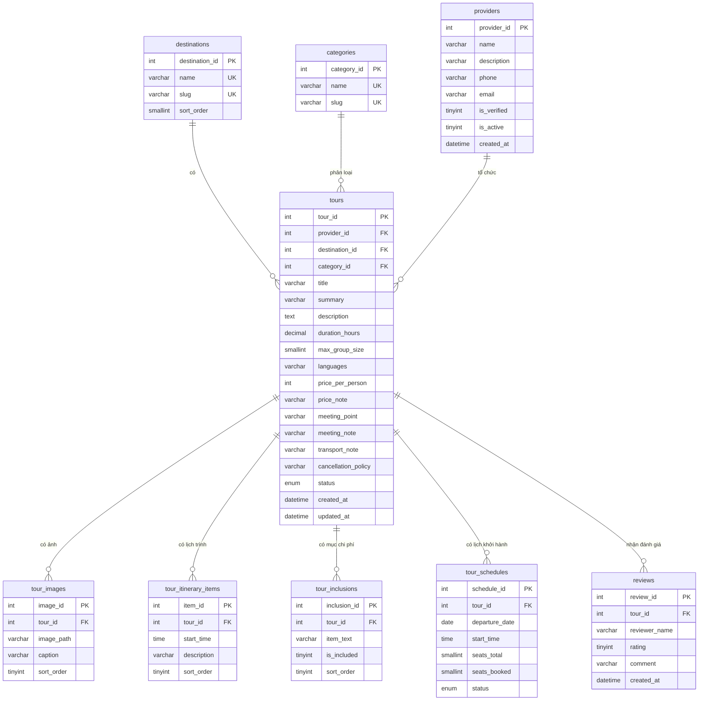

# Lược đồ dữ liệu – db_localtour

| Mục | Nội dung |
| --- | --- |
| Sprint | Sprint 3 – Technical Design, Coding & QA |
| WBS | 3.1.2 – Thiết kế lược đồ Tour, Provider, Schedule và script mẫu |
| Người phụ trách | Nguyễn Minh Thức |
| Thời gian theo kế hoạch | 22–23/10/2026 (1,5 giờ công) |
| Script | `src/database/01_schema.sql`, `src/database/02_seed.sql`, `src/database/03_procedures_LTP.sql`, `src/database/04_procedures_NMT.sql`, `src/database/05_procedures_NTK.sql` |
| Tài liệu liên quan | [01 – Danh mục trường dữ liệu](01-truong-du-lieu.md), [03 – Route và quy ước lỗi](03-route-va-quy-uoc-loi.md), `src/database/README.md` |
| Tiêu chí nghiệm thu | Schema SQL chạy không lỗi; khóa chính/khóa ngoại hợp lý; có dữ liệu tối thiểu 6 tour để kiểm thử. |

## 1. Tổng quan

- Hệ quản trị: MySQL chạy qua XAMPP (MariaDB 10.4); script tương thích MySQL 8.
- Database `db_localtour`, bảng mã `utf8mb4`, collation `utf8mb4_unicode_ci` để lưu đúng tiếng Việt có dấu.
- Engine InnoDB cho mọi bảng để dùng được khóa ngoại.
- 9 bảng: 3 bảng danh mục (`destinations`, `categories`, `providers`), bảng chính `tours` và 5 bảng con của tour (`tour_images`, `tour_itinerary_items`, `tour_inclusions`, `tour_schedules`, `reviews`).
- Ứng dụng PHP không đọc bảng trực tiếp. Mọi truy xuất đi qua stored procedure (xem [03 – Route và quy ước lỗi](03-route-va-quy-uoc-loi.md), mục 7).

## 2. Sơ đồ quan hệ (ERD)

Mỗi tour thuộc đúng một nhà cung cấp, một điểm đến và một loại hình. Một điểm đến, loại hình hoặc nhà cung cấp có thể chưa có tour nào.

## 3. Mô tả từng bảng

Mọi khóa chính có kiểu `INT UNSIGNED AUTO_INCREMENT`; khóa ngoại cùng kiểu `INT UNSIGNED NOT NULL`.

### 3.1. `destinations` – Điểm đến

| Cột | Kiểu | Ràng buộc | Ý nghĩa |
| --- | --- | --- | --- |
| `destination_id` | INT UNSIGNED | PK, AUTO_INCREMENT | Mã điểm đến; dùng làm giá trị bộ lọc `destination`. |
| `name` | VARCHAR(100) | NOT NULL, UNIQUE | Tên hiển thị, ví dụ "Hà Nội". |
| `slug` | VARCHAR(100) | NOT NULL, UNIQUE | Tên không dấu dạng chữ thường nối gạch; trả về trong `/api/destinations`. |
| `sort_order` | SMALLINT | NOT NULL, DEFAULT 0 | Thứ tự hiển thị trong bộ lọc và thanh bên. |

### 3.2. `categories` – Loại hình tour

| Cột | Kiểu | Ràng buộc | Ý nghĩa |
| --- | --- | --- | --- |
| `category_id` | INT UNSIGNED | PK, AUTO_INCREMENT | Mã loại hình. |
| `name` | VARCHAR(100) | NOT NULL, UNIQUE | Tên hiển thị, ví dụ "Tour ẩm thực"; xuất hiện trên thẻ tour và breadcrumb. |
| `slug` | VARCHAR(100) | NOT NULL, UNIQUE | Tên không dấu, dự phòng cho bộ lọc loại hình ở Sprint sau. |

### 3.3. `providers` – Nhà cung cấp (đơn vị tổ chức tour)

| Cột | Kiểu | Ràng buộc | Ý nghĩa |
| --- | --- | --- | --- |
| `provider_id` | INT UNSIGNED | PK, AUTO_INCREMENT | Mã nhà cung cấp. |
| `name` | VARCHAR(150) | NOT NULL | Tên hiển thị "Tổ chức bởi …". |
| `description` | VARCHAR(255) | NULL | Giới thiệu ngắn trong hộp nhà tổ chức ở trang chi tiết. |
| `phone` | VARCHAR(20) | NULL | Số liên hệ. Chưa hiển thị ở Sprint 3. |
| `email` | VARCHAR(150) | NULL | Email liên hệ. Chưa hiển thị ở Sprint 3. |
| `is_verified` | TINYINT(1) | NOT NULL, DEFAULT 0 | 1 = đã xác minh, hiển thị dấu tick. |
| `is_active` | TINYINT(1) | NOT NULL, DEFAULT 1 | 0 = ngừng hoạt động; mọi tour của nhà cung cấp này bị ẩn. |
| `created_at` | DATETIME | NOT NULL, DEFAULT CURRENT_TIMESTAMP | Thời điểm tạo bản ghi. |

### 3.4. `tours` – Tour

| Cột | Kiểu | Ràng buộc | Ý nghĩa |
| --- | --- | --- | --- |
| `tour_id` | INT UNSIGNED | PK, AUTO_INCREMENT | Mã tour, dùng trong URL `/tours/{id}`. |
| `provider_id` | INT UNSIGNED | NOT NULL, FK → `providers`, ON DELETE RESTRICT | Nhà tổ chức. |
| `destination_id` | INT UNSIGNED | NOT NULL, FK → `destinations`, ON DELETE RESTRICT | Điểm đến. |
| `category_id` | INT UNSIGNED | NOT NULL, FK → `categories`, ON DELETE RESTRICT | Loại hình. |
| `title` | VARCHAR(200) | NOT NULL | Tên tour. |
| `summary` | VARCHAR(300) | NOT NULL | Mô tả ngắn trên thẻ tour. |
| `description` | TEXT | NOT NULL | Mô tả đầy đủ ở mục Tổng quan. |
| `duration_hours` | DECIMAL(4,1) | NOT NULL | Thời lượng theo giờ, cho phép nửa giờ (ví dụ 1.5). |
| `max_group_size` | SMALLINT UNSIGNED | NOT NULL | Số khách tối đa mỗi nhóm. |
| `languages` | VARCHAR(100) | NOT NULL | Ngôn ngữ hướng dẫn, ví dụ "Tiếng Việt / Anh". |
| `price_per_person` | INT UNSIGNED | NOT NULL | Giá mỗi người, đơn vị đồng (VND), số nguyên. |
| `price_note` | VARCHAR(150) | NULL | Ghi chú giá và phụ phí đã biết, ví dụ "Giá minh họa • VND • Đã gồm thuế, phí". |
| `meeting_point` | VARCHAR(255) | NOT NULL | Điểm gặp/điểm đón. |
| `meeting_note` | VARCHAR(255) | NULL | Hướng dẫn thêm về điểm gặp. |
| `transport_note` | VARCHAR(255) | NULL | Phương tiện di chuyển trong tour. |
| `cancellation_policy` | VARCHAR(255) | NOT NULL | Chính sách hủy/đổi hiển thị trên thẻ giá. |
| `status` | ENUM('published','hidden') | NOT NULL, DEFAULT 'published' | Chỉ `published` được công khai. |
| `created_at` | DATETIME | NOT NULL, DEFAULT CURRENT_TIMESTAMP | Dùng cho sắp xếp "Mới nhất". |
| `updated_at` | DATETIME | NOT NULL, DEFAULT CURRENT_TIMESTAMP ON UPDATE CURRENT_TIMESTAMP | Thời điểm sửa gần nhất. |

### 3.5. `tour_images` – Ảnh tour

| Cột | Kiểu | Ràng buộc | Ý nghĩa |
| --- | --- | --- | --- |
| `image_id` | INT UNSIGNED | PK, AUTO_INCREMENT | Mã ảnh. |
| `tour_id` | INT UNSIGNED | NOT NULL, FK → `tours`, ON DELETE CASCADE | Tour sở hữu ảnh. |
| `image_path` | VARCHAR(255) | NULL | Đường dẫn tương đối trong `public/`, ví dụ `assets/img/tours/hanoi-1.svg`. `NULL` → giao diện hiện ô xám kèm chú thích. |
| `caption` | VARCHAR(150) | NOT NULL | Chú thích ảnh, đồng thời là văn bản thay thế (alt). |
| `sort_order` | TINYINT UNSIGNED | NOT NULL, DEFAULT 0 | Ảnh có thứ tự nhỏ nhất là ảnh đại diện trên thẻ và ảnh lớn ở trang chi tiết. |

### 3.6. `tour_itinerary_items` – Mốc lịch trình

| Cột | Kiểu | Ràng buộc | Ý nghĩa |
| --- | --- | --- | --- |
| `item_id` | INT UNSIGNED | PK, AUTO_INCREMENT | Mã mốc. |
| `tour_id` | INT UNSIGNED | NOT NULL, FK → `tours`, ON DELETE CASCADE | Tour sở hữu. |
| `start_time` | TIME | NULL | Giờ của mốc; `NULL` khi mốc không gắn giờ cụ thể. |
| `description` | VARCHAR(255) | NOT NULL | Nội dung mốc, ví dụ "Gặp tại Nhà hát Múa rối Thăng Long". |
| `sort_order` | TINYINT UNSIGNED | NOT NULL, DEFAULT 0 | Thứ tự hiển thị. |

### 3.7. `tour_inclusions` – Mục chi phí bao gồm / không bao gồm

| Cột | Kiểu | Ràng buộc | Ý nghĩa |
| --- | --- | --- | --- |
| `inclusion_id` | INT UNSIGNED | PK, AUTO_INCREMENT | Mã mục. |
| `tour_id` | INT UNSIGNED | NOT NULL, FK → `tours`, ON DELETE CASCADE | Tour sở hữu. |
| `item_text` | VARCHAR(150) | NOT NULL | Nội dung, ví dụ "Người dẫn địa phương". |
| `is_included` | TINYINT(1) | NOT NULL, DEFAULT 1 | 1 = đã gồm trong giá; 0 = không gồm (khách tự chi trả). |
| `sort_order` | TINYINT UNSIGNED | NOT NULL, DEFAULT 0 | Thứ tự trong từng nhóm. |

### 3.8. `tour_schedules` – Lịch khởi hành

| Cột | Kiểu | Ràng buộc | Ý nghĩa |
| --- | --- | --- | --- |
| `schedule_id` | INT UNSIGNED | PK, AUTO_INCREMENT | Mã lịch; là giá trị của ô "Ngày tham gia". |
| `tour_id` | INT UNSIGNED | NOT NULL, FK → `tours`, ON DELETE CASCADE | Tour sở hữu. |
| `departure_date` | DATE | NOT NULL | Ngày khởi hành. |
| `start_time` | TIME | NOT NULL | Giờ bắt đầu. |
| `seats_total` | SMALLINT UNSIGNED | NOT NULL | Tổng số chỗ của lịch. |
| `seats_booked` | SMALLINT UNSIGNED | NOT NULL, DEFAULT 0 | Số chỗ đã đặt (Sprint 3 chỉ có trong dữ liệu mẫu). |
| `status` | ENUM('open','full','cancelled') | NOT NULL, DEFAULT 'open' | Chỉ `open` được hiển thị. |
|  |  | UNIQUE (`tour_id`, `departure_date`, `start_time`) | Một tour không có hai lịch trùng ngày và giờ. |

### 3.9. `reviews` – Đánh giá

| Cột | Kiểu | Ràng buộc | Ý nghĩa |
| --- | --- | --- | --- |
| `review_id` | INT UNSIGNED | PK, AUTO_INCREMENT | Mã đánh giá. |
| `tour_id` | INT UNSIGNED | NOT NULL, FK → `tours`, ON DELETE CASCADE | Tour được đánh giá. |
| `reviewer_name` | VARCHAR(100) | NOT NULL | Tên hiển thị của người đánh giá. |
| `rating` | TINYINT UNSIGNED | NOT NULL, giá trị 1–5 | Điểm đánh giá. |
| `comment` | VARCHAR(500) | NOT NULL | Nội dung nhận xét. |
| `created_at` | DATETIME | NOT NULL, DEFAULT CURRENT_TIMESTAMP | Thời điểm đánh giá; dùng sắp xếp mới nhất trước. |

## 4. Khóa, chỉ mục và lý do

| Đối tượng | Định nghĩa trong `01_schema.sql` | Lý do |
| --- | --- | --- |
| Khóa chính | `INT UNSIGNED AUTO_INCREMENT` ở mọi bảng | Đơn giản, đủ lớn; khớp quy ước ID hợp lệ 1–4294967295 ở tầng route. |
| Khóa duy nhất danh mục | `uq_destinations_name`, `uq_destinations_slug`, `uq_categories_name`, `uq_categories_slug` | Không trùng tên điểm đến/loại hình trong bộ lọc. |
| Khóa ngoại của `tours` | `fk_tours_provider`, `fk_tours_destination`, `fk_tours_category`: ON DELETE RESTRICT, ON UPDATE CASCADE | Không xóa được nhà cung cấp, điểm đến hay loại hình khi vẫn còn tour, tránh tour mất thông tin bắt buộc. |
| Khóa ngoại của bảng con | `tour_id` của 5 bảng con: ON DELETE CASCADE, ON UPDATE CASCADE | Ảnh, lịch trình, mục chi phí, lịch khởi hành và đánh giá là phần của tour; xóa tour thì xóa theo. Sprint 3 chưa có thao tác xóa, quy tắc chuẩn bị cho chức năng quản lý tour sau này. |
| `idx_tours_status_destination (status, destination_id)` | Chỉ mục ghép | Danh sách luôn lọc `status = 'published'` và thường lọc theo điểm đến. |
| `idx_tours_destination`, `idx_tours_provider`, `idx_tours_category` | Chỉ mục đơn | Phục vụ phép nối với bảng danh mục, đếm `tour_count` theo điểm đến và kiểm tra khóa ngoại. |
| `idx_providers_active (is_active)` | Chỉ mục đơn | Mọi procedure lọc nhà cung cấp đang hoạt động. |
| `uq_schedules_tour_date_time (tour_id, departure_date, start_time)` | Khóa duy nhất ghép | Chặn lịch trùng; đồng thời phục vụ lấy lịch theo tour, sắp theo ngày và giờ. |
| `idx_schedules_status_date (status, departure_date)` | Chỉ mục ghép | Lọc lịch `open` từ hôm nay trở đi. |
| `idx_tour_images_tour_sort`, `idx_itinerary_tour_sort`, `idx_inclusions_tour_sort` `(tour_id, sort_order)` | Chỉ mục ghép | Lấy dữ liệu con theo tour đúng thứ tự hiển thị; đồng thời là chỉ mục bắt buộc của khóa ngoại. |
| `idx_reviews_tour_created (tour_id, created_at)` | Chỉ mục ghép | Lấy đánh giá mới nhất của một tour; tính điểm trung bình theo tour. |

Quy ước viết script:

- Không có mệnh đề `DEFINER`: import bằng tài khoản nào cũng được; procedure nhận tài khoản đã import làm definer.
- Không dùng ràng buộc `CHECK`: điều kiện như `rating` từ 1 đến 5, `seats_booked ≤ seats_total` được bảo đảm trong dữ liệu mẫu, để script hoạt động giống nhau trên các phiên bản MySQL/MariaDB trong nhóm. Khi có chức năng ghi dữ liệu ở Sprint sau, procedure ghi sẽ kiểm tra các điều kiện này.
- Không dùng `CREATE OR REPLACE`; dùng `DROP … IF EXISTS` để chạy lại nhiều lần. `01_schema.sql` xóa bảng theo thứ tự ngược khóa ngoại (bảng con trước) rồi tạo lại, nên mọi dữ liệu cũ sẽ mất. File không có `CREATE DATABASE`/`USE`; phải chọn database `db_localtour` trước khi chạy (file gộp đã có sẵn phần này).
- Procedure khai báo `READS SQL DATA`: Sprint 3 chỉ đọc dữ liệu.
- Procedure khai báo bằng `DELIMITER $$` để import được qua tab Import của phpMyAdmin.

## 5. Giá trị tính toán, không lưu trong bảng

| Giá trị | Cách tính | Procedure | Lý do không lưu |
| --- | --- | --- | --- |
| `rating_avg` | Trung bình `reviews.rating`, làm tròn 1 chữ số (DECIMAL(2,1)); `NULL` khi chưa có đánh giá. | `LTP_sp_tour_list`, `NMT_sp_tour_detail` | Luôn khớp với bảng `reviews` (NFR-11). |
| `review_count` | Số dòng `reviews` của tour; `0` khi chưa có. | `LTP_sp_tour_list`, `NMT_sp_tour_detail` | Như trên. |
| `seats_left` | `seats_total − seats_booked`. | `NMT_sp_tour_schedule_list` | Một nguồn duy nhất cho số chỗ (FR-09). |
| `next_departure_date` | Ngày sớm nhất của lịch `open`, `departure_date ≥ CURDATE()` và còn chỗ; `NULL` nếu không có. | `LTP_sp_tour_list` | Phụ thuộc ngày hiện tại. |
| `cover_image`, `cover_caption` | Ảnh có `sort_order` nhỏ nhất của tour. | `LTP_sp_tour_list` | Không cần cột "ảnh đại diện" riêng. |
| `tour_count` | Số tour công khai của nhà cung cấp đang hoạt động theo từng điểm đến. | `LTP_sp_destination_list` | Như trên. |

## 6. Quy tắc dữ liệu được công khai

- Một tour được công khai khi `tours.status = 'published'` và `providers.is_active = 1` (BR-01 trong SRS v0.1).
- Mọi procedure đều áp dụng điều kiện này, kể cả các procedure trả danh sách con (ảnh, lịch trình, mục chi phí, lịch khởi hành, đánh giá). Vì vậy tour bị ẩn không lộ dữ liệu qua bất kỳ trang hay endpoint nào, và `/tours/{id}` của tour ẩn trả 404.
- Một lịch khởi hành được hiển thị khi đồng thời: `departure_date ≥ CURDATE()`, `status = 'open'` và `seats_booked < seats_total`.

## 7. Dữ liệu mẫu (`02_seed.sql`)

### 7.1. Số lượng

ID được ghi rõ trong script để dữ liệu giống nhau trên mọi máy.

| Bảng | Số dòng | Ghi chú |
| --- | --- | --- |
| `destinations` | 4 | Hà Nội, Đà Nẵng, Hội An, TP. Hồ Chí Minh (`sort_order` 1–4). |
| `categories` | 4 | Tour ẩm thực, Tour văn hóa – lịch sử, Tour thiên nhiên, Tour đêm. |
| `providers` | 7 | Đều đang hoạt động; 2 đơn vị chưa xác minh (ID 4, 7). |
| `tours` | 10 | 9 tour công khai (ID 1–9: Hà Nội 3, mỗi điểm đến còn lại 2) và 1 tour ẩn (ID 10). |
| `tour_images` | 30 | 3 ảnh mỗi tour; ảnh `sort_order = 1` là ảnh bìa. |
| `tour_itinerary_items` | 47 | 4–5 mốc mỗi tour. |
| `tour_inclusions` | 42 | 3–5 mục mỗi tour, mỗi tour có ít nhất 1 mục "không gồm". |
| `tour_schedules` | 37 | 3–6 lịch mỗi tour, trừ tour 9 (1 lịch đã hủy). |
| `reviews` | 28 | 2–4 đánh giá mỗi tour, trừ tour 9 (không có); 3 đánh giá thuộc tour ẩn. |

Số tour công khai (9) vượt mức tối thiểu 6 tour của tiêu chí nghiệm thu.

### 7.2. Tour khớp wireframe

Ba tour Hà Nội dùng đúng dữ liệu trên wireframe để đối chiếu giao diện:

| ID | Tour | Giá/người | Thời lượng | Ghi chú |
| --- | --- | --- | --- | --- |
| 1 | Hà Nội qua những món ăn phố cổ | 650.000đ | 4 giờ | Nhóm tối đa 8 khách, Tiếng Việt / Anh, lịch trình 17:00–21:00 như wireframe. |
| 2 | Ẩm thực Hà Nội & cà phê trứng | 720.000đ | 3 giờ | Gặp tại chợ Đồng Xuân. |
| 3 | Phố cổ theo cách của bạn | 900.000đ | 4 giờ | |

### 7.3. Trường hợp biên phục vụ kiểm thử

| Trường hợp | Dữ liệu | Kết quả mong đợi |
| --- | --- | --- |
| Tour bị ẩn | Tour 10 `status = 'hidden'`, có lịch mở và điểm 5,0 | Không có trong `/api/tours`, không được tính vào `tour_count`; `/tours/10` và `/api/tours/10` trả 404. Nếu tour này bị lộ, nó sẽ đứng đầu tab "Dành cho bạn", nên dễ phát hiện. |
| Tour chưa có đánh giá và lịch khởi hành | Tour 9: không có đánh giá, chỉ có 1 lịch đã hủy | Thẻ hiện "Chưa có đánh giá", xếp cuối tab "Dành cho bạn", `next_departure_date = null`; trang chi tiết hiện "Chưa có lịch khởi hành sắp tới" và khóa ô chọn. |
| Lịch đã qua | Lịch 1 (tour 1), ngày import − 3 ngày | Không xuất hiện trong "Ngày tham gia", không được tính vào `next_departure_date`. |
| Lịch `full` | Lịch 2 (tour 1) | Như trên. |
| Lịch `open` nhưng hết chỗ | Lịch 7 (tour 2), `seats_booked = seats_total` | Như trên. |
| Lịch `cancelled` | Lịch 15 (tour 4), lịch 34 (tour 9) | Như trên. |
| Hai lịch cùng ngày khác giờ | Tour 3, ngày import + 6 ngày, 08:30 và 14:00 | Hiện thành hai lựa chọn, 08:30 trước. |
| Lịch trình không cố định giờ | Tour 3, mọi mốc có `start_time = NULL` | Mốc lịch trình hiện không kèm giờ. |
| Thiếu ghi chú điểm đón/phương tiện | Tour 9, `meeting_note` và `transport_note` là `NULL` | Mục Điểm đón chỉ hiện điểm gặp, không hiện dòng trống. |
| Nhà tổ chức chưa xác minh | Tour 5 (đơn vị 4), tour 9 (đơn vị 7) | Không có dấu tick xác minh. |
| Mục không gồm trong giá | Mỗi tour có ít nhất 1 dòng `is_included = 0` | Hiện trong phần "Không gồm" của trang chi tiết. |

Thứ tự mong đợi của danh sách 9 tour công khai (không lọc), dùng cho test case sắp xếp:

| `sort` | Thứ tự `tour_id` | Căn cứ |
| --- | --- | --- |
| `recommended` | 3, 1, 6, 2, 7, 4, 8, 5, 9 | Điểm trung bình: tour 3 = 5,0; tour 1, 6 = 4,8; tour 2, 7 = 4,7; tour 4, 8 = 4,5; tour 5 = 4,3; tour 9 chưa có đánh giá. Cùng điểm thì nhiều đánh giá trước, rồi ID nhỏ trước. |
| `newest` | 9, 8, 5, 3, 7, 4, 2, 1, 6 | `created_at` tính lùi từ thời điểm import. |
| `price_asc` | 5, 9, 4, 6, 1, 2, 7, 8, 3 | 480.000đ → 900.000đ. |
| `price_desc` | 3, 8, 7, 2, 1, 6, 4, 9, 5 | 900.000đ → 480.000đ. |

`tour_count` mong đợi: Hà Nội 3, Đà Nẵng 2, Hội An 2, TP. Hồ Chí Minh 2.

### 7.4. Ngày tương đối theo `CURDATE()`

Ngày khởi hành không viết cứng mà tính lúc import: lịch sắp tới dùng `CURDATE() + INTERVAL n DAY` với `n` từ 2 đến 30; lịch "đã qua" dùng `CURDATE() - INTERVAL 3 DAY`. Ngày tạo tour và ngày đánh giá cũng tính lùi từ `NOW()`. Nhờ vậy dữ liệu luôn có lịch tương lai ngay sau khi import, còn thứ tự "Mới nhất" và thứ tự đánh giá không đổi.

Lưu ý: `CURDATE()` được tính tại thời điểm import, không phải lúc xem trang. Sau vài ngày, các lịch gần nhất sẽ trở thành ngày đã qua và tự biến mất khỏi giao diện. Vì vậy:

- Test case mô tả kết quả theo quy tắc (ngày ≥ hôm nay, còn chỗ, sắp theo ngày) thay vì ghi ngày cụ thể.
- Import lại toàn bộ `db_localtour.sql` trước buổi kiểm thử (28/10) và buổi demo (29/10).

## 8. Dữ liệu minh họa

- Toàn bộ tour, giá, lịch khởi hành, đánh giá và nhà cung cấp là dữ liệu minh họa do nhóm tự soạn để kiểm thử, không phải tour hay đơn vị có thật. Footer mọi trang ghi: "© 2026 LocalTour · Dữ liệu tour, giá và đánh giá là minh họa phục vụ Sprint 3."
- Tên người đánh giá là tên gọi phổ biến, không gắn với người thật. Không lưu số điện thoại, email hay thông tin cá nhân thật: `providers.phone` để trống (NULL) để không trùng số thật, còn `providers.email` dùng tên miền `.example` (tên miền dành riêng cho ví dụ, không tồn tại). Hai cột này chưa hiển thị trên giao diện ở Sprint 3.
- Ảnh là hình SVG minh họa do nhóm tạo trong `src/public/assets/img/tours/`, mỗi điểm đến một bộ 3 ảnh (`hanoi-1..3`, `danang-1..3`, `hoian-1..3`, `hcm-1..3`). Các tour cùng điểm đến dùng chung bộ ảnh với chú thích khác nhau.
- Giá là số nguyên, bội số của 1.000đ. Nội dung viết bằng tiếng Việt tự nhiên.

## 9. Thứ tự chạy script

| Thứ tự | File | Người phụ trách | Nội dung |
| --- | --- | --- | --- |
| 1 | `01_schema.sql` | Thức | Xóa và tạo lại 9 bảng, khóa, chỉ mục. |
| 2 | `02_seed.sql` | Thức | Dữ liệu mẫu. |
| 3 | `03_procedures_LTP.sql` | Phong | `LTP_sp_tour_list`, `LTP_sp_destination_list`. |
| 4 | `04_procedures_NMT.sql` | Thức | `NMT_sp_tour_detail`, `NMT_sp_tour_schedule_list`, `NMT_sp_tour_itinerary_list`. |
| 5 | `05_procedures_NTK.sql` | Khôi | `NTK_sp_tour_image_list`, `NTK_sp_tour_inclusion_list`, `NTK_sp_tour_review_list`. |

File gộp `db_localtour.sql` gồm phần đầu (`CREATE DATABASE IF NOT EXISTS db_localtour CHARACTER SET utf8mb4 COLLATE utf8mb4_unicode_ci; USE db_localtour; SET NAMES utf8mb4;`) và năm file trên theo đúng thứ tự. File gộp không đưa lên Git (đã có trong `.gitignore`); cách import xem [src/README.md](../../src/README.md).

## 10. Đối chiếu tiêu chí nghiệm thu 3.1.2

| Tiêu chí | Căn cứ | Cách kiểm tra |
| --- | --- | --- |
| Schema SQL chạy không lỗi | `01_schema.sql` – `05_procedures_NTK.sql` | Import `db_localtour.sql` bằng phpMyAdmin trên XAMPP 8.2 (MariaDB 10.4) hai lần liên tiếp; cả hai lần không báo lỗi và có 9 bảng, 8 procedure. |
| Khóa chính/khóa ngoại hợp lý | Mục 3 và 4 | Thử xóa một điểm đến đang có tour: bị từ chối (RESTRICT). |
| Có tối thiểu 6 tour để kiểm thử | Mục 7 | `/api/tours` trả `total = 9`; tour ẩn không xuất hiện. |
