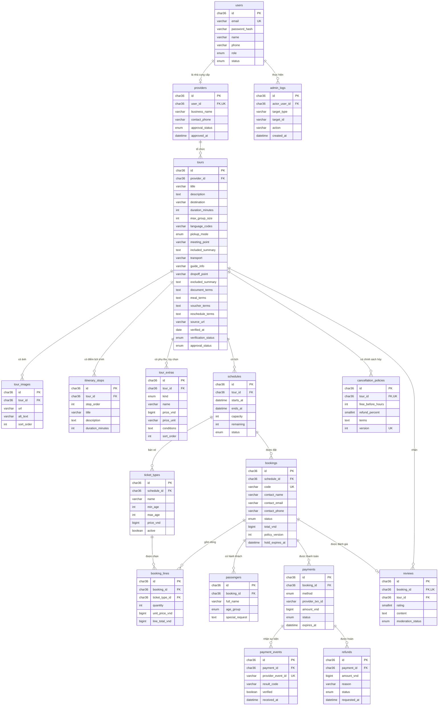

# Lược đồ dữ liệu – db_localtour

| Mục | Nội dung |
| --- | --- |
| Sprint | Sprint 3 – Technical Design, Coding & QA |
| WBS | 3.1.2 – Thiết kế lược đồ Tour, Provider, Schedule và script mẫu |
| Người phụ trách | Nguyễn Minh Thức |
| Thời gian theo kế hoạch | 22–23/10/2026 (1,5 giờ công) |
| Căn cứ | ERD sơ bộ của nhóm: trang 01 "Lõi đặt tour" (`docs/diagram/erd-so-bo-loi-dat-tour_localtour.jpg`) và trang 02 "Khám phá & vận hành" (ERDSequel); bảng yêu cầu FR/NFR (Bài tập nhóm tuần 2). Ngày 22/10/2026 Phong chốt gộp hai trang ERD với bảng FR thành một lược đồ 17 bảng. |
| Script | `src/database/01_schema.sql`, `src/database/02_seed.sql`, `src/database/03_procedures_LTP.sql`, `src/database/04_procedures_NMT.sql`, `src/database/05_procedures_NTK.sql` |
| Tài liệu liên quan | [01 – Danh mục trường dữ liệu](01-truong-du-lieu.md), [03 – Route và quy ước lỗi](03-route-va-quy-uoc-loi.md), `src/database/README.md` |
| Tiêu chí nghiệm thu | Schema SQL chạy không lỗi; khóa chính/khóa ngoại hợp lý; có dữ liệu tối thiểu 6 tour để kiểm thử. |

## 1. Tổng quan

- Hệ quản trị: MySQL chạy qua XAMPP (MariaDB 10.4); script tương thích MySQL 8.
- Database `db_localtour`, bảng mã `utf8mb4`, collation `utf8mb4_unicode_ci` để lưu đúng tiếng Việt có dấu.
- Engine InnoDB cho mọi bảng để dùng được khóa ngoại.
- 17 bảng, gộp từ hai trang ERD và bảng FR. Nguyên tắc: giữ những gì một FR/NFR hoặc hai trang của Sprint 3 cần, bỏ những gì không yêu cầu nào cần.
  - 13 bảng của trang 01 "Lõi đặt tour", có sửa: `users.role` chỉ còn `admin`, `support`, `provider`; `bookings` bỏ `customer_id`; `reviews` bỏ `user_id`; `tours` thêm 11 cột theo bảng FR (mục 4.3).
  - 3 bảng của trang 02: `tour_images`, `itinerary_stops`, `admin_logs`.
  - 1 bảng mới theo bảng FR: `tour_extras` (phụ thu và hoạt động tùy chọn).
  - 7 bảng còn lại của trang 02 đã bỏ (mục 1.2).
- Sprint 3 đọc 11 bảng để hiển thị danh sách và chi tiết tour. 6 bảng còn lại được tạo sẵn để Sprint sau không phải đổi lược đồ (mục 1.1).
- Ứng dụng PHP không đọc bảng trực tiếp. Mọi truy xuất đi qua stored procedure (xem [03 – Route và quy ước lỗi](03-route-va-quy-uoc-loi.md), mục 7).
- `01_schema.sql` là bản gốc của lược đồ, mỗi bảng và mỗi cột thêm mới có ghi chú FR mà nó phục vụ. Thức vẽ lại ERD chính thức từ file này.

### 1.1. Ánh xạ thực thể → bảng SQL

| Nguồn | Thực thể | Bảng SQL | Dùng ở Sprint 3 |
| --- | --- | --- | --- |
| ERD 01 · Tài khoản & nhà cung cấp | NGƯỜI_DÙNG | `users` | Đọc: trạng thái tài khoản của nhà cung cấp. Chỉ có tài khoản nhân viên và nhà cung cấp. |
| ERD 01 · Tài khoản & nhà cung cấp | NHÀ_CUNG_CẤP | `providers` | Đọc: tên hiển thị, trạng thái duyệt, ngày duyệt. |
| ERD 01 · Tour & tồn chỗ | TOUR | `tours` | Đọc, kể cả 8 cột thông tin thêm theo bảng FR; 3 cột NFR-07 chưa đọc. |
| ERD 01 · Tour & tồn chỗ | LỊCH_KHỞI_HÀNH | `schedules` | Đọc: lịch còn đặt được, số chỗ còn. |
| ERD 01 · Tour & tồn chỗ | VÉ_THEO_LỊCH | `ticket_types` | Đọc: giá theo loại vé của từng lịch. |
| ERD 01 · Tour & tồn chỗ | CHÍNH_SÁCH_HỦY | `cancellation_policies` | Đọc: phiên bản mới nhất. |
| ERD 01 · Đặt chỗ | ĐƠN_ĐẶT_TOUR | `bookings` | Đọc gián tiếp: tên người đánh giá (`contact_name`) và ngày đi tour của một đánh giá. |
| ERD 01 · Đặt chỗ | DÒNG_ĐƠN | `booking_lines` | Tạo sẵn, dùng ở Sprint sau (đặt tour). |
| ERD 01 · Đặt chỗ | HÀNH_KHÁCH | `passengers` | Tạo sẵn, dùng ở Sprint sau (đặt tour). |
| ERD 01 · Giao dịch | THANH_TOÁN | `payments` | Tạo sẵn, dùng ở Sprint sau (thanh toán). |
| ERD 01 · Giao dịch | SỰ_KIỆN_THANH_TOÁN | `payment_events` | Tạo sẵn, dùng ở Sprint sau (thanh toán). |
| ERD 01 · Giao dịch | HOÀN_TIỀN | `refunds` | Tạo sẵn, dùng ở Sprint sau (hủy đơn, hoàn tiền). |
| ERD 01 · Đánh giá | ĐÁNH_GIÁ | `reviews` | Đọc: chỉ đánh giá đã duyệt. |
| ERD 02 · Nội dung tour | ẢNH_TOUR | `tour_images` | Đọc: ảnh bìa và thư viện ảnh của chính tour. |
| ERD 02 · Nội dung tour | ĐIỂM_LỊCH_TRÌNH | `itinerary_stops` | Đọc: lịch trình theo `stop_order`. |
| ERD 02 · Danh tính & kiểm duyệt | NHẬT_KÝ_QUẢN_TRỊ | `admin_logs` | Tạo sẵn, để trống (NFR-09, dùng khi có trang quản trị). |
| Bảng FR (FR-04, FR-10) | PHỤ_THU / HOẠT_ĐỘNG_TÙY_CHỌN | `tour_extras` | Đọc: phụ thu và hoạt động tùy chọn, giá tách riêng. |

Các bảng "tạo sẵn" của trang 01 vẫn có vài dòng dữ liệu mẫu (đơn đặt, thanh toán, hoàn tiền) vì mỗi đánh giá phải gắn với một đơn đặt đã hoàn thành. `admin_logs` không có dữ liệu. Không màn hình nào của Sprint 3 hiển thị dữ liệu của các bảng tạo sẵn.

### 1.2. Bảng đã bỏ

| Bảng (ERD trang 02) | Lý do bỏ |
| --- | --- |
| `notifications` (THÔNG_BÁO) | Cần tài khoản khách hàng; bảng FR xếp tài khoản khách vào "Won't Have" và không có FR thông báo. |
| `tour_posts` (BÀI_ĐĂNG_TOUR), `post_comments` (BÌNH_LUẬN), `post_interactions` (TƯƠNG_TÁC_BÀI) | Bài đăng, bình luận, thích, chia sẻ cần tài khoản khách hàng; bảng FR không có FR nào cho các chức năng này. |
| `favorite_tours` (TOUR_YÊU_THÍCH) | Lưu tour cần tài khoản khách hàng; bảng FR không có FR này. |
| `comparisons` (BỘ_SO_SÁNH), `comparison_tours` (TOUR_TRONG_BỘ_SO_SÁNH) | FR-15 so sánh tour diễn ra trong phiên duyệt web. Chính ghi chú trên ERD trang 02 nói bỏ hai bảng nét đứt này trong trường hợp đó. |

`01_schema.sql` vẫn `DROP TABLE IF EXISTS` 7 bảng này để import đè lên bản cũ không bị lỗi và không còn bảng thừa.

## 2. Sơ đồ quan hệ (ERD)

Sơ đồ dưới đây vẽ 17 bảng đúng theo `01_schema.sql`. `PK` = khóa chính, `FK` = khóa ngoại, `UK` = giá trị duy nhất. "N" được hiểu là 0..N (ví dụ tour mới tạo chưa có lịch). ERD chính thức dạng hình do Thức vẽ lại từ `01_schema.sql`; khi hình và script lệch nhau thì theo script.

Ở `cancellation_policies`, hai dấu `UK` là một khóa duy nhất ghép (`tour_id`, `version`). Mỗi tài khoản có tối đa một hồ sơ nhà cung cấp (`providers.user_id` duy nhất) và mỗi đơn đặt có tối đa một đánh giá (`reviews.booking_id` duy nhất). `bookings` và `reviews` không nối với `users`: khách đặt tour không có tài khoản.

## 3. Quy ước kiểu dữ liệu

### 3.1. Ánh xạ kiểu ERD → MySQL

| Kiểu trên ERD | Kiểu MySQL | Ghi chú |
| --- | --- | --- |
| UUID | `CHAR(36)` | Mọi khóa chính là cột `id CHAR(36)` chứa UUID dạng chữ thường, ví dụ `c0000000-0000-4000-8000-000000000001`. Không dùng `AUTO_INCREMENT`. Khóa ngoại cùng kiểu. |
| varchar | `VARCHAR(n)` | Độ dài `n` ghi ở mục 4. |
| text | `TEXT` | |
| int / smallint | `INT` / `SMALLINT` | |
| bigint | `BIGINT` | Tiền VND, số nguyên đồng. |
| boolean | `BOOLEAN` (= `TINYINT(1)`) | |
| date | `DATE` | Chỉ có ở `tours.verified_at`. |
| timestamp | `DATETIME` | MariaDB 10.4 tự gắn `ON UPDATE CURRENT_TIMESTAMP` cho cột `TIMESTAMP NOT NULL` đầu tiên và `TIMESTAMP` chỉ lưu được tới năm 2038; `DATETIME` giữ đúng giá trị được ghi. |
| enum | `ENUM(...)` | Giá trị ở mục 3.2. |
| Dấu `?` sau kiểu | `NULL` | Cột không có `?` là `NOT NULL`. Cột thêm theo bảng FR đều `NULL` (= chưa cập nhật), trừ `verification_status`. |

### 3.2. Giá trị enum

ERD chỉ ghi một phần giá trị (ví dụ `pending/confirmed/...`). Trạng thái đơn đặt và thanh toán lấy theo bảng FR (FR-11, FR-17 và quy trình BPMN); phần còn lại do nhóm chốt như sau.

| Cột | Giá trị | Mặc định |
| --- | --- | --- |
| `users.role` | `admin` (Quản trị viên), `support` (Nhân viên hỗ trợ khách hàng), `provider` (tài khoản của nhà cung cấp) | Không có, bắt buộc nhập |
| `users.status` | `active`, `locked` | `active` |
| `providers.approval_status` | `pending`, `approved`, `rejected` | `pending` |
| `tours.pickup_mode` | `meeting_point` (khách tự đến điểm hẹn), `hotel_pickup` (đón tại khách sạn) | Không có, bắt buộc nhập |
| `tours.verification_status` | `unverified` (chưa xác minh), `verified` (đã xác minh) | `unverified` |
| `tours.approval_status` | `draft`, `pending`, `approved`, `rejected` | `draft` |
| `tour_extras.kind` | `surcharge` (Phụ thu), `optional` (Hoạt động tùy chọn) | Không có, bắt buộc nhập |
| `schedules.status` | `open`, `full`, `cancelled`, `completed` | `open` |
| `bookings.status` | `pending` (Chờ xác nhận), `awaiting_payment` (Chờ thanh toán), `confirmed` (Đã xác nhận), `rejected` (Từ chối), `cancelled` (Đã hủy), `completed` (Đã hoàn thành) | `pending` |
| `passengers.age_group` | `adult`, `child`, `infant` | Không có |
| `payments.method` | `vnpay`, `vietqr` | Không có |
| `payments.status` | `pending` (Chưa thanh toán), `processing` (Đang xử lý), `awaiting_reconciliation` (Chờ đối chiếu), `paid` (Thành công), `failed` (Thất bại) | `pending` |
| `refunds.status` | `requested`, `approved`, `rejected`, `completed` | `requested` |
| `reviews.moderation_status` | `pending`, `approved`, `rejected` | `pending` |

Ghi chú:

- `users.role` không có vai trò khách hàng: theo bảng FR, khách xem tour, đặt tour và tra cứu đơn mà không cần tài khoản.
- `completed` không có trong bảng FR mà đến từ quy tắc trên ERD "đánh giá thuộc đơn đã hoàn thành": chỉ đơn `completed` mới có đánh giá.
- `payments.method` chỉ có hai phương thức của FR-17 (VNPay, VietQR); không có trả sau.
- `payments.status` không có `expired` hay `refunded`: tiền hoàn được ghi riêng ở bảng `refunds`, đơn quá hạn thanh toán chuyển sang `cancelled`.

`ticket_types.name` không phải enum mà là `VARCHAR(50)` (`adult`, `child`, …) để Sprint sau thêm loại vé mới không phải sửa bảng.

## 4. Mô tả từng bảng

Mọi bảng có cột đầu tiên `id CHAR(36)`, khóa chính; các bảng dưới đây chỉ liệt kê những cột sau `id`. Mọi khóa ngoại là `CHAR(36) NOT NULL`.

### 4.1. `users` – Người dùng (NGƯỜI_DÙNG)

Chỉ có tài khoản nhân viên và nhà cung cấp (FR-13, NFR-04).

| Cột | Kiểu | Ràng buộc | Ý nghĩa |
| --- | --- | --- | --- |
| `email` | VARCHAR(150) | NOT NULL, UNIQUE | Email tài khoản. |
| `password_hash` | VARCHAR(255) | NULL | Mật khẩu đã băm. Sprint 3 chưa có đăng nhập nên dữ liệu mẫu để `NULL`. |
| `name` | VARCHAR(100) | NOT NULL | Tên hiển thị của tài khoản. Sprint 3 không hiển thị. |
| `phone` | VARCHAR(20) | NULL | Số điện thoại; dữ liệu mẫu để `NULL`. |
| `role` | ENUM | NOT NULL | `admin`, `support` hoặc `provider`. |
| `status` | ENUM | NOT NULL, DEFAULT 'active' | `locked` → mọi tour của nhà cung cấp thuộc tài khoản này bị ẩn. |

### 4.2. `providers` – Nhà cung cấp (NHÀ_CUNG_CẤP)

| Cột | Kiểu | Ràng buộc | Ý nghĩa |
| --- | --- | --- | --- |
| `user_id` | CHAR(36) | FK → `users`, UNIQUE | Tài khoản sở hữu hồ sơ nhà cung cấp. |
| `business_name` | VARCHAR(150) | NOT NULL | Tên hiển thị "Tổ chức bởi …"; có trong phạm vi tìm kiếm. |
| `contact_phone` | VARCHAR(20) | NOT NULL | Số liên hệ. Chưa hiển thị ở Sprint 3. |
| `approval_status` | ENUM | NOT NULL, DEFAULT 'pending' | Chỉ `approved` được công khai. |
| `approved_at` | DATETIME | NULL | Thời điểm LocalTour duyệt nhà cung cấp; trang chi tiết hiện "Đối tác của LocalTour từ …". |

### 4.3. `tours` – Tour (TOUR)

| Cột | Kiểu | Ràng buộc | Ý nghĩa |
| --- | --- | --- | --- |
| `provider_id` | CHAR(36) | FK → `providers` | Nhà tổ chức. |
| `title` | VARCHAR(200) | NOT NULL | Tên tour. |
| `description` | TEXT | NOT NULL | Mô tả đầy đủ, các đoạn cách nhau bằng một dòng trống. Đoạn đầu được cắt làm mô tả ngắn trên thẻ tour. |
| `destination` | VARCHAR(100) | NOT NULL | Tên điểm đến dạng chữ, ví dụ "Hà Nội". Không có bảng điểm đến riêng: bộ lọc điểm đến lấy các giá trị khác nhau của cột này. |
| `duration_minutes` | INT | NOT NULL | Thời lượng tính bằng phút (240 = 4 giờ). |
| `max_group_size` | INT | NOT NULL | Số khách tối đa mỗi nhóm. |
| `language_codes` | VARCHAR(50) | NOT NULL | Mã ngôn ngữ hướng dẫn, cách nhau bằng dấu phẩy, ví dụ `vi,en`. |
| `pickup_mode` | ENUM | NOT NULL | Cách đón khách. |
| `meeting_point` | VARCHAR(255) | NULL | Điểm hẹn khi `meeting_point`; khu vực đón khi `hotel_pickup`. |
| `included_summary` | TEXT | NOT NULL | FR-04 đã bao gồm: mỗi dòng một mục. |
| `transport` | VARCHAR(255) | NULL | FR-02 phương tiện. |
| `guide_info` | VARCHAR(255) | NULL | FR-02 hướng dẫn viên. |
| `dropoff_point` | VARCHAR(255) | NULL | FR-02 điểm trả khách. |
| `excluded_summary` | TEXT | NULL | FR-04 không bao gồm: mỗi dòng một mục, giống `included_summary`. |
| `document_terms` | TEXT | NULL | FR-05 giấy tờ. |
| `meal_terms` | TEXT | NULL | FR-05 ăn uống. |
| `voucher_terms` | TEXT | NULL | FR-05 voucher. |
| `reschedule_terms` | TEXT | NULL | FR-05 đổi lịch. |
| `source_url` | VARCHAR(500) | NULL | NFR-07 nguồn tham khảo. |
| `verified_at` | DATE | NULL | NFR-07 ngày xác minh gần nhất. |
| `verification_status` | ENUM | NOT NULL, DEFAULT 'unverified' | NFR-07 trạng thái xác minh. Thiếu nguồn hoặc ngày thì để `unverified`, không gán ngày giả. |
| `approval_status` | ENUM | NOT NULL, DEFAULT 'draft' | Chỉ `approved` được công khai. |

11 cột từ `transport` đến `verification_status` là phần thêm theo bảng FR. `NULL` = chưa cập nhật, giao diện hiện "Chưa cập nhật". 8 cột FR-02/04/05 được `NMT_sp_tour_detail` trả về; 3 cột NFR-07 chỉ dành cho trang quản trị sau này.

### 4.4. `schedules` – Lịch khởi hành (LỊCH_KHỞI_HÀNH)

| Cột | Kiểu | Ràng buộc | Ý nghĩa |
| --- | --- | --- | --- |
| `tour_id` | CHAR(36) | FK → `tours` | Tour sở hữu. |
| `starts_at` | DATETIME | NOT NULL | Ngày giờ bắt đầu. |
| `ends_at` | DATETIME | NOT NULL | Ngày giờ kết thúc. |
| `capacity` | INT | NOT NULL | Tổng số chỗ của lịch. |
| `remaining` | INT | NOT NULL | Số chỗ còn lại. Sprint 3 chỉ có trong dữ liệu mẫu; Sprint sau giảm khi có đơn đặt. |
| `status` | ENUM | NOT NULL, DEFAULT 'open' | Chỉ `open` có thể đặt được. |

### 4.5. `ticket_types` – Vé theo lịch (VÉ_THEO_LỊCH)

| Cột | Kiểu | Ràng buộc | Ý nghĩa |
| --- | --- | --- | --- |
| `schedule_id` | CHAR(36) | FK → `schedules` | Lịch bán loại vé này. Giá gắn với từng lịch, nên cùng một tour có thể có giá khác nhau theo ngày. |
| `name` | VARCHAR(50) | NOT NULL | Mã loại vé: `adult`, `child`… Giao diện đổi thành "Người lớn", "Trẻ em". |
| `min_age` | INT | NULL | Tuổi tối thiểu; `NULL` = không giới hạn. |
| `max_age` | INT | NULL | Tuổi tối đa; `NULL` = không giới hạn. |
| `price_vnd` | BIGINT | NOT NULL | Giá mỗi vé (VND). |
| `active` | BOOLEAN | NOT NULL, DEFAULT TRUE | `FALSE` = ngừng bán, không hiển thị. |

### 4.6. `cancellation_policies` – Chính sách hủy (CHÍNH_SÁCH_HỦY)

| Cột | Kiểu | Ràng buộc | Ý nghĩa |
| --- | --- | --- | --- |
| `tour_id` | CHAR(36) | FK → `tours` | Tour áp dụng. |
| `free_before_hours` | INT | NULL | Hủy miễn phí nếu trước giờ khởi hành ít nhất số giờ này; `NULL` = không có mốc miễn phí. |
| `refund_percent` | SMALLINT | NOT NULL | Phần trăm tiền được hoàn khi hủy sau mốc miễn phí (0–100). |
| `terms` | TEXT | NOT NULL | Điều khoản dạng văn bản. |
| `version` | INT | NOT NULL | Phiên bản. Đổi chính sách thì thêm bản mới, không sửa bản cũ, vì đơn đặt lưu `policy_version`. Trang chi tiết hiện phiên bản lớn nhất. |
|  |  | UNIQUE (`tour_id`, `version`) | Một tour không có hai chính sách cùng số phiên bản. |

### 4.7. `bookings` – Đơn đặt tour (ĐƠN_ĐẶT_TOUR)

Khách không có tài khoản nên đơn chỉ lưu thông tin liên hệ. Khách tra cứu đơn bằng `code` kèm `contact_email` hoặc `contact_phone` (NFR-04 của bảng FR).

| Cột | Kiểu | Ràng buộc | Ý nghĩa |
| --- | --- | --- | --- |
| `schedule_id` | CHAR(36) | FK → `schedules` | Lịch được đặt. |
| `code` | VARCHAR(20) | NOT NULL, UNIQUE | Mã đơn để khách tra cứu. |
| `contact_name`, `contact_email`, `contact_phone` | VARCHAR(100), VARCHAR(150), VARCHAR(20) | NOT NULL | Người liên hệ. ERD ghi gộp `contact_name/email/phone`, khi tạo bảng tách thành ba cột. `contact_name` cũng là tên hiển thị của đánh giá. |
| `status` | ENUM | NOT NULL, DEFAULT 'pending' | Trạng thái đơn. |
| `total_vnd` | BIGINT | NOT NULL | Tổng tiền vé (tổng `line_total_vnd`), không gồm `tour_extras`. |
| `policy_version` | INT | NOT NULL | Phiên bản chính sách hủy tại thời điểm đặt. |
| `hold_expires_at` | DATETIME | NULL | Hạn giữ chỗ khi chưa thanh toán. |

### 4.8. Bảng của luồng đặt tour và thanh toán (dùng ở Sprint sau)

Năm bảng này chưa được procedure nào của Sprint 3 đọc, nên chỉ tóm tắt. Mọi cột `NOT NULL` trừ khi ghi `NULL`; khóa ngoại trỏ tới `id` của bảng ghi sau dấu →.

| Bảng (ERD) | Cột sau `id` | Ghi chú |
| --- | --- | --- |
| `booking_lines` (DÒNG_ĐƠN) | `booking_id` → `bookings`; `ticket_type_id` → `ticket_types`; `quantity` INT; `unit_price_vnd` BIGINT; `line_total_vnd` BIGINT | Mỗi loại vé trong đơn một dòng. Giá được chụp lại lúc đặt; `line_total_vnd = quantity × unit_price_vnd`. |
| `passengers` (HÀNH_KHÁCH) | `booking_id` → `bookings`; `full_name` VARCHAR(100); `age_group` ENUM; `special_request` TEXT NULL | Mỗi người tham gia tour một dòng. |
| `payments` (THANH_TOÁN) | `booking_id` → `bookings`; `method` ENUM; `provider_txn_id` VARCHAR(100) NULL; `amount_vnd` BIGINT; `status` ENUM, DEFAULT 'pending'; `expires_at` DATETIME NULL | Một đơn có thể có nhiều lần thanh toán (ví dụ lần đầu thất bại). `provider_txn_id` là mã giao dịch phía cổng thanh toán. |
| `payment_events` (SỰ_KIỆN_THANH_TOÁN) | `payment_id` → `payments`; `provider_event_id` VARCHAR(100) UNIQUE; `result_code` VARCHAR(20); `verified` BOOLEAN, DEFAULT FALSE; `received_at` DATETIME | Thông báo cổng thanh toán gửi về. Mã sự kiện duy nhất để một thông báo không bị xử lý hai lần; `verified` = đã kiểm tra chữ ký. |
| `refunds` (HOÀN_TIỀN) | `payment_id` → `payments`; `amount_vnd` BIGINT; `reason` VARCHAR(255); `status` ENUM, DEFAULT 'requested'; `requested_at` DATETIME | Yêu cầu hoàn tiền cho một khoản thanh toán. |

### 4.9. `reviews` – Đánh giá (ĐÁNH_GIÁ)

| Cột | Kiểu | Ràng buộc | Ý nghĩa |
| --- | --- | --- | --- |
| `booking_id` | CHAR(36) | FK → `bookings`, UNIQUE | Đơn đã đi tour; mỗi đơn tối đa một đánh giá. Người đánh giá được xác thực qua đơn, tên hiển thị là `bookings.contact_name`. |
| `tour_id` | CHAR(36) | FK → `tours` | Tour được đánh giá. |
| `rating` | SMALLINT | NOT NULL, giá trị 1–5 | Điểm đánh giá. |
| `content` | TEXT | NOT NULL | Nội dung nhận xét. |
| `moderation_status` | ENUM | NOT NULL, DEFAULT 'pending' | Chỉ `approved` được hiển thị và tính điểm. |

### 4.10. `tour_images` – Ảnh tour (ẢNH_TOUR)

| Cột | Kiểu | Ràng buộc | Ý nghĩa |
| --- | --- | --- | --- |
| `tour_id` | CHAR(36) | FK → `tours` | Tour sở hữu ảnh. Mỗi dòng ảnh chỉ thuộc một tour. |
| `url` | VARCHAR(255) | NOT NULL | Đường dẫn ảnh. Dữ liệu mẫu dùng đường dẫn tương đối trong `src/public/assets/`, ví dụ `img/tours/hanoi-1.svg`; link `http(s)://` được giữ nguyên. |
| `alt_text` | VARCHAR(255) | NULL | Mô tả ngắn của ảnh, dùng làm chú thích và văn bản thay thế; `NULL` thì dùng tên tour. |
| `sort_order` | INT | NOT NULL | Thứ tự hiển thị. Ảnh có `sort_order` nhỏ nhất là ảnh bìa trên thẻ tour. |
|  |  | INDEX (`tour_id`, `sort_order`) | Lấy ảnh của một tour theo đúng thứ tự. |

### 4.11. `itinerary_stops` – Điểm lịch trình (ĐIỂM_LỊCH_TRÌNH)

| Cột | Kiểu | Ràng buộc | Ý nghĩa |
| --- | --- | --- | --- |
| `tour_id` | CHAR(36) | FK → `tours` | Tour sở hữu lịch trình. |
| `stop_order` | INT | NOT NULL | Thứ tự điểm/hoạt động trong lịch trình (1, 2, 3…). |
| `title` | VARCHAR(200) | NOT NULL | Tên điểm hoặc hoạt động. |
| `description` | TEXT | NULL | Mô tả; `NULL` thì không hiện dòng mô tả. |
| `duration_minutes` | INT | NULL | Thời gian ở điểm này; `NULL` thì không hiện thời gian (FR-03: chỉ hiện giờ khi dữ liệu có ghi). |
|  |  | INDEX (`tour_id`, `stop_order`) | Lấy lịch trình của một tour theo đúng thứ tự. |

### 4.12. `tour_extras` – Phụ thu và hoạt động tùy chọn (mới, theo bảng FR)

Khoản phát sinh ngoài giá tour (FR-04 phụ thu / hoạt động tùy chọn, FR-10 giá tách riêng). Không bao giờ được cộng vào giá "Từ", phần tạm tính hay `bookings.total_vnd`.

| Cột | Kiểu | Ràng buộc | Ý nghĩa |
| --- | --- | --- | --- |
| `tour_id` | CHAR(36) | FK → `tours` | Tour áp dụng. |
| `kind` | ENUM | NOT NULL | `surcharge` = phụ thu, `optional` = hoạt động tùy chọn. |
| `name` | VARCHAR(200) | NOT NULL | Tên khoản, ví dụ "Phụ thu ngày lễ". |
| `price_vnd` | BIGINT | NULL | Giá; `NULL` = chưa cập nhật, giao diện hiện "Giá: Chưa cập nhật". |
| `price_unit` | VARCHAR(50) | NULL | Đơn vị tính, ví dụ `người`, `nhóm`, `xe`; `NULL` thì chỉ hiện giá. |
| `conditions` | TEXT | NULL | Điều kiện áp dụng; `NULL` thì không hiện. |
| `sort_order` | INT | NOT NULL, DEFAULT 0 | Thứ tự hiển thị trong cùng loại. |
|  |  | INDEX (`tour_id`, `sort_order`) | Lấy các khoản của một tour theo thứ tự. |

### 4.13. `admin_logs` – Nhật ký quản trị (NHẬT_KÝ_QUẢN_TRỊ)

Ai làm gì với đối tượng nào (NFR-09). Sprint 3 để trống.

| Cột | Kiểu | Ràng buộc | Ý nghĩa |
| --- | --- | --- | --- |
| `actor_user_id` | CHAR(36) | FK → `users` | Nhân viên thực hiện. |
| `target_type`, `target_id` | VARCHAR(50), VARCHAR(36) | NOT NULL | Đối tượng bị tác động, ví dụ `tour` + UUID của tour. ERD ghi gộp `target_type/id`, khi tạo bảng tách thành hai cột. `target_id` không có khóa ngoại vì đối tượng có thể nằm ở nhiều bảng. |
| `action` | VARCHAR(50) | NOT NULL | Thao tác, ví dụ duyệt tour, đổi trạng thái đơn. |
| `created_at` | DATETIME | NOT NULL, DEFAULT CURRENT_TIMESTAMP | Thời điểm thực hiện. |

## 5. Khóa, chỉ mục và lý do

| Đối tượng | Định nghĩa trong `01_schema.sql` | Lý do |
| --- | --- | --- |
| Khóa chính | `id CHAR(36)` (UUID) ở mọi bảng | Theo ERD. UUID không lộ số lượng hay thứ tự bản ghi và tạo được trước khi ghi vào database. Dữ liệu mẫu dùng UUID cố định, dễ đọc. |
| Khóa duy nhất | `uq_users_email`, `uq_providers_user`, `uq_bookings_code`, `uq_payment_events_provider_event`, `uq_reviews_booking`, `uq_policies_tour_version (tour_id, version)` | Theo các dấu UNIQUE trên ERD; riêng khóa ghép của chính sách hủy do nhóm thêm để không trùng số phiên bản. |
| 18 khóa ngoại | Mỗi đường nối ở mục 2 là một khóa ngoại, tất cả `ON DELETE RESTRICT ON UPDATE CASCADE` | Không xóa được bản ghi cha khi còn bản ghi con (ví dụ không xóa được tour đã có đơn đặt), giữ lại dữ liệu đơn và thanh toán để đối soát. Sprint 3 chưa có thao tác xóa. `admin_logs.target_id` không có khóa ngoại (mục 4.13). |
| Chỉ mục khóa ngoại | `idx_<bảng>_<cột>` trên mỗi cột khóa ngoại; một số cột dùng chung khóa duy nhất hoặc chỉ mục ghép bắt đầu bằng cột đó | Phục vụ phép nối và kiểm tra khóa ngoại. |
| `idx_tours_status_destination (approval_status, destination)` | Chỉ mục ghép | Danh sách luôn lọc tour `approved` và thường lọc theo điểm đến; đếm số tour theo điểm đến. |
| `idx_schedules_tour_starts (tour_id, starts_at)` | Chỉ mục ghép | Lấy lịch theo tour, sắp theo giờ bắt đầu; tìm lịch sắp tới gần nhất. |
| `idx_tour_images_tour_sort (tour_id, sort_order)`, `idx_itinerary_stops_tour_order (tour_id, stop_order)`, `idx_tour_extras_tour_sort (tour_id, sort_order)` | Chỉ mục ghép | Lấy ảnh, lịch trình, phụ thu / tùy chọn của một tour theo đúng thứ tự; tìm ảnh bìa. |

Quy ước viết script:

- Không có mệnh đề `DEFINER`: import bằng tài khoản nào cũng được; procedure nhận tài khoản đã import làm definer.
- Không dùng `AUTO_INCREMENT`: UUID của dữ liệu mẫu được ghi rõ trong script; chức năng ghi dữ liệu ở Sprint sau tạo UUID mới bằng `UUID()`.
- Không dùng ràng buộc `CHECK`: điều kiện như `rating` từ 1 đến 5, `remaining ≤ capacity` được bảo đảm trong dữ liệu mẫu, để script hoạt động giống nhau trên các phiên bản MySQL/MariaDB trong nhóm. Khi có chức năng ghi dữ liệu, procedure ghi sẽ kiểm tra các điều kiện này.
- Không dùng `CREATE OR REPLACE`; dùng `DROP … IF EXISTS` để chạy lại nhiều lần. `01_schema.sql` xóa 17 bảng hiện tại theo thứ tự bảng con trước, 7 bảng đã bỏ của ERD trang 02 (mục 1.2) và 5 bảng của thiết kế cũ (`tour_itinerary_items`, `tour_inclusions`, `tour_schedules`, `categories`, `destinations`) để database dùng chung không còn bảng thừa. Trong lúc xóa, script tạm tắt `FOREIGN_KEY_CHECKS` rồi bật lại. Mọi dữ liệu cũ sẽ mất. File không có `CREATE DATABASE`/`USE`; phải chọn database `db_localtour` trước khi chạy (file gộp đã có sẵn phần này).
- Tham số chuỗi của procedure được so sánh với `COLLATE utf8mb4_unicode_ci`, tránh lỗi "Illegal mix of collations" khi kết nối dùng collation mặc định khác.
- Procedure khai báo `READS SQL DATA`: Sprint 3 chỉ đọc dữ liệu.
- Procedure khai báo bằng `DELIMITER $$` để import được qua tab Import của phpMyAdmin.

## 6. Giá trị tính toán, không lưu trong bảng

| Giá trị | Cách tính | Nơi tính | Lý do không lưu |
| --- | --- | --- | --- |
| `from_price_vnd` | Giá vé `adult` đang bán thấp nhất trong các lịch còn đặt được của tour. Không lấy giá vé trẻ em thay thế: `NULL` khi không có lịch đặt được hoặc không có vé `adult` đang bán, và tour vào nhóm chưa cập nhật giá. Không cộng `tour_extras`. | `LTP_sp_tour_list`, `NMT_sp_tour_detail`; theo từng lịch trong `NMT_sp_tour_schedule_list` | Giá nằm ở vé của từng lịch; luôn khớp với vé đang bán. |
| `rating_avg` | Trung bình `reviews.rating` của đánh giá `approved`, làm tròn 1 chữ số (DECIMAL(2,1)); `NULL` khi chưa có. | `LTP_sp_tour_list`, `NMT_sp_tour_detail` | Luôn khớp với bảng `reviews` (NFR-11). |
| `review_count` | Số đánh giá `approved` của tour; `0` khi chưa có. | Như trên | Như trên. |
| `next_starts_at` | `starts_at` sớm nhất trong các lịch còn đặt được; `NULL` nếu không có. | `LTP_sp_tour_list`, `NMT_sp_tour_detail` | Phụ thuộc thời điểm hiện tại. |
| `tour_count` | Số tour công khai theo từng giá trị `tours.destination`. | `LTP_sp_destination_list` | Như trên. |
| `reviewer_name` | `bookings.contact_name` của đơn gắn với đánh giá. | `NTK_sp_tour_review_list` | Khách không có tài khoản; tên đã có trong đơn. |
| `tour_date` | `schedules.starts_at` của đơn đặt gắn với đánh giá. | `NTK_sp_tour_review_list` | Ngày đi tour đã có ở lịch của đơn. |
| Mô tả ngắn (`excerpt`) | Đoạn đầu của `tours.description`, tối đa 180 ký tự. | PHP (`TourListController`) | Không cần cột mô tả ngắn riêng. |
| `cover_image_url`, `cover_alt_text` | `url`, `alt_text` của ảnh có `sort_order` nhỏ nhất (cùng thứ tự thì `id` nhỏ nhất) trong `tour_images` của chính tour; `NULL` khi tour chưa có ảnh. | `LTP_sp_tour_list` | Ảnh bìa luôn là ảnh đầu của thư viện ảnh. |
| `departure_text` (nơi khởi hành) | `hotel_pickup` → "Đón tại khách sạn"; có `meeting_point` → điểm hẹn; còn lại → "Chưa cập nhật". | PHP (`departure_text()`) | Lược đồ không có cột nơi khởi hành riêng (mục 12). |

## 7. Quy tắc dữ liệu được công khai

- Một tour được công khai khi đồng thời: `tours.approval_status = 'approved'`, nhà cung cấp có `providers.approval_status = 'approved'` và tài khoản của nhà cung cấp có `users.status = 'active'` (BR-01 trong SRS v0.1).
- Mọi procedure đều áp dụng điều kiện này, kể cả các procedure trả danh sách con (lịch, vé, ảnh, lịch trình, phụ thu / tùy chọn, đánh giá, chính sách hủy). Tour không công khai trả 0 dòng ở mọi procedure, không lộ dữ liệu qua bất kỳ trang hay endpoint nào, và `/tours/{uuid}` của tour đó trả 404.
- Một lịch khởi hành **còn đặt được** khi đồng thời: `status = 'open'`, `starts_at > NOW()`, `remaining > 0` và có ít nhất một loại vé `active`.
- Chỉ vé `active = TRUE` của lịch còn đặt được được hiển thị và dùng để tính giá.
- Chỉ đánh giá `moderation_status = 'approved'` được hiển thị và được tính vào điểm, số đánh giá.
- Chính sách hủy hiển thị là bản có `version` lớn nhất của tour.
- Ảnh và lịch trình chỉ lấy từ dòng của chính tour đó, sắp theo `sort_order` / `stop_order` rồi `id`. Tour không có dòng nào thì giao diện hiện "Chưa cập nhật", không mượn ảnh hay lịch trình của tour khác (FR-02).
- Phụ thu / tùy chọn sắp theo: phụ thu trước, rồi `sort_order`, rồi `id`. Giá của chúng tách riêng, không bao giờ cộng vào giá tour hay tạm tính.

## 8. Dữ liệu mẫu (`02_seed.sql`)

### 8.1. UUID cố định

UUID được ghi rõ trong script để dữ liệu giống nhau trên mọi máy. Mẫu chung: `<tiền tố bảng>-0000-4000-8000-<số thứ tự 12 chữ số>`.

| Tiền tố | Bảng | Tiền tố | Bảng |
| --- | --- | --- | --- |
| `a0000000` | `users` | `10000000` | `bookings` |
| `b0000000` | `providers` | `20000000` | `booking_lines` |
| `c0000000` | `tours` | `30000000` | `passengers` |
| `d0000000` | `schedules` | `40000000` | `payments` |
| `e0000000` | `ticket_types` | `50000000` | `payment_events` |
| `f0000000` | `cancellation_policies` | `60000000` | `refunds` |
| `80000000` | `tour_images` | `70000000` | `reviews` |
| `90000000` | `itinerary_stops` | `c1000000` | `tour_extras` |

Trong tài liệu, "tour N", "lịch N", "phụ thu N" là bản ghi có UUID kết thúc bằng số N. Ví dụ tour 1 = `c0000000-0000-4000-8000-000000000001`, tour 10 = `c0000000-0000-4000-8000-000000000010`.

### 8.2. Số lượng

| Bảng | Số dòng | Ghi chú |
| --- | --- | --- |
| `users` | 9 | 1 quản trị viên, 1 nhân viên hỗ trợ khách hàng, 7 tài khoản của nhà cung cấp. Không có tài khoản khách. |
| `providers` | 7 | Đều đã duyệt. |
| `tours` | 10 | 9 tour công khai (tour 1–9: Hà Nội 3, Đà Nẵng 2, Hội An 2, TP. Hồ Chí Minh 2) và tour 10 chờ duyệt. |
| `cancellation_policies` | 11 | Mỗi tour một bản; tour 4 có thêm bản 2. |
| `schedules` | 65 | Lịch 1–37 của các tour; lịch 101–128 là lịch đã đi của các đơn có đánh giá. |
| `ticket_types` | 118 | Người lớn từ 12 tuổi (tour 8 từ 16 tuổi); trẻ em 4–11 tuổi, khoảng 70% giá người lớn. Tour 3 và 8 chỉ bán vé người lớn. |
| `bookings` | 30 | 29 đơn đã đi tour (`completed`), 1 đơn đã hủy. Chỉ có thông tin liên hệ. |
| `booking_lines` | 35 | |
| `passengers` | 60 | |
| `payments` | 30 | Mỗi đơn một thanh toán, đều `paid`: 15 VNPay, 15 VietQR. |
| `payment_events` | 30 | Mỗi thanh toán một sự kiện; mã sự kiện minh họa `EVT-DEMO-…`. |
| `refunds` | 1 | Hoàn tiền của đơn đã hủy. |
| `reviews` | 29 | 25 đánh giá đã duyệt của tour 1–8, 3 đánh giá của tour 10, 1 đánh giá chờ duyệt của tour 1. |
| `tour_images` | 12 | Mỗi file SVG chỉ thuộc một tour. Tour 2 và tour 9 không có ảnh; tour 10 có 1 ảnh (bị ẩn). |
| `itinerary_stops` | 43 | Tour 1, 3–8 mỗi tour 5 chặng, tour 2 có 4 chặng, tour 10 có 4 chặng (bị ẩn); tour 9 không có chặng. |
| `tour_extras` | 15 | 0–3 dòng mỗi tour; tour 2 và tour 9 không có; tour 10 có 2 dòng (bị ẩn). |
| `admin_logs` | 0 | Để trống. |

Số tour công khai (9) vượt mức tối thiểu 6 tour của tiêu chí nghiệm thu.

### 8.3. Trường hợp biên phục vụ kiểm thử

| Trường hợp | Dữ liệu | Kết quả mong đợi |
| --- | --- | --- |
| Tour chờ duyệt | Tour 10 `approval_status = 'pending'`, có lịch mở và 3 đánh giá 5 sao | Không có trong `/api/tours`, không được tính vào `tour_count`; `/tours/{uuid tour 10}` trả 404. Nếu tour này bị lộ, nó sẽ đứng đầu tab "Nổi bật", nên dễ phát hiện. |
| Tour chưa có đánh giá và lịch đặt được | Tour 9: không có đánh giá, chỉ có lịch 34 đã hủy | Thẻ hiện "Chưa có đánh giá", "Giá: Chưa cập nhật" và "Chưa có lịch khởi hành sắp tới", xếp cuối mọi kiểu sắp xếp; `from_price_vnd`, `next_starts_at` là `null`; trang chi tiết khóa phần chọn vé. |
| Tour không có ảnh và lịch trình | Tour 9 | Thẻ và thư viện ảnh là ô xám "Chưa cập nhật ảnh" (`cover_image_url` là `null`); mục Lịch trình hiện "Chưa cập nhật". |
| Tour không có ảnh nhưng có lịch | Tour 2 (Hà Nội chỉ có 3 file SVG cho 4 tour) | Hiện "Chưa cập nhật ảnh", không mượn ảnh của tour 1 hay tour 3. |
| Thiếu thông tin tour (FR-02/04/05) | Tour 9: cả 8 cột `transport` … `reschedule_terms` là `NULL`. Tour 3: thiếu `dropoff_point`, `voucher_terms`. Tour 5: thiếu `excluded_summary`. Tour 7: thiếu `guide_info`, `reschedule_terms` | Đúng các dòng đó hiện "Chưa cập nhật"; các dòng khác của cùng tour vẫn có nội dung. |
| NFR-07 chưa xác minh | Mọi tour: `source_url`, `verified_at` là `NULL`, `verification_status = 'unverified'` | Không hiển thị ở Sprint 3; không có nguồn hay ngày kiểm tra giả. |
| Lịch đã qua | Lịch 1 (tour 1), `completed`, ngày import − 3 ngày | Không xuất hiện trong lịch khởi hành, không được tính vào giá và lần khởi hành gần nhất. |
| Lịch `full` | Lịch 2 (tour 1) | Như trên. |
| Lịch `open` nhưng hết chỗ | Lịch 7 (tour 2), `remaining = 0` | Như trên. |
| Lịch `cancelled` | Lịch 15 (tour 4), lịch 34 (tour 9) | Như trên. |
| Lịch giá cao hơn | Lịch 6 (tour 1), vé người lớn 690.000đ | Có trong bảng lịch với giá riêng; giá "Từ" của tour vẫn là 650.000đ. |
| Vé ngừng bán | Vé trẻ em của lịch 8 (tour 2), `active = FALSE` | Lịch 8 chỉ có dòng vé người lớn. |
| Tour chỉ bán vé người lớn | Tour 3, tour 8 | Phần chọn vé chỉ có một dòng. |
| Hai lịch cùng ngày khác giờ | Tour 3, ngày import + 6 ngày, 08:30 và 14:00 | Hiện thành hai lựa chọn, 08:30 trước. |
| Đón tại khách sạn | Tour 4, tour 8 (`hotel_pickup`) | Thẻ và mục Điểm đón hiện "Đón tại khách sạn". |
| Chính sách hủy có hai phiên bản | Tour 4, version 1 và 2 | Trang chi tiết hiện version 2 (có thêm quy định dời lịch khi mưa lớn). |
| Đánh giá chờ duyệt | Đánh giá 29 (tour 1, 1 sao) | Không hiển thị, không được tính; tour 1 vẫn là 4,8 với 4 đánh giá. |
| Tên người đánh giá | Mọi đánh giá | Tên là `bookings.contact_name` của đơn tương ứng, ví dụ đánh giá 4 là "Minh Anh". |
| Đơn đã hủy có hoàn tiền | Đơn 30 (tour 1): thanh toán `paid`, hoàn tiền `completed` | Không ảnh hưởng màn hình nào; dùng để kiểm tra các bảng giao dịch import đúng. |
| Hai ảnh cùng `sort_order` | Tour 4: ảnh 3 và ảnh 4 đều `sort_order = 1` | Ảnh bìa là ảnh có id nhỏ hơn (ảnh 3). |
| Ảnh bìa có id lớn hơn | Tour 6: ảnh 6 (`sort_order = 2`), ảnh 7 (`sort_order = 1`) | Ảnh bìa là ảnh 7; thư viện ảnh hiện ảnh 7 trước ảnh 6. |
| Ảnh chèn lệch thứ tự, thiếu mô tả | Tour 8: 3 ảnh chèn theo `sort_order` 3, 1, 2; ảnh `sort_order = 3` có `alt_text` là `NULL` | Thư viện ảnh hiện đúng thứ tự 1, 2, 3; chú thích của ảnh thiếu mô tả là tên tour. |
| Chặng lịch trình chèn lệch thứ tự | Tour 1–8: các chặng không được chèn theo `stop_order`; một số chặng có `description` hoặc `duration_minutes` là `NULL` | Mục Lịch trình hiện chặng 1 → n; chỉ hiện mô tả và thời lượng khi có dữ liệu. |
| Phụ thu chèn sau tùy chọn | Tour 1: tùy chọn "Thêm phần chè cuối tour" chèn trước phụ thu "Phụ thu đi riêng, không ghép khách" | Nhóm "Phụ thu" hiện trước nhóm "Hoạt động tùy chọn". |
| Thứ tự trong cùng loại | Tour 3: phụ thu 4; tùy chọn 5 (`sort_order = 1`) và 3 (`sort_order = 2`). Tour 6: hai tùy chọn cùng `sort_order = 0` | Tour 3: 4, 5, 3. Tour 6: theo id (9 rồi 10). |
| Phụ thu / tùy chọn thiếu giá, đơn vị, điều kiện | Tour 4: "Phụ thu ngày lễ" có giá, đơn vị, điều kiện đều `NULL`. Tour 8: tùy chọn quán bar có đơn vị nhưng giá `NULL`. Tour 6: "Thuê áo dài chụp ảnh" thiếu đơn vị | Giá `NULL` → "Giá: Chưa cập nhật"; thiếu đơn vị → "120.000đ · đơn vị chưa cập nhật"; thiếu điều kiện → không có dòng điều kiện. |
| Chỉ có một loại | Tour 4 chỉ có phụ thu; tour 5, 6, 7 chỉ có tùy chọn | Nhóm còn lại hiện "Chưa cập nhật". |
| Không có phụ thu / tùy chọn | Tour 2, tour 9 | Mục "Phụ thu / hoạt động tùy chọn" hiện "Chưa cập nhật". |
| Phụ thu không cộng vào giá | Mọi tour | Giá "Từ", giá từng lịch và "Tạm tính tiền vé" không đổi khi tour có phụ thu / tùy chọn. |
| Ảnh, lịch trình, phụ thu của tour bị ẩn | Tour 10: 1 ảnh, 4 chặng, 2 phụ thu / tùy chọn | `NMT_sp_tour_image_list`, `NTK_sp_tour_itinerary_list` và `NTK_sp_tour_extra_list` trả 0 dòng. |

Thứ tự mong đợi của danh sách 9 tour công khai (không lọc), dùng cho test case sắp xếp. Thứ tự tên theo collation `utf8mb4_unicode_ci` ("Ẩm thực…" đứng trước "Làng rau…").

| `sort` | Thứ tự tour | Căn cứ |
| --- | --- | --- |
| `recommended` | 3, 1, 6, 2, 7, 4, 8, 5, 9 | Điểm trung bình: tour 3 = 5,0; tour 1, 6 = 4,8; tour 2, 7 = 4,7; tour 4, 8 = 4,5; tour 5 = 4,3; tour 9 chưa có đánh giá. Cùng điểm thì nhiều đánh giá trước (tour 4 có 4, tour 8 có 2), rồi theo tên tour. |
| `upcoming` | 4, 6, 8, 5, 1, 7, 2, 3, 9 | Ngay sau khi import: tour 4 và 6 khởi hành sau 2 ngày (05:00, 16:30), tour 8 và 5 sau 3 ngày (18:00, 18:30), tour 1 sau 4 ngày, tour 7 và 2 sau 5 ngày (08:00, 15:00), tour 3 sau 6 ngày. Thứ tự có thể đổi khi các lịch gần nhất đã qua. |
| `price_asc` | 5, 4, 6, 1, 2, 7, 8, 3, 9 | 480.000đ → 900.000đ; tour 9 không có giá, xếp cuối. |
| `price_desc` | 3, 8, 7, 2, 1, 6, 4, 5, 9 | 900.000đ → 480.000đ; tour 9 xếp cuối. |

`tour_count` mong đợi: Hà Nội 3, Đà Nẵng 2, Hội An 2, TP. Hồ Chí Minh 2 (cùng số tour thì theo tên; `Đ` đứng sau `D`, trước `H`).

### 8.4. Ngày tương đối theo `NOW()`

Ngày giờ không viết cứng mà tính lúc import từ `NOW()`/`CURDATE()`: lịch sắp tới dùng `+ INTERVAL n DAY`, lịch đã qua dùng `- INTERVAL n DAY`. Nhờ vậy dữ liệu luôn có lịch tương lai ngay sau khi import.

Lưu ý: thời điểm được tính lúc import, không phải lúc xem trang. Sau vài ngày, các lịch gần nhất sẽ trở thành lịch đã qua và tự biến mất khỏi giao diện. Vì vậy:

- Test case mô tả kết quả theo quy tắc (lịch sau thời điểm hiện tại, còn chỗ, sắp theo giờ bắt đầu) thay vì ghi ngày cụ thể.
- Import lại toàn bộ `db_localtour.sql` trước buổi kiểm thử (28/10) và buổi demo (29/10).

## 9. Dữ liệu minh họa

- Toàn bộ tour, giá, phụ thu, lịch khởi hành, đánh giá, nhà cung cấp, tài khoản và đơn đặt là dữ liệu minh họa do nhóm tự soạn để kiểm thử, không phải tour, đơn vị hay giao dịch có thật. Footer mọi trang ghi: "© 2026 LocalTour · Dữ liệu tour, giá và đánh giá là minh họa phục vụ Sprint 3."
- Tên liên hệ trong đơn đặt (cũng là tên người đánh giá) là tên gọi phổ biến, không gắn với người thật. Email dùng tên miền `@localtour.test` (tên miền dành riêng cho kiểm thử, không tồn tại); `password_hash` và `users.phone` để `NULL`; số liên hệ là số giả rõ ràng dạng `0000000xxx`. Mã giao dịch thanh toán là chuỗi minh họa (`VNP-DEMO-…`, `VQR-DEMO-…`), không phải giao dịch VNPay/VietQR thật.
- NFR-07: mọi tour để `source_url`, `verified_at` là `NULL` và `verification_status = 'unverified'`, vì dữ liệu là minh họa; gán nguồn hay ngày kiểm tra giả sẽ trái với NFR-07.
- Ảnh là hình SVG minh họa do nhóm tạo trong `src/public/assets/img/tours/` (`hanoi-1..3`, `danang-1..3`, `hoian-1..3`, `hcm-1..3`). Bảng `tour_images` lưu đường dẫn tương đối tới các file này. Không file nào được dùng cho hai tour (FR-02: không lấy nội dung của tour khác), nên tour nào không còn file trống của điểm đến mình thì không có ảnh và hiện "Chưa cập nhật ảnh".
- Giá là số nguyên, bội số của 1.000đ. Nội dung viết bằng tiếng Việt tự nhiên.

## 10. Thứ tự chạy script

| Thứ tự | File | Người phụ trách | Nội dung |
| --- | --- | --- | --- |
| 1 | `01_schema.sql` | Thức | Xóa 17 bảng hiện tại, 7 bảng đã bỏ và 5 bảng của thiết kế cũ; tạo lại 17 bảng, khóa, chỉ mục. |
| 2 | `02_seed.sql` | Thức | Dữ liệu mẫu. |
| 3 | `03_procedures_LTP.sql` | Phong | `LTP_sp_tour_list`, `LTP_sp_destination_list`. |
| 4 | `04_procedures_NMT.sql` | Thức | `NMT_sp_tour_detail`, `NMT_sp_tour_schedule_list`, `NMT_sp_tour_ticket_list`, `NMT_sp_tour_image_list`. |
| 5 | `05_procedures_NTK.sql` | Khôi | `NTK_sp_tour_review_list`, `NTK_sp_tour_cancellation_policy`, `NTK_sp_tour_itinerary_list`, `NTK_sp_tour_extra_list`. |

Thay đổi theo lược đồ gộp:

- `NMT_sp_tour_detail` có thêm 8 cột cuối: `transport`, `guide_info`, `dropoff_point`, `excluded_summary`, `document_terms`, `meal_terms`, `voucher_terms`, `reschedule_terms`. Không trả 3 cột NFR-07.
- `NTK_sp_tour_extra_list(p_tour_id)` (mới) → `extra_id`, `kind`, `name`, `price_vnd`, `price_unit`, `conditions`, `sort_order`, sắp phụ thu trước, rồi `sort_order`, `id`.
- `NTK_sp_tour_review_list`: `reviewer_name` lấy từ `bookings.contact_name`.
- Giữ nguyên từ trang 02: `NMT_sp_tour_image_list` → `image_id`, `url`, `alt_text`, `sort_order`; `NTK_sp_tour_itinerary_list` → `stop_id`, `stop_order`, `title`, `description`, `duration_minutes`; `LTP_sp_tour_list` có `cover_image_url`, `cover_alt_text` (mục 6).

Mọi procedure trả 0 dòng khi tour không công khai (mục 7). Các procedure của lược đồ cũ (`NMT_sp_tour_itinerary_list`, `NTK_sp_tour_image_list`, `NTK_sp_tour_inclusion_list`) đã bỏ; file `04`, `05` vẫn `DROP PROCEDURE IF EXISTS` chúng để database dùng chung không còn procedure thừa. Mục đã bao gồm và không bao gồm lấy từ `tours.included_summary`, `tours.excluded_summary`, không có procedure riêng.

File gộp `db_localtour.sql` gồm phần đầu (`CREATE DATABASE IF NOT EXISTS db_localtour CHARACTER SET utf8mb4 COLLATE utf8mb4_unicode_ci; USE db_localtour; SET NAMES utf8mb4;`) và năm file trên theo đúng thứ tự. File gộp không đưa lên Git (đã có trong `.gitignore`); cách import xem [src/README.md](../../src/README.md).

## 11. Đối chiếu tiêu chí nghiệm thu 3.1.2

| Tiêu chí | Căn cứ | Cách kiểm tra |
| --- | --- | --- |
| Schema SQL chạy không lỗi | `01_schema.sql` – `05_procedures_NTK.sql` | Import `db_localtour.sql` bằng phpMyAdmin trên XAMPP 8.2 (MariaDB 10.4) hai lần liên tiếp; cả hai lần không báo lỗi và có 17 bảng, 10 procedure. |
| Khóa chính/khóa ngoại hợp lý | Mục 2, 4 và 5 | Đối chiếu sơ đồ ở mục 2 với `01_schema.sql` và ERD do Thức vẽ lại; thử xóa một tour đang có lịch: bị từ chối (RESTRICT). |
| Có tối thiểu 6 tour để kiểm thử | Mục 8 | `/api/tours` trả `total = 9`; tour chờ duyệt không xuất hiện. |

## 12. Đối chiếu với bảng FR

Mã FR ở mục này theo bảng yêu cầu FR/NFR (Bài tập nhóm tuần 2), khác cách đánh số của SRS v0.1 dùng trong [01 – Danh mục trường dữ liệu](01-truong-du-lieu.md). Hệ quản trị vẫn là MySQL theo tài liệu kỹ thuật Sprint 3; dòng "SQL Server" trong bảng FR là mục tiêu môn học ban đầu.

| FR | Yêu cầu | Sprint 3 đáp ứng thế nào |
| --- | --- | --- |
| FR-01 | Danh mục tour | Thẻ tour có tên, điểm đến, nơi khởi hành (`departure_text`), mô tả ngắn và ảnh bìa của chính tour (`cover_image_url`). Chỉ tour công khai (mục 7). Không có ảnh → ô xám "Chưa cập nhật ảnh". |
| FR-02 | Trang chi tiết tour | Mục "Thông tin tour": Điểm đến, Nơi khởi hành / điểm đón, Điểm trả (`dropoff_point`), Phương tiện (`transport`), Hướng dẫn viên (`guide_info`), Ngôn ngữ hướng dẫn, Thời lượng, Số khách tối đa. Thư viện ảnh chỉ lấy `tour_images` của chính tour. |
| FR-03 | Lịch trình theo trình tự | `itinerary_stops` qua `NTK_sp_tour_itinerary_list`, đúng thứ tự `stop_order`. Thời lượng và mô tả chỉ hiện khi có dữ liệu. Không có điểm nào → "Chưa cập nhật". |
| FR-04 | Dịch vụ và chi phí phát sinh | Ba tiêu đề con riêng: "Đã bao gồm" (`included_summary`), "Không bao gồm" (`excluded_summary`), "Phụ thu / hoạt động tùy chọn" (`tour_extras`, chia hai nhóm "Phụ thu" và "Hoạt động tùy chọn"). |
| FR-05 | Điều kiện và chính sách | Tiêu đề riêng "Điều kiện & chính sách": Độ tuổi (từ độ tuổi của vé), Giấy tờ, Ăn uống, Voucher, Đổi lịch (4 cột `*_terms`), Hủy & hoàn tiền (chính sách hủy mới nhất), Điều kiện đón khách (cách đón). |
| FR-06 | Tìm kiếm, lọc và sắp xếp | Tìm theo tên, điểm đến, mô tả, nhà tổ chức; lọc điểm đến; 4 kiểu sắp xếp. Khi sắp theo giá, tour chưa có giá không xếp lẫn với tour có giá: trước tour chưa có giá đầu tiên có dòng "Các tour dưới đây chưa cập nhật giá nên không được xếp theo giá." Mọi giá cùng đơn vị VND. |
| FR-10 | Hiển thị giá minh bạch | Giá ghi rõ đơn vị: "Từ 650.000đ / người lớn"; giá theo từng lịch và loại vé. Phụ thu / tùy chọn có giá và đơn vị riêng, không cộng vào giá tour. Không có giá → "Giá: Chưa cập nhật". "Tạm tính tiền vé" chỉ cộng giá vé, có ghi chú chưa gồm phụ thu và hoạt động tùy chọn. |
| FR-16 | Xem đánh giá | Chỉ hiển thị đánh giá mẫu đã duyệt, gắn với đơn `completed`; tên người đánh giá lấy từ đơn. Không có → "Chưa có đánh giá". |

Quy tắc chung (giả định nghiệp vụ số 3 của bảng FR): dữ liệu thiếu hiện "Chưa cập nhật", không suy diễn, không lấy từ tour khác. Hai trường hợp không dùng câu này: chưa có đánh giá ("Chưa có đánh giá") và không có lịch đặt được ("Chưa có lịch khởi hành sắp tới", đây là trạng thái chứ không phải dữ liệu thiếu).

Các trường trước đây ERD chưa có cột, nay đã được lưu: Điểm trả, Phương tiện, Hướng dẫn viên (FR-02); Không bao gồm, Phụ thu / hoạt động tùy chọn (FR-04, FR-10); Giấy tờ, Ăn uống, Voucher, Đổi lịch (FR-05); nguồn tham khảo, ngày xác minh, trạng thái xác minh (NFR-07, chưa hiển thị). Nơi khởi hành vẫn dùng `tours.meeting_point` (hoặc "Đón tại khách sạn" khi `hotel_pickup`), không có cột riêng.

Còn chưa lưu hoặc chưa làm:

- FR-07 gói lựa chọn của tour: bảng FR còn CLARIFY thuộc tính nào tạo thành gói và thông tin riêng của từng gói, nên lược đồ chưa có bảng gói.
- FR-15 so sánh tour: chưa có giao diện, các nút hiện "Sắp có". Việc so sánh diễn ra trong phiên duyệt web nên không cần bảng (mục 1.2).
- FR-16 đánh giá: bảng FR xếp "Phát triển sau" và còn CLARIFY nguồn đánh giá, cách xác thực người đánh giá. Lược đồ chỉ giữ bảng `reviews` của ERD; chưa có chức năng gửi đánh giá.

Khi bảng FR chốt các mục trên, nhóm cập nhật `01_schema.sql` trước, sau đó mới sửa procedure, giao diện và ERD.
