# Hướng dẫn sử dụng LocalTour

| Mục | Nội dung |
| --- | --- |
| Sprint | Sprint 6 – Chuẩn bị demo, hướng dẫn và nghiệm thu UAT (13/11 – 19/11/2026) |
| WBS | 6.2 – User Guide đặt tour; 6.11 – Cập nhật tài liệu theo CR2 |
| Người phụ trách | Hồ Duy Hải, Đỗ Sơn Thành |
| Căn cứ | Giao diện bản tích hợp Sprint 6, gồm yêu cầu thay đổi CR2 (đặt tour giữ chỗ ngay, tài khoản đơn vị tổ chức, phí dịch vụ và chi trả, thông số vận hành); Product Backlog (US-01 → US-29); [Sprint 5 – Yêu cầu và luồng](../sprint5/01-yeu-cau-va-luong-sprint5.md); [Sprint 4 – Yêu cầu và luồng đặt tour](../sprint4/02-yeu-cau-va-luong-dat-tour.md) |
| Tài liệu liên quan | [01 – Kế hoạch Sprint 6](01-ke-hoach-sprint6.md), [02 – Hướng dẫn cài đặt](02-huong-dan-cai-dat.md), [04 – Kế hoạch và checklist UAT](04-uat-checklist.md) |
| Trạng thái | Bản nháp; nội dung đã cập nhật theo CR2. Ảnh minh họa đã chụp lại trên bản tích hợp có CR2 (13/11/2026); đối chiếu với gói demo 6.3, chốt ngày 16/11/2026. |

Tên nút, nhãn và thông báo trong tài liệu chép đúng như trên màn hình. Ảnh minh họa dùng dữ liệu thử (tài khoản `khach.a@localtour.test`, đơn LT577460, đơn vị tổ chức “Hà Nội Local”); tài khoản ngân hàng trong ảnh là số mẫu.

## 1. Trước khi bắt đầu

Cài đặt, tạo tài khoản quản trị và điền khóa thanh toán theo [02 – Hướng dẫn cài đặt](02-huong-dan-cai-dat.md). Đường dẫn trong tài liệu (ví dụ `/tours`) viết sau địa chỉ trang web đã cài.

| Vai trò | Làm được | Vào từ |
| --- | --- | --- |
| Khách (chưa đăng nhập) | Xem, tìm, lọc, so sánh tour, xem chi tiết tour. | `/tours` |
| Khách hàng | Thêm: đặt tour, thanh toán, “Đơn của tôi”, voucher, đổi ngày / hủy tour. | “Đăng ký” hoặc “Đăng nhập” ở góc phải |
| Đơn vị tổ chức | Khu đơn vị tổ chức: đăng tour và gửi duyệt, lịch khởi hành và giá vé, xem đơn đặt tour của tour mình, khoản chi trả. Không đặt tour được. | `/host/login` |
| Quản trị viên | Trang quản trị. Không đặt tour được. | `/admin/login` |

Mỗi trình duyệt chỉ đăng nhập một tài khoản tại một thời điểm: đăng nhập vai khác sẽ thay tài khoản đang đăng nhập. Muốn làm song song nhiều vai thì mở mỗi vai ở một cửa sổ ẩn danh hoặc một trình duyệt khác.

## 2. Trạng thái và quy tắc cần biết

Trạng thái đơn:

| Trạng thái | Ý nghĩa |
| --- | --- |
| Chờ thanh toán | Đơn vừa đặt. LocalTour giữ chỗ ngay lúc đặt; khách thanh toán bằng VNPay hoặc VietQR trong thời gian giữ chỗ (mặc định 30 phút, không muộn hơn giờ khởi hành). Quá hạn chưa thanh toán, đơn tự hủy và chỗ được trả lại cho lịch. |
| Đã xác nhận | Đã thanh toán thành công, có voucher. |
| Đã hoàn thành | Tour đã diễn ra. Hệ thống tự chuyển khi lịch khởi hành kết thúc. |
| Đã hủy | Quá hạn thanh toán, quản trị viên hủy (kèm lý do), hoặc yêu cầu hủy tour được đồng ý. |
| Chờ xác nhận | Chỉ còn ở đơn tạo theo quy trình cũ (dữ liệu mẫu có vài đơn): đơn chưa giữ chỗ, chờ quản trị viên xác nhận chỗ và giá. Đơn mới không qua trạng thái này. |
| Từ chối | Quản trị viên không nhận một đơn “Chờ xác nhận”, kèm lý do. |

Trạng thái khoản thanh toán: Chưa thanh toán, Đang xử lý, Chờ đối chiếu, Thành công, Thất bại.

Trạng thái tour: Nháp, Chờ duyệt, Đã duyệt, Bị từ chối, Ngừng hiển thị. Trạng thái khoản chi trả: Chờ chi trả, Đã chi trả.

Quy tắc:

- Giá tính bằng VND. “Tạm tính tiền vé” ở trang tour chưa gồm phụ thu và hoạt động tùy chọn. Đơn giữ giá lúc đặt: giá vé đổi sau đó chỉ áp dụng cho đơn đặt sau.
- Đặt tour là giữ chỗ ngay, không chờ quản trị viên xác nhận chỗ. Thời gian giữ chỗ mặc định 30 phút tính từ lúc đặt và không muộn hơn giờ khởi hành; thanh toán lại không gia hạn. Đơn có khoản VietQR đang “Chờ đối chiếu” không bị tự hủy.
- LocalTour ngừng nhận đặt 60 phút trước giờ khởi hành. Lịch sát giờ hơn, lịch hết chỗ và lịch đã hủy không còn trong ô “Ngày tham gia”.
- Chuyển khoản VietQR cần quản trị viên đối chiếu nên chỉ nhận khi còn ít nhất 24 giờ tới giờ khởi hành; sát giờ hơn thì thanh toán bằng VNPay.
- Voucher chỉ có sau khi thanh toán thành công.
- Mỗi đơn chỉ có một yêu cầu đổi ngày / hủy tour đang chờ xử lý. Không gửi được khi tour đã khởi hành hoặc đơn đã đóng (bị từ chối, đã hủy, đã hoàn thành). Đổi ngày giữ nguyên số khách, gói và tổng tiền.
- Tiền hoàn do LocalTour chuyển khoản lại thủ công, chưa hoàn tự động qua VNPay. Chuyển xong, quản trị viên ghi “Đã hoàn tiền” (mục 4.11).
- Khách chỉ thấy tour “Đã duyệt” của đơn vị tổ chức “Đang hợp tác”.
- Phí dịch vụ LocalTour (mặc định 10 %) được lưu vào đơn lúc đặt. Sau khi lịch khởi hành kết thúc, hệ thống lập một khoản chi trả cho đơn vị tổ chức: thực nhận = tiền thực thu − phí dịch vụ. LocalTour chuyển khoản cho đơn vị ngoài hệ thống (mục 4.10).
- Các mức 30 phút, 60 phút, 24 giờ và 10 % là giá trị mặc định; quản trị viên đổi được ở trang “Thông số vận hành” (mục 4.12).
- So sánh tối đa 3 tour; danh sách so sánh lưu trên trình duyệt đang dùng.
- Các nút có nhãn “Sắp có” (Ngày đi, Bộ lọc, Thích, Bình luận, Chia sẻ, Lưu tour) chưa dùng được.

## 3. Khách hàng

### 3.1. Xem, tìm và lọc tour

1. Mở `/tours` (trang “Bảng tin du lịch”). Mỗi thẻ tour có đơn vị tổ chức, điểm đến, loại hình, tên tour, “Nơi khởi hành”, lịch khởi hành gần nhất và giá.
2. Tìm: gõ vào ô “Tìm điểm đến, tour hoặc người dẫn...” ở đầu trang, bấm **Tìm**.
3. Lọc: chọn ở “Điểm đến:” và “Loại hình:”, hoặc bấm một điểm đến ở mục “ĐIỂM ĐẾN” bên trái.
4. Sắp xếp: tab **Nổi bật** / **Sắp khởi hành**; ô “Giá”: Mặc định, Thấp đến cao, Cao đến thấp.
5. Không có kết quả: trang ghi “Không có tour phù hợp”, bấm **Xóa bộ lọc** để xem lại tất cả.

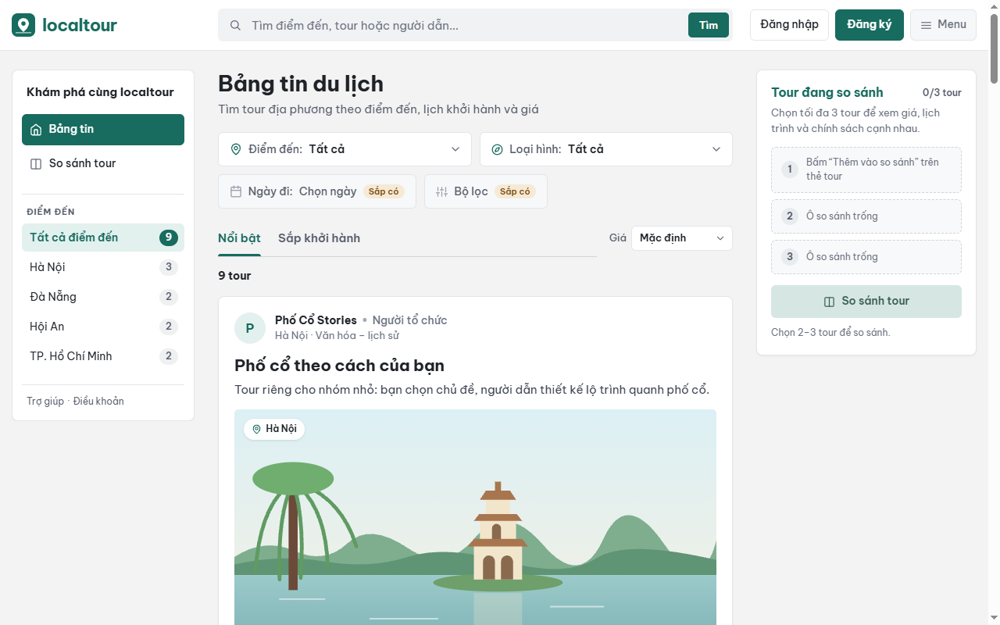

### 3.2. Xem chi tiết tour

1. Bấm **Xem chi tiết** trên thẻ tour.
2. Trang chi tiết có các mục: Thông tin tour, Gói tour (nếu tour chia gói), Lịch trình, Lịch khởi hành, Dịch vụ (bao gồm / không bao gồm), Chính sách, Đánh giá. Thông tin đơn vị tổ chức chưa cung cấp ghi “Chưa cập nhật”.
3. Thẻ đặt tour bên phải: chọn “Gói tour” (nếu có), “Ngày tham gia” (mỗi lịch ghi ngày, giờ và số chỗ còn; chỉ có lịch đang mở bán, còn chỗ và còn trong hạn nhận đặt), số khách theo loại vé bằng nút **+** / **−**. “Tạm tính tiền vé” cập nhật theo lựa chọn.
4. Bấm **Quay lại danh sách** để về bảng tin.

### 3.3. So sánh 2–3 tour

1. Bấm **Thêm vào so sánh** trên thẻ tour hoặc ở trang chi tiết. Khung “Tour đang so sánh” bên phải bảng tin hiện “N/3 tour”. Bấm lại nút (nhãn “Đã thêm vào so sánh”) để bỏ tour.
2. Thêm tour thứ 4 sẽ bị chặn với thông báo “Chỉ so sánh tối đa 3 tour. Bỏ bớt một tour trước khi thêm tour khác.”
3. Có từ 2 tour, bấm **So sánh tour** (hoặc mục “So sánh tour” ở menu trái). Trang “So sánh tour” đặt mỗi tour một cột theo 4 nhóm: Giá và lịch, Thông tin tour, Lịch trình và dịch vụ, Chính sách. Ô thiếu dữ liệu ghi “Chưa cập nhật”.
4. Trên trang so sánh: **Xem chi tiết** để mở tour và đặt; **Bỏ** để bỏ một tour; **Xóa danh sách** để bỏ hết.

Không cần đăng nhập để so sánh.

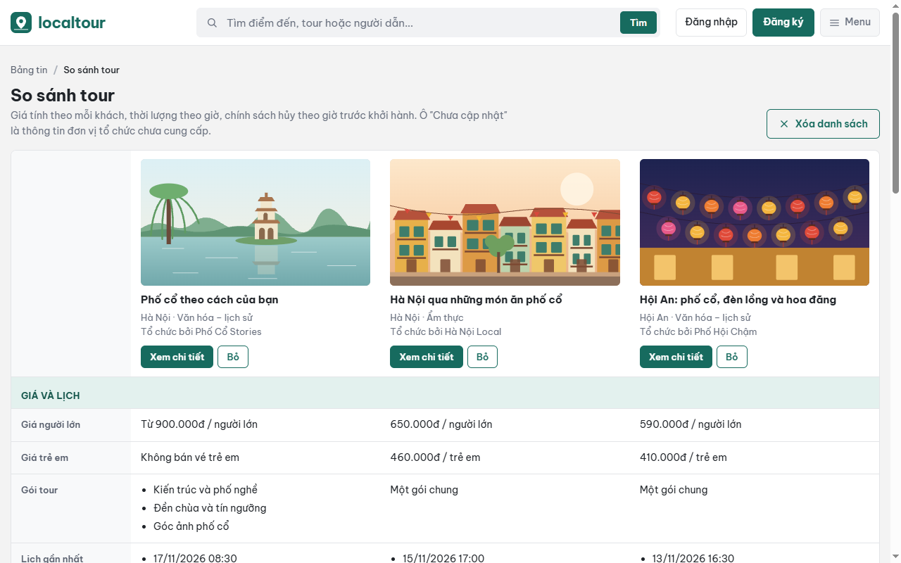

### 3.4. Đăng ký, đăng nhập, đăng xuất

1. Đăng ký: bấm **Đăng ký**, nhập Họ tên, Email, Số điện thoại (không bắt buộc), Mật khẩu (tối thiểu 8 ký tự), Nhập lại mật khẩu, bấm **Tạo tài khoản**. Email đã có tài khoản sẽ báo “Email này đã được dùng.”
2. Đăng nhập: bấm **Đăng nhập**, nhập Email, Mật khẩu, bấm **Đăng nhập**. Sai email hoặc mật khẩu đều báo “Email hoặc mật khẩu không đúng.”
3. Đang xem tour mà chưa đăng nhập: chọn ngày và số khách rồi bấm **Đăng nhập để đặt tour**; đăng nhập xong sẽ vào thẳng trang đặt tour với lựa chọn vừa chọn.
4. Đăng xuất: bấm biểu tượng mũi tên cạnh tên tài khoản ở góc phải.

### 3.5. Đặt tour

1. Ở trang chi tiết tour, chọn gói (nếu có), ngày và số khách, bấm **Đặt tour**.
2. Trang “Hoàn tất thông tin đặt tour” có 4 phần:
   - **1 Thông tin liên hệ:** Họ tên, Email, Số điện thoại.
   - **2 Chuyến đi:** đổi được ngày tham gia, gói, số khách; tích “Phụ thu và hoạt động tùy chọn (không bắt buộc)” nếu cần. Khoản “Phụ thu” / “Tùy chọn” ghi rõ tính theo người hay theo nhóm.
   - **3 Danh sách khách:** nhập họ tên từng khách như trên giấy tờ; “Yêu cầu đặc biệt (không bắt buộc)” tối đa 500 ký tự.
   - **4 Điều kiện đặt tour:** đọc điều kiện (giữ chỗ ngay khi đặt, thời gian giữ chỗ để thanh toán, hạn nhận đặt trước giờ khởi hành, điều kiện dùng VietQR, chính sách hủy), tích “Tôi đồng ý với điều kiện đặt tour và chính sách hủy.”
3. Bấm **Xem lại & xác nhận**. Thiếu thông tin thì ô bị đánh dấu kèm thông báo, ví dụ “Vui lòng nhập họ tên khách 2.”, “Vui lòng đồng ý điều kiện đặt tour và chính sách hủy.”
4. Ở “Xem lại đơn đặt tour”, kiểm tra tour, ngày, giờ, danh sách khách, phụ thu và **Tổng tiền**. Bấm **Sửa thông tin** để quay lại hoặc **Đặt tour và thanh toán**.
5. LocalTour giữ chỗ ngay và mở trang “Thanh toán đơn LTxxxxxx” với thông báo “Đã giữ chỗ cho đơn LTxxxxxx” và hạn thanh toán (“LocalTour giữ chỗ tới dd/mm/yyyy hh:mm. Quá hạn chưa thanh toán, đơn tự hủy và chỗ được trả lại cho lịch.”). Đơn ở trạng thái **Chờ thanh toán** và đã nằm trong “Đơn của tôi”. Chưa thu tiền ở bước này; thanh toán theo mục 3.6.
6. Lịch vừa hết chỗ hoặc vừa quá hạn nhận đặt lúc bấm thì không có đơn nào được tạo, trang báo “Lịch này vừa hết chỗ. Vui lòng chọn ngày khác.” hoặc “Lịch này không còn nhận đặt (đã đóng hoặc quá sát giờ khởi hành). Vui lòng chọn ngày khác.”

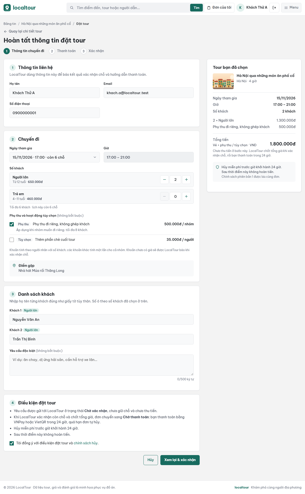

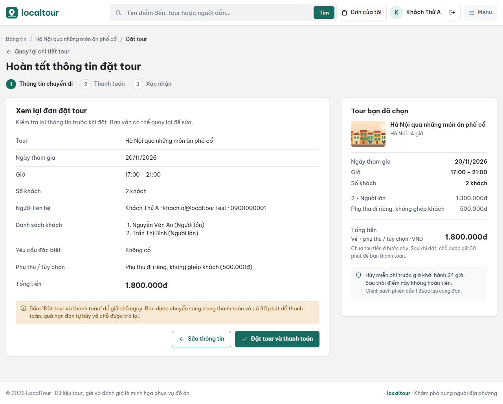

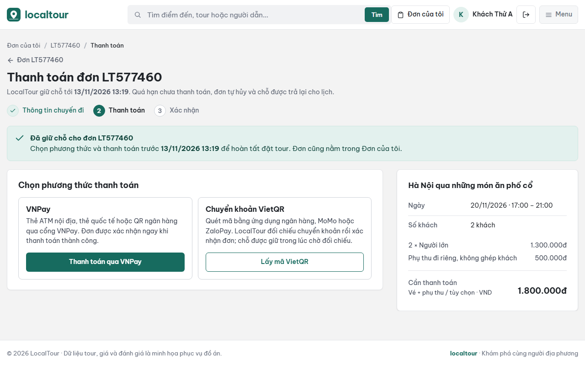

### 3.6. Thanh toán VNPay hoặc VietQR

Thanh toán được khi đơn ở **Chờ thanh toán** và còn hạn giữ chỗ. Vừa đặt xong, bạn đang ở sẵn trang thanh toán. Đã rời trang thì mở **Đơn của tôi**, mở đơn: trang đơn ghi hạn (“LocalTour đang giữ chỗ cho bạn. Vui lòng thanh toán trước dd/mm/yyyy hh:mm; quá hạn đơn tự hủy và chỗ được trả lại cho lịch.”) và “Số tiền cần thanh toán”.

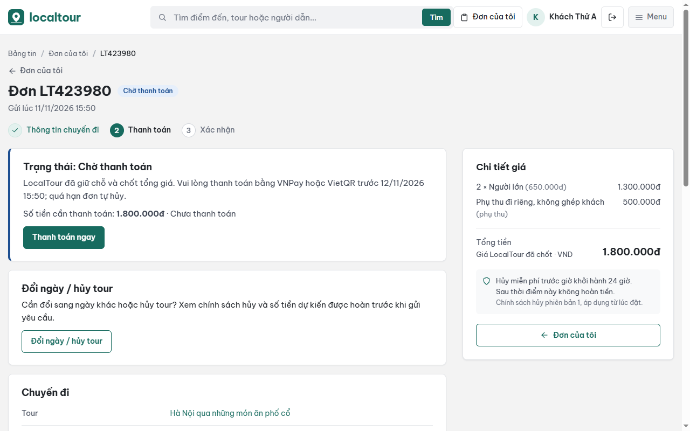

1. Bấm **Thanh toán ngay** → trang “Thanh toán đơn LTxxxxxx”, phần “Chọn phương thức thanh toán”.
2. **VNPay:** bấm **Thanh toán qua VNPay** → cổng VNPay sandbox → thanh toán bằng thẻ thử của VNPay sandbox (xem [02 – Hướng dẫn cài đặt](02-huong-dan-cai-dat.md)). VNPay trả về trang đơn với “Thanh toán VNPay thành công. Đơn đã được xác nhận và voucher đã sẵn sàng.” Hủy ở cổng VNPay thì về trang đơn với “Bạn đã hủy giao dịch ở VNPay.”, đơn vẫn **Chờ thanh toán** và thanh toán lại được trong hạn.
3. **VietQR:** bấm **Lấy mã VietQR** → trang “Chuyển khoản VietQR” có mã QR, số tiền và nội dung chuyển khoản (mã thanh toán dạng `LTxxxxxxP1`). Chuyển đúng số tiền và nội dung, rồi bấm **Tôi đã chuyển khoản**. Trang đơn báo “Đã ghi nhận bạn báo chuyển khoản. LocalTour sẽ đối chiếu rồi xác nhận đơn; đơn không bị tự hủy trong lúc chờ.”, khoản ở **Chờ đối chiếu**.
4. Đơn còn dưới 24 giờ tới giờ khởi hành: thẻ “Chuyển khoản VietQR” ghi “Không dùng được cho đơn này: còn dưới 24 giờ tới giờ khởi hành nên LocalTour không kịp đối chiếu chuyển khoản.” và không có nút **Lấy mã VietQR**; thanh toán bằng VNPay.
5. Muốn xem lại mã chuyển khoản: bấm **Xem thông tin chuyển khoản** ở trang đơn. Ở trang chuyển khoản, **Chọn phương thức khác** để quay lại chọn VNPay; **Về trang đơn** để về đơn.
6. Quá hạn giữ chỗ mà chưa thanh toán: đơn chuyển **Đã hủy**, chỗ được trả lại cho lịch, “Lịch sử đơn” ghi “Quá hạn thanh toán, đơn tự hủy”. Muốn đi tour thì đặt lại.

Đây là môi trường thử nghiệm. Trong buổi demo và UAT không chuyển tiền thật: bấm **Tôi đã chuyển khoản** rồi quản trị viên đối chiếu (mục 4.3). Không chụp ảnh trang “Chuyển khoản VietQR” (có thông tin tài khoản nhận).

### 3.7. Theo dõi đơn

1. Bấm **Đơn của tôi** ở đầu trang. Danh sách chỉ có đơn của tài khoản đang đăng nhập; đơn chờ thanh toán ghi “Thanh toán trước dd/mm/yyyy hh:mm”. Chưa có đơn thì ghi “Bạn chưa có đơn đặt tour nào”.
2. Bấm vào một đơn để mở trang đơn. Đầu trang là trạng thái và việc cần làm tiếp; bên dưới có Chuyến đi, Danh sách khách, Người liên hệ, Các lần thanh toán, Lịch sử đơn; bên phải là Chi tiết giá và chính sách hủy của đơn.
3. Đơn bị hủy (và đơn bị từ chối, với đơn theo quy trình cũ) ghi “Lý do: …”.
4. “Lịch sử đơn” ghi từng bước kèm thời điểm và người làm (Khách hàng, LocalTour, Hệ thống, VNPay).
5. Khi lịch khởi hành kết thúc, đơn **Đã xác nhận** tự chuyển **Đã hoàn thành**.

### 3.8. Voucher

1. Khi đơn **Đã xác nhận**, trang đơn ghi “Mã voucher: …” và nút **Xem và in voucher**.
2. Trang “Voucher tham gia tour” có mã voucher, mã đơn, ngày, giờ, điểm gặp, đơn vị tổ chức, người liên hệ, danh sách khách, phụ thu đã chọn và số tiền đã thanh toán. Bấm **In voucher** để in hoặc lưu PDF.
3. Đưa mã voucher cho hướng dẫn viên khi tới điểm hẹn; có mặt trước giờ khởi hành 15 phút.

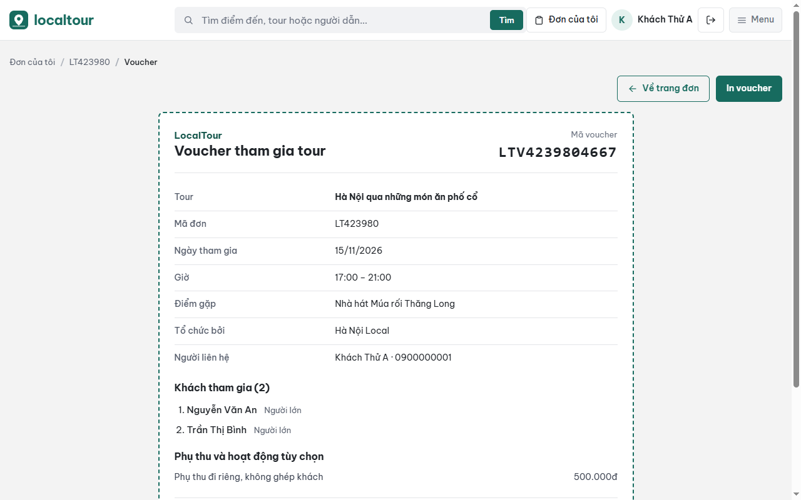

### 3.9. Đổi ngày hoặc hủy tour

1. Ở trang đơn, thẻ “Đổi ngày / hủy tour”, bấm **Đổi ngày / hủy tour**.
2. Bên phải là “Chính sách hủy của đơn”: mốc “Hủy miễn phí đến”, “Hiện tại”, “Đã thanh toán” và “Dự kiến hoàn nếu hủy bây giờ”.
3. Ở “Bạn muốn”, chọn:
   - **Hủy tour:** dòng dưới ghi số tiền dự kiến được hoàn theo chính sách.
   - **Đổi sang ngày khác:** chọn “Ngày muốn đổi sang”; chỉ hiện các lịch cùng tour còn đủ chỗ cho số khách của đơn.
4. Nhập “Lý do” (bắt buộc, tối đa 500 ký tự), bấm **Gửi yêu cầu**. Trang báo “Đã gửi yêu cầu. LocalTour sẽ xử lý và cập nhật kết quả trên trang này. Tiền hoàn (nếu có) được LocalTour chuyển lại thủ công.”
5. Mục “Yêu cầu đã gửi” hiện trạng thái **Chờ xử lý**, sau đó **Đã đồng ý** hoặc **Đã từ chối** kèm “Phản hồi của LocalTour”. Đơn giữ nguyên cho tới khi yêu cầu được đồng ý.
6. Yêu cầu hủy được đồng ý thì đơn chuyển “Đã hủy”: trang đơn ghi “Đơn đã bị hủy. Lý do: …” (phản hồi của LocalTour), và “Lịch sử đơn” có dòng “Đồng ý hủy tour” cùng dòng “Tạo yêu cầu hoàn tiền” ghi số tiền hoàn. Đơn đã hủy không còn thẻ “Đổi ngày / hủy tour”.

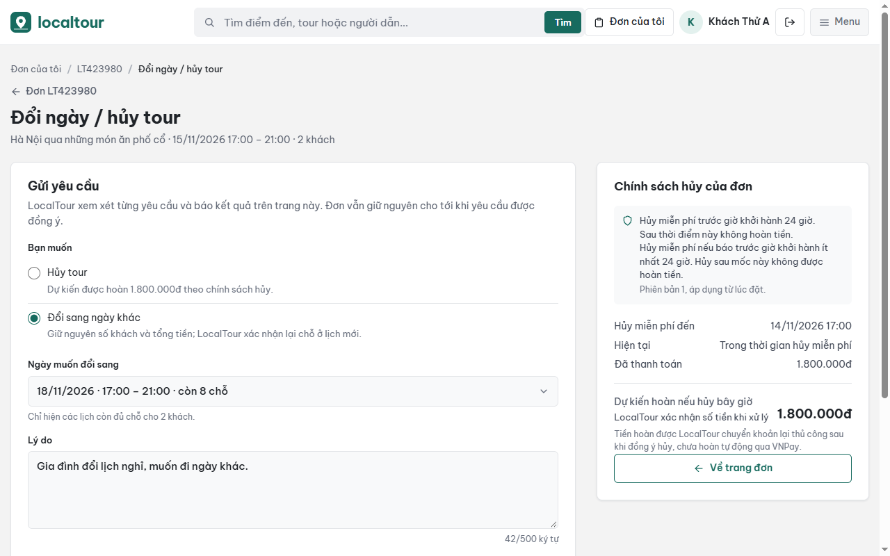

## 4. Quản trị viên

### 4.1. Đăng nhập quản trị

1. Mở `/admin/login` (“Đăng nhập quản trị”), nhập Email, Mật khẩu của tài khoản quản trị tạo lúc cài đặt, bấm **Đăng nhập**.
2. Menu trái: Tổng quan, Duyệt tour, Đơn vị tổ chức, Đơn đặt tour, Đổi ngày / hủy tour, Đối chiếu thanh toán, Chi trả đơn vị tổ chức, Thông số vận hành, Về trang khách, Đăng xuất.
3. Tài khoản khách hàng hoặc tài khoản đơn vị tổ chức mở trang quản trị sẽ thấy “Bạn không có quyền truy cập trang này.”

### 4.2. Theo dõi, xác nhận và hủy đơn đặt tour

Đơn mới được giữ chỗ ngay lúc khách đặt nên quản trị viên không còn bước xác nhận chỗ. Thanh toán VNPay thành công thì đơn tự chuyển “Đã xác nhận”; chuyển khoản VietQR đối chiếu ở mục 4.3; quá hạn giữ chỗ thì đơn tự hủy; lịch khởi hành kết thúc thì đơn tự chuyển “Đã hoàn thành”.

1. Bấm **Đơn đặt tour**. Lọc theo tab (Tất cả, Chờ xác nhận, Chờ thanh toán, Đã xác nhận, Đã hoàn thành, Từ chối, Đã hủy) hoặc tìm theo mã đặt chỗ, tên, email, số điện thoại. Bấm **Xem** ở đơn cần mở.
2. Trang “Đơn LTxxxxxx” có “Tour và lịch khởi hành” (“Chỗ của lịch”: số chỗ còn và số chỗ đơn này đang giữ), vé và phụ thu, danh sách khách, “Khách hàng”, “Thanh toán”, “Lịch sử xử lý”. Đơn chờ thanh toán ghi “Hạn thanh toán” ở đầu trang.
3. Ở “Cập nhật trạng thái”, “Trạng thái mới” chỉ có các lựa chọn hợp với trạng thái hiện tại của đơn:
   - Đơn “Chờ thanh toán”: **Xác nhận đã thanh toán (chuyển “Đã xác nhận”)** chỉ dùng khi đơn đã có khoản thanh toán thành công hoặc khoản VietQR chờ đối chiếu (thường làm qua mục 4.3); chưa có thì trang báo “Đơn chưa có thanh toán thành công hoặc khoản chuyển khoản VietQR chờ đối chiếu, chưa xác nhận được.” **Hủy đơn**: bắt buộc nhập “Lý do / ghi chú”; chỗ được trả lại cho lịch, khách thấy lý do ở trang đơn.
   - Đơn “Đã xác nhận”: **Tour đã diễn ra (chuyển “Đã hoàn thành”)** chỉ dùng sau giờ khởi hành; bình thường hệ thống tự làm khi lịch kết thúc. **Hủy đơn**: bắt buộc nhập lý do; chỗ được trả lại, hệ thống tạo khoản hoàn tiền cho khách (mục 4.11).
   - Đơn còn khoản VietQR chờ đối chiếu thì đối chiếu trước (mục 4.3) rồi mới hủy được.
4. Bấm **Cập nhật trạng thái**. Trang báo “Đã cập nhật trạng thái đơn.”, lịch sử ghi người làm và thời điểm. Đơn “Đã hoàn thành”, “Từ chối”, “Đã hủy” là trạng thái cuối, không cập nhật được nữa.
5. Đơn “Chờ xác nhận” (tạo theo quy trình cũ): có thêm lựa chọn **Xác nhận chỗ và giá (giữ chỗ, chuyển “Chờ thanh toán”, hạn 24 giờ)** kèm ô “Tổng giá chốt (VND)”, và **Từ chối đơn** (bắt buộc nhập lý do). Đơn mới không qua bước này.

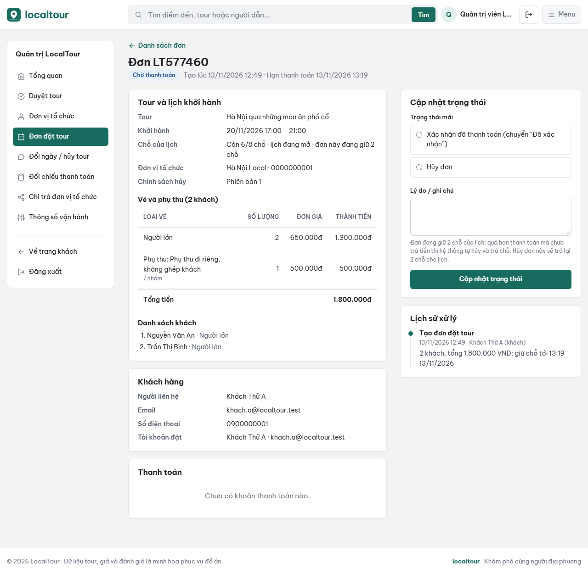

### 4.3. Đối chiếu chuyển khoản VietQR

1. Bấm **Đối chiếu thanh toán**. Mục “Chuyển khoản VietQR chờ đối chiếu” liệt kê nội dung chuyển khoản, số tiền, đơn, tour, lúc khách báo và hạn giữ chỗ.
2. Bấm **Đối chiếu** → trang đơn, phần “Thanh toán”. Kiểm tra sao kê tài khoản nhận tiền: đúng số tiền và nội dung `LTxxxxxxP1`.
3. Khớp: bấm **Đã nhận tiền** → “Đã xác nhận nhận tiền. Đơn còn chờ thanh toán thì chuyển “Đã xác nhận” và khách nhận được voucher; đơn đã hủy hoặc đã thanh toán bằng khoản khác thì tạo yêu cầu hoàn tiền.”
4. Không khớp: nhập “Lý do (bắt buộc khi không khớp)”, bấm **Không khớp** → “Đã báo chuyển khoản không khớp. Đơn còn hạn giữ chỗ thì khách thanh toán lại được; đã quá hạn thì đơn tự hủy và trả lại chỗ.”

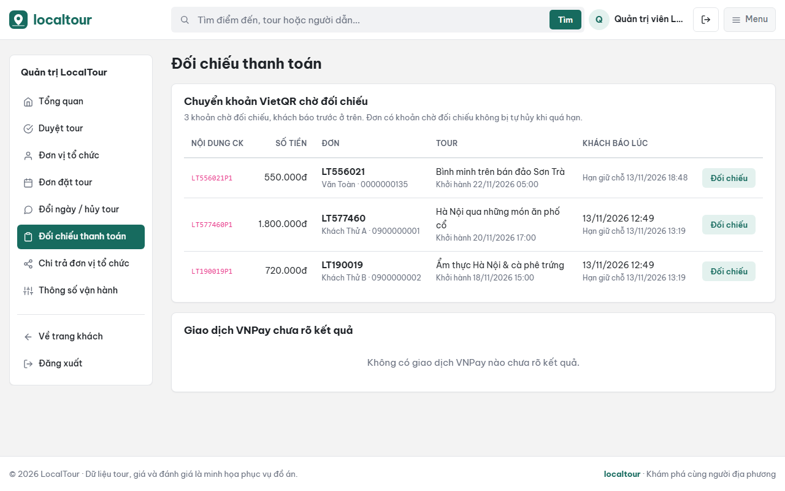

### 4.4. Xử lý giao dịch VNPay chưa rõ kết quả

Khi chạy ở máy cục bộ, VNPay không gọi được IPN; kết quả chỉ ghi khi khách quay về từ cổng VNPay. Khoản VNPay không có kết quả sau 15 phút hiện ở mục “Giao dịch VNPay chưa rõ kết quả” của **Đối chiếu thanh toán**.

1. Bấm **Đối chiếu** ở khoản đó, tra mã thanh toán (`LTxxxxxxPn`) trên cổng VNPay sandbox.
2. Có giao dịch thành công: nhập “Mã giao dịch VNPay (khi có giao dịch thành công)” (chỉ chữ số), bấm **Có giao dịch thành công**. Đơn còn chờ thanh toán thì chuyển “Đã xác nhận” và có voucher; đơn đã hủy thì hệ thống tạo yêu cầu hoàn tiền.
3. Không có giao dịch: nhập “Ghi chú (bắt buộc khi không có giao dịch)”, bấm **Không có giao dịch**. Đơn còn hạn giữ chỗ thì khách thanh toán lại được.

### 4.5. Xử lý yêu cầu đổi ngày / hủy tour

1. Bấm **Đổi ngày / hủy tour**. Tab: Chờ xử lý, Đã đồng ý, Đã từ chối, Tất cả. Bấm **Xử lý** ở yêu cầu cần làm.
2. Trang yêu cầu có lý do của khách, đơn, ngày đang đặt, ngày muốn đổi sang (kèm số chỗ còn), chính sách hủy áp dụng, số tiền đã thanh toán. Bấm **Xem đơn** để mở đơn.
3. Ở “Xử lý”, chọn “Kết quả”:
   - **Đồng ý hủy tour:** nhập “Số tiền hoàn (đ)”. Đơn chuyển “Đã hủy”, trả chỗ, ghi khoản hoàn; LocalTour chuyển khoản lại thủ công rồi ghi “Đã hoàn tiền” (mục 4.11). Đơn còn khoản VietQR chờ đối chiếu thì phải đối chiếu trước.
   - **Đồng ý đổi ngày:** đơn chuyển sang lịch mới, giữ số khách, gói và tổng tiền.
   - **Từ chối, giữ nguyên đơn.**
4. Nhập “Ghi chú gửi khách (bắt buộc)”, bấm **Lưu kết quả**. Mỗi yêu cầu chỉ xử lý một lần; khách thấy kết quả và ghi chú ở trang đơn.

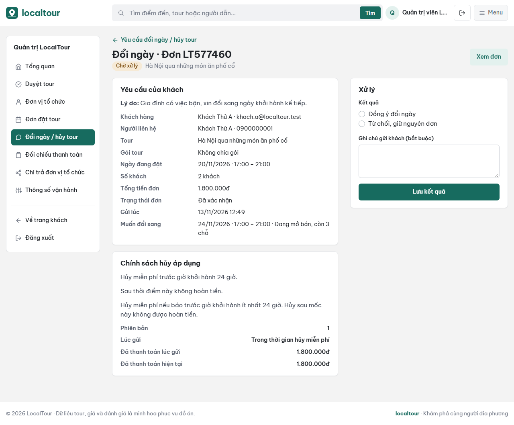

### 4.6. Quản lý tour, lịch, giá, gói và nội dung

Tour chỉ hiện cho khách khi tour đã được duyệt và đơn vị tổ chức đang hợp tác. Tour do quản trị viên thêm và tour do đơn vị tổ chức đăng (mục 5.2) đều nằm ở trang này.

1. Bấm **Duyệt tour**. Tab: Chờ duyệt, Đã duyệt, Bị từ chối, Ngừng hiển thị, Tất cả. Bấm **Xem và duyệt** / **Xem** để mở chi tiết tour.
2. **Thêm tour:** bấm **Thêm tour**, nhập Tên tour, Đơn vị tổ chức, Điểm đến, Loại hình, Ngôn ngữ hướng dẫn, Thời lượng (phút), Số khách tối đa mỗi yêu cầu đặt, Mô tả, điểm hẹn, điều kiện tour, nguồn và xác minh; bấm **Thêm tour**. Tour mới ở “Chờ duyệt”.
3. Ở trang chi tiết tour:
   - **Sửa thông tin:** sửa các trường ở bước 2, bấm **Lưu thay đổi**.
   - **Lịch khởi hành và giá vé:** “Thêm lịch khởi hành” (Khởi hành, Kết thúc, Sức chứa (chỗ) từ 1 đến 500, Giá vé người lớn (đ), Giá vé trẻ em (đ)) → **Thêm lịch**. Bấm **Sửa** ở một lịch để đổi giờ, sức chứa, giá hoặc “Trạng thái” (Mở bán / Hủy lịch) → **Lưu thay đổi**. Giá mới chỉ áp dụng cho đơn đặt sau khi lưu, đơn đã đặt giữ giá lúc đặt; chỉ hủy được lịch khi không còn đơn đang xử lý.
   - **Gói tour:** “Thêm gói” (Tên gói, Thứ tự hiển thị, Giá người lớn (đ), Giá trẻ em (đ), Mô tả) → **Thêm gói**. Bỏ chọn “Đang bán” để ngừng bán gói; đơn đã đặt không bị ảnh hưởng. Tour có gói thì giá vé lấy theo gói.
   - **Ảnh, lịch trình, dịch vụ, chính sách:**
     - Ảnh: **Tải ảnh lên** (JPG, PNG hoặc WebP, tối đa 2 MB; tối đa 12 ảnh) hoặc dán đường dẫn ảnh, nhập “Mô tả ảnh”, bấm **Thêm ảnh**; **Đặt làm ảnh bìa**, **Xóa**.
     - Lịch trình: Giờ, Thứ tự, Nội dung → **Thêm mục**; **Sửa**, **Xóa** từng mục.
     - Dịch vụ: Tên dịch vụ, Loại (Đã bao gồm / Không bao gồm) → **Thêm dịch vụ**.
     - Chính sách hủy: “Hủy miễn phí trước (giờ)”, “Hoàn sau mốc đó (%)”, “Nội dung chính sách cho khách” → **Lưu phiên bản mới**. Đơn đã đặt giữ phiên bản lúc đặt.
4. Duyệt: bấm **Phê duyệt tour**, hoặc nhập “Lý do từ chối (bắt buộc)” rồi bấm **Từ chối tour**. Lịch sử xử lý ghi người làm và thời điểm. Tour và bản sửa do đơn vị tổ chức gửi duyệt: xem mục 4.9.
5. Xóa tour (tab “Xóa tour” ở trang nội dung): tích “Tôi hiểu tour sẽ bị xóa hoặc ngừng hiển thị với khách.”, bấm **Xóa tour**. Tour chưa có đơn bị xóa hẳn; tour đã có đơn chuyển “Ngừng hiển thị”; không xóa được khi còn đơn chờ xác nhận, chờ thanh toán hoặc đã xác nhận.
6. Hiển thị lại tour đang “Ngừng hiển thị”: ở tab “Hiển thị lại”, bấm **Chuyển về Chờ duyệt**, rồi phê duyệt lại.

### 4.7. Quản lý đơn vị tổ chức và cấp tài khoản đăng nhập

1. Bấm **Đơn vị tổ chức** để xem danh sách (tên, số điện thoại, email, trạng thái hợp tác, số tour).
2. Thêm: bấm **Thêm đơn vị**, nhập Tên đơn vị, Số điện thoại liên hệ, Email liên hệ, “Trạng thái hợp tác” (Đang hợp tác / Chờ duyệt / Ngừng hợp tác; mặc định “Chờ duyệt”), bấm **Thêm đơn vị** → “Đã thêm đơn vị tổ chức.” Mỗi email chỉ dùng cho một tài khoản: trùng thì báo “Email này đã được dùng cho một tài khoản khác.”
3. Cấp tài khoản đăng nhập: bấm **Sửa** ở đơn vị vừa thêm; ở “Tài khoản đăng nhập” nhập “Mật khẩu” (tối thiểu 8 ký tự), bấm **Cấp mật khẩu** → “Đã lưu mật khẩu đăng nhập của đơn vị.” Gửi mật khẩu cho đơn vị qua kênh riêng; LocalTour không hiển thị lại mật khẩu. Đổi mật khẩu: nhập “Mật khẩu mới”, bấm **Đổi mật khẩu**.
4. Đơn vị đăng nhập ở `/host/login` bằng email liên hệ và mật khẩu được cấp, và chỉ đăng nhập được khi ở trạng thái “Đang hợp tác”. Đơn vị không tự đăng ký tài khoản.
5. Sửa: bấm **Sửa**, đổi thông tin, bấm **Lưu thay đổi**. Chuyển “Ngừng hợp tác” thì tour của đơn vị không hiện cho khách và đơn vị không đăng nhập được.
6. Xóa (chỉ đơn vị chưa có tour): ở trang sửa, tích “Tôi hiểu đơn vị sẽ bị xóa hẳn.”, bấm **Xóa đơn vị**. Đơn vị còn tour thì mục “Xóa đơn vị” không có ô tích và nút xóa, chỉ ghi “Đơn vị còn N tour nên không xóa được (đơn cũ cần giữ thông tin đơn vị).”; muốn ẩn tour của đơn vị thì chọn “Ngừng hợp tác” rồi lưu.

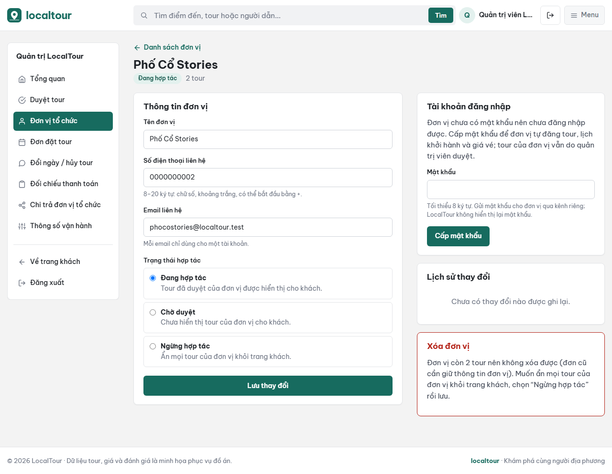

### 4.8. Tổng quan và thống kê doanh thu

1. Bấm **Tổng quan**. Ba ô đầu trang: “Tài khoản khách hàng” (số đang hoạt động / bị khóa), “Tour” (chờ duyệt / đã duyệt / bị từ chối, thêm số tour nháp nếu có), “Đơn chờ thanh toán”. Bảng “Đơn đặt tour theo trạng thái” đếm đơn theo từng trạng thái.
2. Ở “Thống kê”, chọn Theo ngày / Theo tháng / Theo năm, “Từ ngày”, “Đến ngày”, bấm **Xem thống kê**. Để trống ngày: theo ngày = 30 ngày gần nhất, theo tháng = 12 tháng gần nhất, theo năm = toàn bộ.
3. “Số đơn đặt tour theo ngày tạo” đếm đơn theo kỳ. “Doanh thu theo ngày thanh toán” ghi Lượt thanh toán, Doanh thu gộp, Hoàn tiền, Doanh thu thuần (= tiền đã thanh toán thành công − tiền đã hoàn).
4. Bấm vào một kỳ để mở “Khoản thanh toán theo kỳ” và đối chiếu từng khoản.

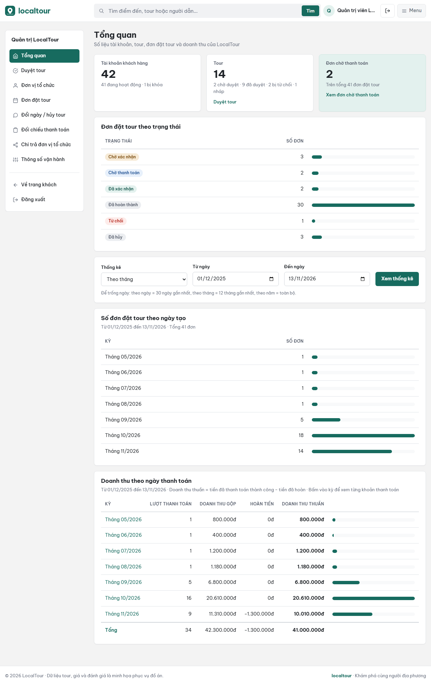

### 4.9. Duyệt tour và bản sửa của đơn vị tổ chức

1. Bấm **Duyệt tour**, tab “Chờ duyệt”. Tour mới của đơn vị hiện theo tên tour; bản sửa của tour đã duyệt hiện với dòng “Bản sửa của tour đã duyệt: <tên tour>”. Bấm **Xem và duyệt**.
2. Tour mới: xem thông tin, ảnh, lịch trình, dịch vụ, chính sách hủy và lịch khởi hành. Bấm **Phê duyệt tour** → “Đã phê duyệt tour.”, tour hiện cho khách. Hoặc nhập “Lý do từ chối (bắt buộc)” rồi bấm **Từ chối tour** → “Đã từ chối tour và lưu lý do.”; đơn vị thấy lý do, sửa tour và gửi lại. Để trống lý do thì báo “Vui lòng nhập lý do từ chối.”
3. Bản sửa: mục “So sánh với tour đang hiển thị” đặt “Đang hiển thị” cạnh “Bản sửa” và chỉ liệt kê nhóm có thay đổi. “Thông tin tour” là bảng ba cột “Mục”, “Đang hiển thị”, “Bản sửa”, mỗi dòng một mục đã đổi. “Ảnh” gắn nhãn “Mới” cho ảnh thêm vào và “Bị bỏ” cho ảnh bị bỏ. “Lịch trình”, “Dịch vụ bao gồm / không bao gồm” và “Chính sách hủy” ghi cả danh sách ở hai bên. Lịch khởi hành và giá vé không nằm trong bản sửa. Bấm **Xem tour đang hiển thị** để mở tour gốc.
4. Ở “Xử lý”: bấm **Phê duyệt bản sửa** → “Đã duyệt bản sửa: nội dung mới đã được áp dụng cho tour.” Hoặc nhập lý do rồi bấm **Từ chối bản sửa**: tour đang hiển thị giữ nguyên, đơn vị thấy lý do.
5. Trong lúc tour hoặc bản sửa “Chờ duyệt”, đơn vị không sửa được nội dung. Lịch khởi hành và giá vé đơn vị sửa trực tiếp, không qua duyệt (mục 5.5).

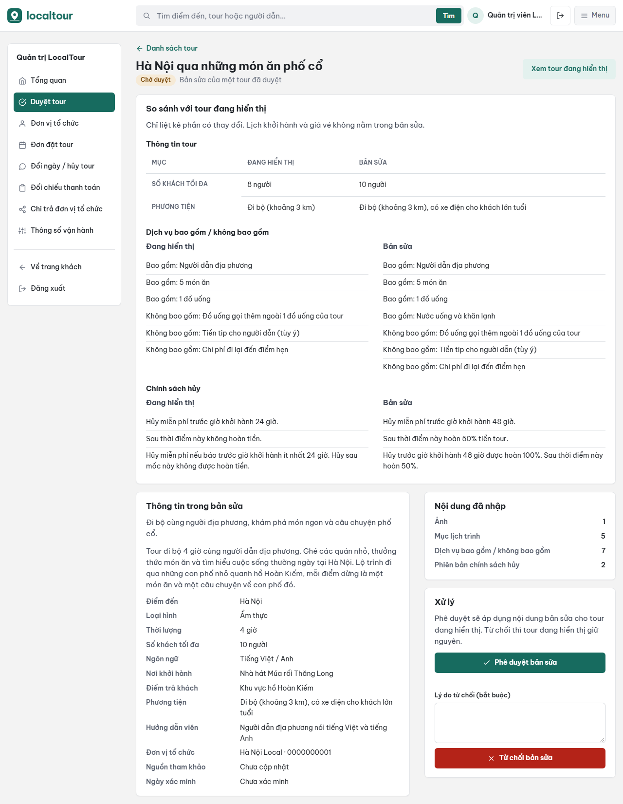

### 4.10. Chi trả cho đơn vị tổ chức

Khi lịch khởi hành kết thúc, hệ thống tự chuyển các đơn “Đã xác nhận” của lịch sang “Đã hoàn thành” và lập một khoản chi trả cho lịch đó. Thực nhận = tiền thực thu (khách đã trả, đã trừ tiền hoàn) − phí dịch vụ LocalTour (theo mức lưu trong từng đơn lúc đặt). Hệ thống không tự chuyển tiền. Bước tự động này chạy mỗi khi mở trang “Chi trả đơn vị tổ chức” và theo tác vụ định kỳ cài ở [02 – Hướng dẫn cài đặt](02-huong-dan-cai-dat.md).

1. Bấm **Chi trả đơn vị tổ chức**. Ba ô đầu trang: “Tiền thực thu”, “Phí dịch vụ LocalTour”, “Thực nhận chờ chi trả”. Tab: Chờ chi trả, Đã chi trả, Tất cả. Đầu trang ghi mốc “Chi trả được lập cho các lịch kết thúc từ …”.
2. Mỗi dòng là một lịch khởi hành: Đơn vị tổ chức, Tiền thực thu, Phí dịch vụ, Thực nhận, Trạng thái. Dòng ghi “Chưa khai tài khoản nhận tiền” hoặc “Tài khoản chưa xác minh” thì chưa chuyển khoản được. Bấm **Chi trả**.
3. Trang “Chi trả <số tiền>” có “Lịch khởi hành và số tiền”, “Các đơn trong khoản chi trả”, “Đơn vị nhận tiền” và “Chuyển khoản”.
4. **Xác minh tài khoản nhận tiền:** tài khoản đơn vị mới khai hoặc vừa đổi ghi “Xác minh: Chưa xác minh”. Kiểm tra tài khoản với đơn vị ngoài hệ thống (ví dụ gọi số điện thoại liên hệ), rồi bấm **Đã kiểm tra, xác minh tài khoản này** → “Đã xác minh tài khoản nhận tiền của đơn vị.” Đơn vị đổi tài khoản thì dấu xác minh bị xóa và phải xác minh lại.
5. **Ghi nhận đã chi trả:** chuyển đúng số “Thực nhận” cho đơn vị bằng ngân hàng của LocalTour, nhập “Mã giao dịch chuyển khoản” và “Ghi chú nội bộ (không bắt buộc)”, bấm **Ghi nhận đã chi trả** → “Đã ghi nhận chuyển khoản. Khoản chi trả chuyển sang “Đã chi trả”.” Đơn vị thấy mã giao dịch ở “Doanh thu & chi trả”.
6. Chưa có ô nhập mã giao dịch: mục “Chuyển khoản” ghi “Chưa chuyển khoản được: đơn vị chưa khai tài khoản nhận tiền. …” (nhắc đơn vị khai theo mục 5.8) hoặc “Chưa chuyển khoản được: tài khoản nhận tiền của đơn vị chưa được xác minh. …” (làm bước 4).
7. Mục “Lịch đã kết thúc, chưa lập được khoản chi trả” liệt kê lịch còn việc dang dở ở cột “Còn dang dở”: đơn chưa hoàn thành, khoản thanh toán chờ đối chiếu, khoản hoàn tiền chưa chuyển cho khách, yêu cầu đổi ngày / hủy tour chờ xử lý. Xử lý xong các việc đó, hệ thống tự lập khoản chi trả.

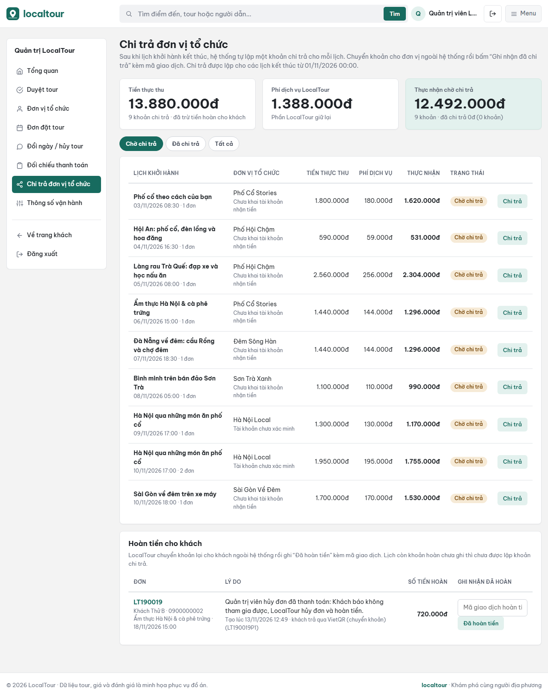

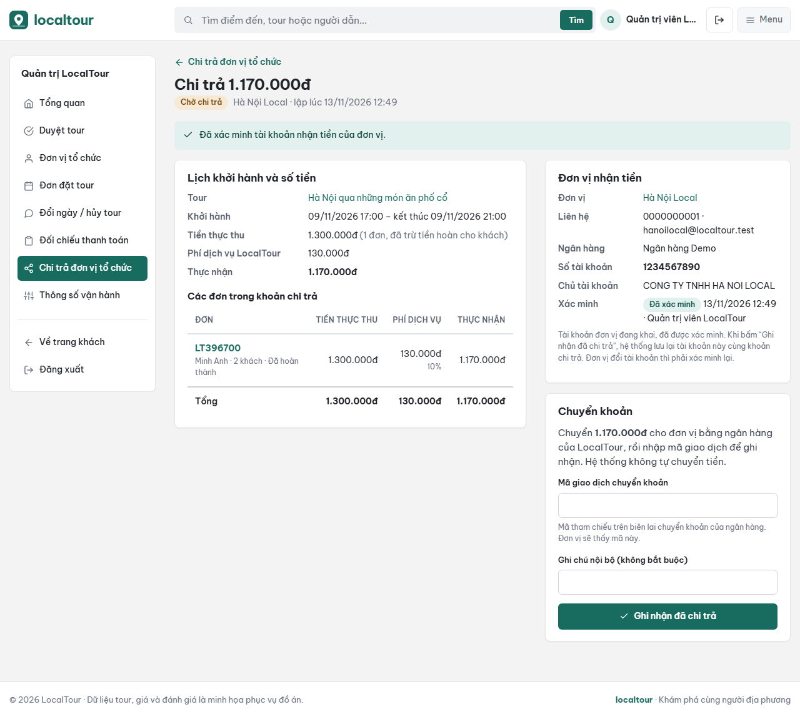

### 4.11. Ghi “Đã hoàn tiền”

1. Khoản hoàn tiền phát sinh khi: đồng ý một yêu cầu hủy tour có số tiền hoàn (mục 4.5), hủy một đơn đã thanh toán (mục 4.2), hoặc ghi nhận một khoản thanh toán cho đơn đã hủy (mục 4.3, 4.4). Trang đơn báo “Có khoản … cần hoàn tiền cho khách …”.
2. Chuyển khoản lại cho khách ngoài hệ thống.
3. Bấm **Chi trả đơn vị tổ chức**, xuống mục “Hoàn tiền cho khách” (cột Đơn, Lý do, Số tiền hoàn, Ghi nhận đã hoàn). Nhập “Mã giao dịch hoàn tiền”, bấm **Đã hoàn tiền** → “Đã ghi nhận hoàn tiền cho khách.” Để trống mã thì báo “Vui lòng nhập mã giao dịch hoàn tiền.”
4. Lịch còn khoản hoàn chưa ghi thì chưa được lập khoản chi trả (mục 4.10 bước 7).

### 4.12. Thông số vận hành

1. Bấm **Thông số vận hành**. Mục “Phí dịch vụ và hạn đặt tour” có 4 ô:

   | Ô | Mặc định | Giới hạn | Tác dụng |
   | --- | --- | --- | --- |
   | Phí dịch vụ LocalTour (%) | 10 | 0 đến 100 | Phần LocalTour giữ lại trên tiền thực thu của mỗi đơn. Chỉ áp dụng cho đơn đặt sau khi lưu; đơn cũ giữ mức lúc đặt. |
   | Thời gian giữ chỗ (phút) | 30 | 5 đến 1440 | Đơn “Chờ thanh toán” được giữ chỗ bấy nhiêu phút; quá hạn chưa thanh toán thì đơn tự hủy và trả chỗ. |
   | Ngừng nhận đặt trước giờ khởi hành (phút) | 60 | 0 đến 1440 | Còn ít hơn bấy nhiêu phút tới giờ khởi hành thì lịch không nhận đơn mới. 0 = nhận tới giờ khởi hành. |
   | Ngừng nhận chuyển khoản VietQR (giờ) | 24 | 0 đến 168 | Còn ít hơn bấy nhiêu giờ tới giờ khởi hành thì không nhận chuyển khoản VietQR. 0 = luôn nhận. |

2. Bấm **Lưu thông số** → “Đã lưu thông số vận hành.” Không đổi gì thì báo “Không có thay đổi nào.” Giá trị ngoài giới hạn bị đánh dấu kèm thông báo, ví dụ “Nhập số nguyên từ 5 đến 1440 phút.”, và không ô nào được lưu.
3. Dưới mỗi ô đã sửa ghi “Sửa lần cuối … bởi …”.

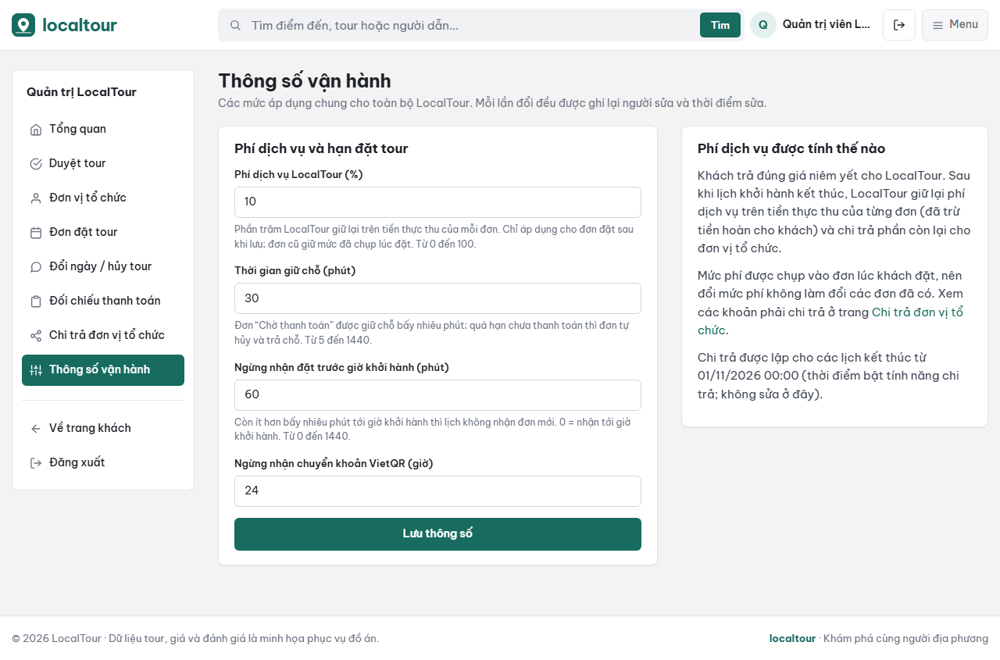

## 5. Đơn vị tổ chức

### 5.1. Đăng nhập

1. Tài khoản do quản trị viên LocalTour cấp (mục 4.7); đơn vị không tự đăng ký. Trang đăng nhập ghi “Chưa có tài khoản đơn vị? Liên hệ quản trị viên LocalTour để được cấp tài khoản.”
2. Mở `/host/login` (“Đăng nhập đơn vị tổ chức”), nhập “Email liên hệ của đơn vị” và “Mật khẩu”, bấm **Đăng nhập**. Sai email hoặc mật khẩu báo “Email hoặc mật khẩu không đúng.”
3. Đăng nhập xong vào trang “Tour của tôi”. Menu trái: Tour của tôi, Thêm tour, Đơn đặt tour, Doanh thu & chi trả, Tài khoản nhận tiền, Về trang khách, Đăng xuất.
4. Đơn vị đang “Chờ duyệt” thì báo “Đơn vị đang chờ quản trị viên LocalTour duyệt. Sau khi được duyệt, bạn đăng nhập bằng email và mật khẩu quản trị viên đã cấp.” Đơn vị “Ngừng hợp tác” thì báo “Đơn vị chưa được duyệt hoặc đã ngừng hợp tác nên chưa đăng nhập được. Vui lòng liên hệ quản trị viên LocalTour.”
5. Tài khoản đơn vị tách với tài khoản khách hàng và tài khoản quản trị: không đặt tour được, không mở được trang quản trị, và chỉ thấy tour, đơn, khoản chi trả của chính đơn vị.

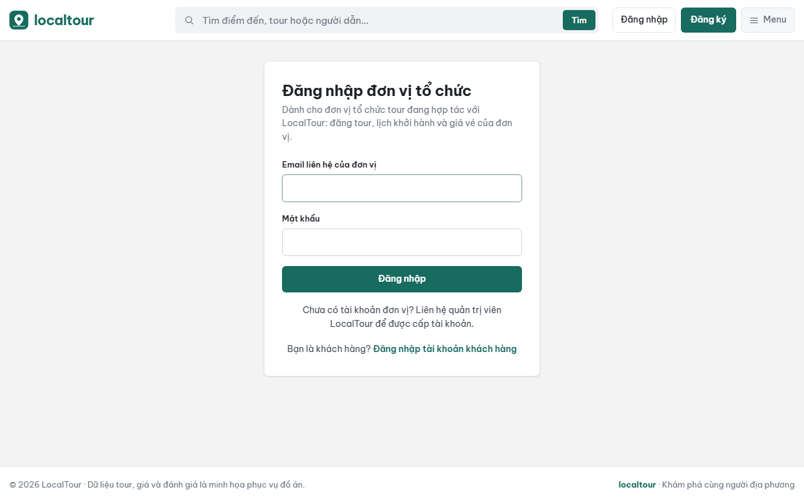

### 5.2. Tạo tour và gửi duyệt

1. Bấm **Thêm tour**. Nhập Tên tour, Điểm đến, Loại hình, Ngôn ngữ hướng dẫn, Thời lượng (phút), Số khách tối đa mỗi yêu cầu đặt, Mô tả, điểm hẹn và điều kiện tour; bấm **Thêm tour** → “Đã thêm tour ở trạng thái "Nháp". Thêm lịch khởi hành, giá vé, ảnh và chính sách hủy rồi chọn "Gửi duyệt".”
2. Tour “Nháp” chưa hiển thị cho khách. Trang tour báo phần còn thiếu (ví dụ “Tour còn thiếu: lịch khởi hành, loại vé và giá vé, chính sách hủy, ảnh.”); mục “Nội dung đã nhập” đếm lịch khởi hành, loại vé, ảnh, mục lịch trình, dịch vụ và phiên bản chính sách hủy.
3. Nhập nội dung bằng các nút ở đầu trang tour:
   - **Lịch khởi hành và giá vé:** xem mục 5.5.
   - **Ảnh, lịch trình, dịch vụ, chính sách:** các tab Ảnh, Lịch trình, Dịch vụ, Chính sách hủy; cách nhập như mục 4.6 bước 3.
   - **Sửa thông tin:** sửa các trường ở bước 1, bấm **Lưu thay đổi** → “Đã lưu thông tin tour.”
4. Ở mục “Gửi duyệt”, bấm **Gửi duyệt** → “Đã gửi duyệt. Tour bị khóa cho tới khi quản trị viên LocalTour xử lý.” Tour chuyển “Chờ duyệt”. Hệ thống chỉ cảnh báo phần còn thiếu, không chặn gửi: kiểm tra đủ nội dung trước khi gửi.
5. Quản trị viên phê duyệt thì tour chuyển “Đã duyệt”, ghi “Đang hiển thị cho khách”. Mục “Lịch sử duyệt” ghi từng bước kèm thời điểm.

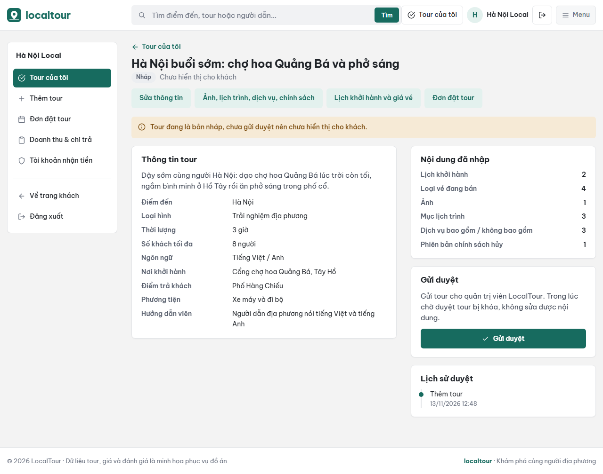

### 5.3. Sửa tour bị từ chối

1. Tour “Bị từ chối” ghi “Tour bị từ chối: <lý do>” ở đầu trang; “Lịch sử duyệt” có dòng “Quản trị viên từ chối” kèm “Lý do: …”.
2. Sửa theo góp ý bằng **Sửa thông tin** hoặc **Ảnh, lịch trình, dịch vụ, chính sách**. Sau khi sửa, tour về “Nháp”.
3. Bấm **Gửi duyệt** để gửi lại. Quản trị viên duyệt lại như tour mới.

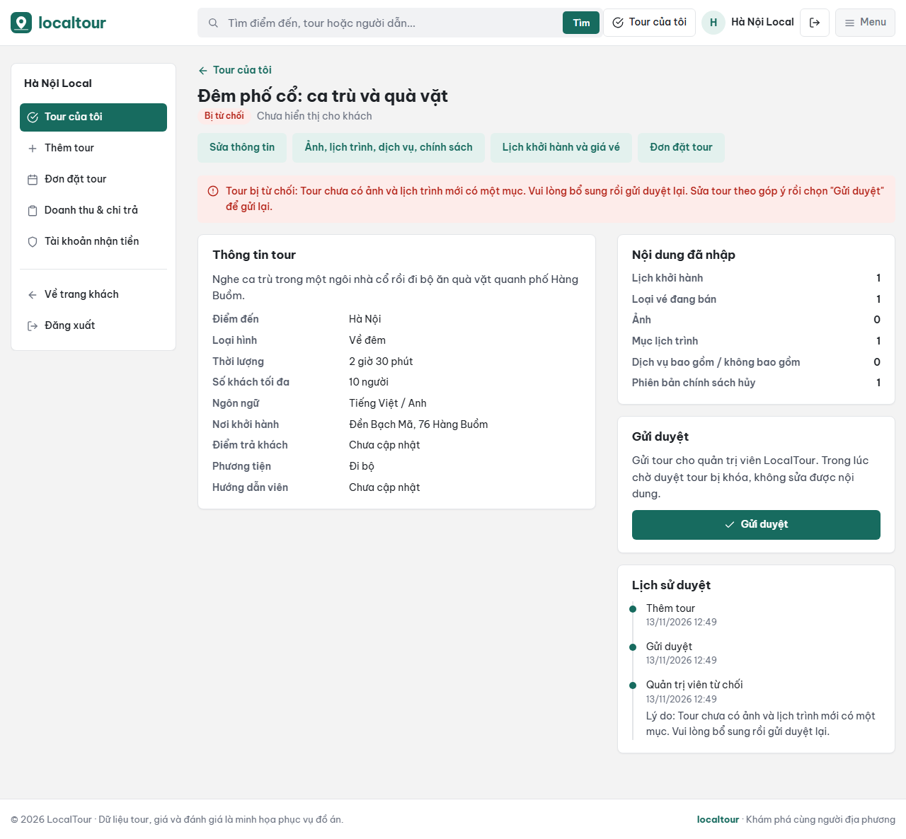

### 5.4. Bản sửa của tour đã duyệt

Thông tin, ảnh, lịch trình, dịch vụ và chính sách hủy của tour “Đã duyệt” không sửa trực tiếp mà sửa qua một bản sửa. Khách vẫn thấy nội dung hiện tại cho tới khi quản trị viên duyệt bản sửa.

1. Ở trang tour, mục “Sửa tour đã duyệt”, bấm **Tạo bản sửa** → “Đã tạo bản sửa. Sửa nội dung rồi chọn "Gửi duyệt"; khách vẫn thấy nội dung đã duyệt cho tới khi bản sửa được duyệt.” Mỗi tour chỉ có một bản sửa cùng lúc; đã có thì bấm **Mở bản sửa**.
2. Ở trang bản sửa, sửa bằng **Sửa thông tin** và **Ảnh, lịch trình, dịch vụ, chính sách**.
3. Bấm **Gửi duyệt bản sửa**. Trong lúc chờ duyệt, bản sửa bị khóa; tour đang hiển thị giữ nguyên.
4. Bản sửa được duyệt: nội dung mới thay cho nội dung đang hiển thị. Bản sửa bị từ chối: trang ghi “Bản sửa bị từ chối: <lý do>”; sửa theo góp ý rồi gửi duyệt lại, hoặc bấm **Hủy bản sửa** → “Đã hủy bản sửa. Tour đang hiển thị giữ nguyên.”
5. Bản sửa đang “Chờ duyệt” không hủy được. Lịch khởi hành và giá vé không nằm trong bản sửa (mục 5.5).

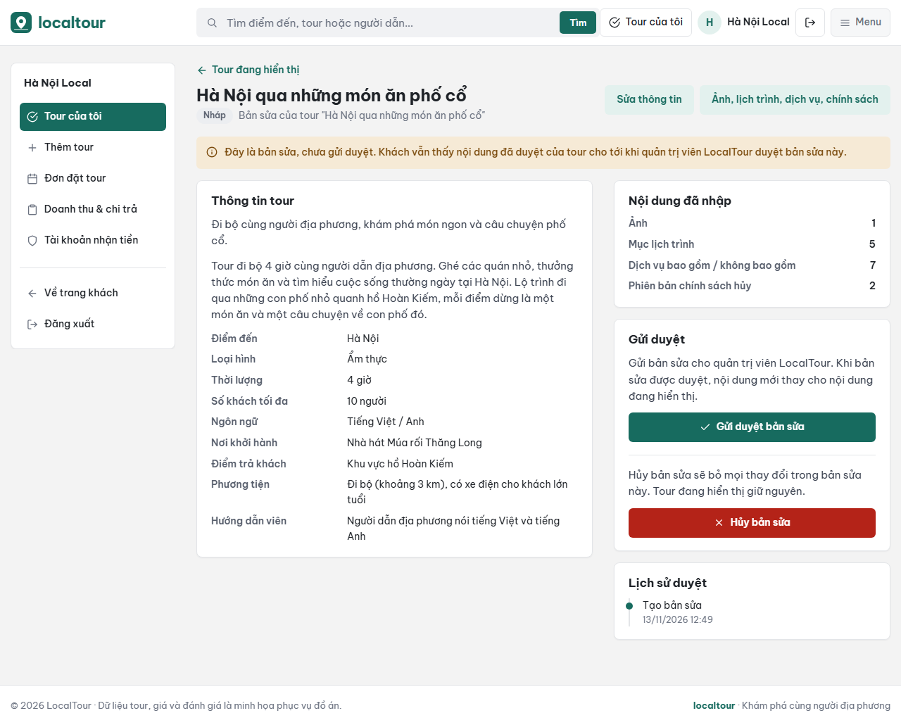

### 5.5. Lịch khởi hành và giá vé

1. Ở trang tour, bấm **Lịch khởi hành và giá vé**. Bảng “Các lịch khởi hành” ghi Khởi hành, Sức chứa, Đang giữ, Còn nhận, Trạng thái (Đang mở bán, Hết chỗ, Đã hủy, Đã hoàn thành) và Giá vé.
2. Thêm: ở “Thêm lịch khởi hành”, nhập Khởi hành, Kết thúc, Sức chứa (chỗ), Giá vé người lớn (đ), Giá vé trẻ em (đ), bấm **Thêm lịch** → “Đã thêm lịch khởi hành.” Giờ khởi hành phải sau thời điểm hiện tại, giờ kết thúc phải sau giờ khởi hành.
3. Sửa: bấm **Sửa** ở một lịch để đổi giờ, sức chứa, giá hoặc “Trạng thái” (Mở bán / Hủy lịch), bấm **Lưu thay đổi** → “Đã lưu lịch khởi hành.” Giá mới chỉ áp dụng cho đơn đặt sau khi lưu; chỉ hủy được lịch khi không còn đơn đang xử lý.
4. Lịch khởi hành và giá vé không cần quản trị viên duyệt: lịch của tour “Đã duyệt” hiện cho khách ngay sau khi lưu.
5. Lịch sửa ở tour gốc, không sửa trên bản sửa hoặc tour đã ngừng hiển thị.

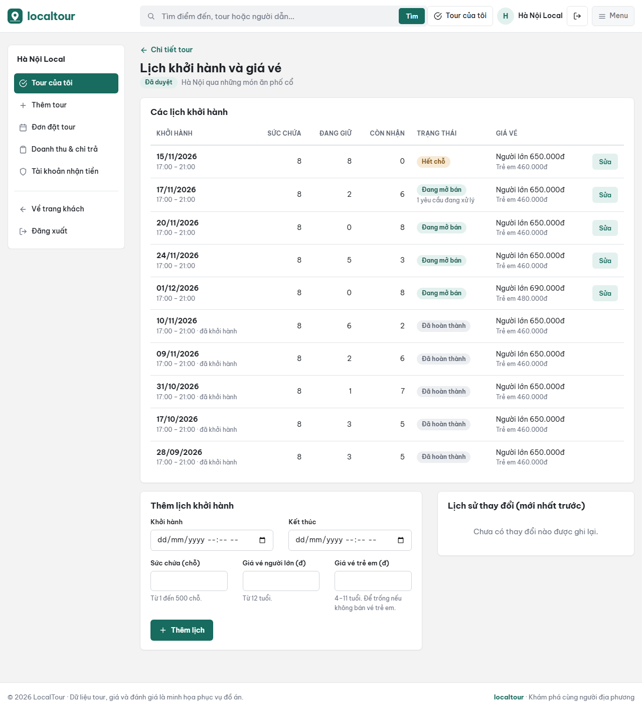

### 5.6. Ngừng hiển thị tour

1. Ở trang tour “Đã duyệt”, mục “Sửa tour đã duyệt”, bấm **Ngừng hiển thị tour** → “Đã ngừng hiển thị tour. Khách không còn tìm thấy và không đặt được tour.” Các đơn cũ giữ nguyên.
2. Chỉ làm được khi tour không còn đơn đang xử lý; còn thì báo “Tour còn đơn đang chờ xác nhận, chờ thanh toán hoặc đã xác nhận nên chưa ngừng hiển thị được.”
3. Muốn hiển thị lại: liên hệ quản trị viên LocalTour (mục 4.6 bước 6).

### 5.7. Xem đơn đặt tour

1. Bấm **Đơn đặt tour**. Danh sách chỉ có đơn khách đặt trên tour của đơn vị. Lọc theo tour (chọn tour hoặc “Tất cả tour của đơn vị”, bấm **Lọc**) và theo tab trạng thái.
2. Bấm **Xem** để mở “Đơn LTxxxxxx”: “Tour và lịch khởi hành”, vé và phụ thu, “Danh sách khách”, “Khách liên hệ và thanh toán” (Người liên hệ, Số điện thoại, Email, Thanh toán, Mã voucher), “Yêu cầu đổi ngày / hủy tour”.
3. Trang chỉ để xem (“Trang này chỉ để xem: cần đổi gì ở đơn, liên hệ quản trị viên LocalTour.”). Xác nhận đơn, hủy đơn, xử lý đổi ngày / hủy tour và hoàn tiền do quản trị viên LocalTour làm.
4. Khi đón khách, đối chiếu mã voucher khách đưa với “Mã voucher” của đơn.

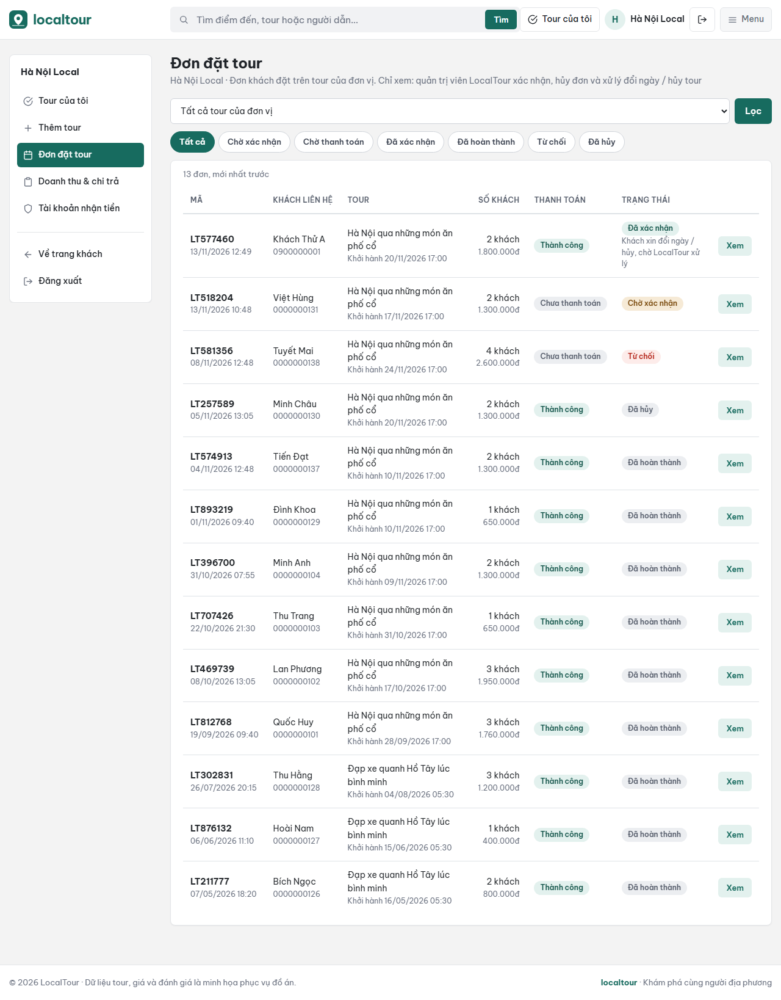

### 5.8. Tài khoản nhận tiền

1. Bấm **Tài khoản nhận tiền**. Ở “Tài khoản ngân hàng”, nhập “Ngân hàng”, “Số tài khoản” (chỉ gồm chữ số, từ 6 đến 20 chữ số), “Tên chủ tài khoản” (đúng như tên đăng ký tại ngân hàng), bấm **Lưu tài khoản** → “Đã lưu tài khoản nhận tiền.”
2. Tài khoản mới khai ghi “Chờ LocalTour xác minh: khoản chi trả chỉ được chuyển sau khi LocalTour xác minh tài khoản.” Khi quản trị viên đã xác minh, trang ghi “Đã được LocalTour xác minh …”.
3. Mỗi lần đổi tài khoản, dấu xác minh bị xóa; LocalTour phải xác minh lại tài khoản mới rồi mới chuyển các khoản chi trả. Đổi tài khoản chỉ áp dụng cho các khoản chưa chi trả.

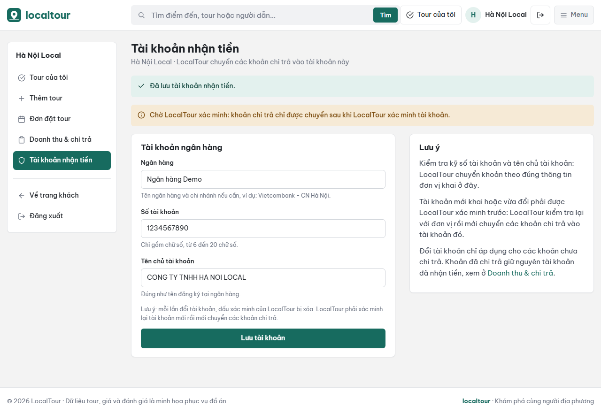

### 5.9. Doanh thu & chi trả

1. Bấm **Doanh thu & chi trả**. Ba ô đầu trang: “Tiền thực thu”, “Thực nhận chờ chi trả”, “Thực nhận đã chi trả”. Trang ghi mức phí dịch vụ LocalTour hiện tại; đơn đã đặt giữ mức phí lúc đặt.
2. Mục “Các khoản chi trả”: mỗi lịch khởi hành có khách đã thanh toán có một khoản chi trả sau khi lịch kết thúc và các đơn của lịch đã xử lý xong. Mỗi dòng ghi Tiền thực thu, Phí dịch vụ, Thực nhận và Trạng thái (Chờ chi trả / Đã chi trả).
3. Bấm **Xem** để mở “Thực nhận <số tiền>”: “Các đơn trong khoản chi trả” và “Chuyển khoản”. Khi LocalTour đã chuyển, mục “Chuyển khoản” có “Chuyển lúc”, “Mã giao dịch” và “Tài khoản nhận”.
4. Chưa khai tài khoản nhận tiền hoặc tài khoản chưa được xác minh thì trang nhắc ở đầu; làm theo mục 5.8. Đã ghi “Đã chi trả” mà chưa thấy tiền về: liên hệ quản trị viên LocalTour kèm mã giao dịch.

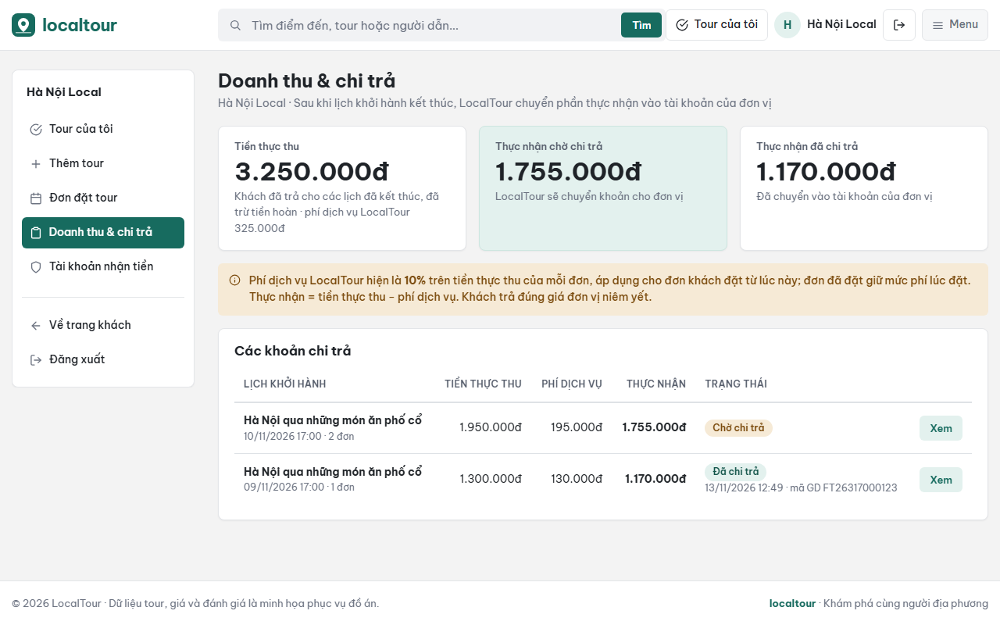

## 6. Lỗi thường gặp khi sử dụng

| Hiện tượng | Nguyên nhân | Cách làm |
| --- | --- | --- |
| Tài khoản mẫu luôn báo “Email hoặc mật khẩu không đúng.” | Tài khoản mẫu không có mật khẩu. | Đăng ký tài khoản mới ở `/register`. |
| Trang đặt tour báo “Tài khoản này không đặt tour được” | Đang đăng nhập bằng tài khoản quản trị hoặc tài khoản đơn vị tổ chức. | Đăng xuất, đăng nhập bằng tài khoản khách hàng. |
| Không thấy ngày muốn đi ở ô “Ngày tham gia” | Lịch đã hết chỗ, đã hủy, hoặc còn dưới 60 phút tới giờ khởi hành. | Chọn ngày khác. |
| Bấm **Đặt tour và thanh toán** thì báo “Lịch này vừa hết chỗ…” hoặc “Lịch này không còn nhận đặt…” | Lịch vừa hết chỗ hoặc vừa quá hạn nhận đặt trong lúc điền thông tin. | Chọn ngày khác rồi đặt lại. |
| Nút ghi “VNPay đang tạm ngưng” / “VietQR đang tạm ngưng” | Máy chưa điền khóa thanh toán. | Điền khóa theo [02 – Hướng dẫn cài đặt](02-huong-dan-cai-dat.md). |
| Thẻ “Chuyển khoản VietQR” ghi “Không dùng được cho đơn này…” | Còn dưới 24 giờ tới giờ khởi hành. | Thanh toán bằng VNPay. |
| Ảnh tour chỉ là ô xám có biểu tượng ảnh | File ảnh tải lên không có trên máy này. | Chép thư mục ảnh tải lên theo 02. |
| Đơn “Chờ thanh toán” chuyển “Đã hủy” | Quá thời gian giữ chỗ (mặc định 30 phút) mà chưa thanh toán. | Đặt lại tour và thanh toán trong hạn. |
| Không gửi được yêu cầu đổi ngày / hủy | Đơn đang có một yêu cầu chờ xử lý, tour đã khởi hành hoặc đơn đã đóng. | Chờ kết quả yêu cầu trước, hoặc liên hệ LocalTour. |
| Không thấy lịch muốn đổi sang | Lịch đó không còn đủ chỗ cho số khách của đơn. | Chọn ngày khác. |
| Đơn vị tổ chức không đăng nhập được | Chưa được cấp mật khẩu, hoặc đơn vị đang “Chờ duyệt” / “Ngừng hợp tác”. | Quản trị viên cấp mật khẩu và chuyển đơn vị sang “Đang hợp tác” (mục 4.7). |
| Đơn vị không sửa được nội dung tour | Tour đang “Chờ duyệt” (bị khóa), hoặc tour “Đã duyệt” phải sửa qua bản sửa. | Chờ quản trị viên xử lý, hoặc bấm **Tạo bản sửa** (mục 5.4). |
| Lịch đã kết thúc nhưng chưa có khoản chi trả | Lịch còn việc dang dở: khoản hoàn tiền chưa ghi, khoản thanh toán chờ đối chiếu, yêu cầu đổi ngày / hủy tour chờ xử lý. | Xử lý theo cột “Còn dang dở” (mục 4.10 bước 7). |
| Không ghi nhận được “Đã chi trả” | Đơn vị chưa khai tài khoản nhận tiền, hoặc tài khoản chưa được xác minh. | Đơn vị khai tài khoản (mục 5.8); quản trị viên xác minh (mục 4.10 bước 4). |
