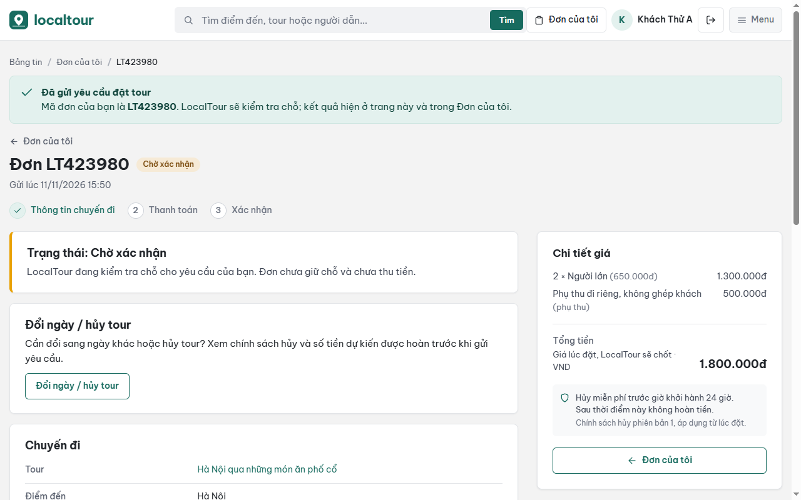
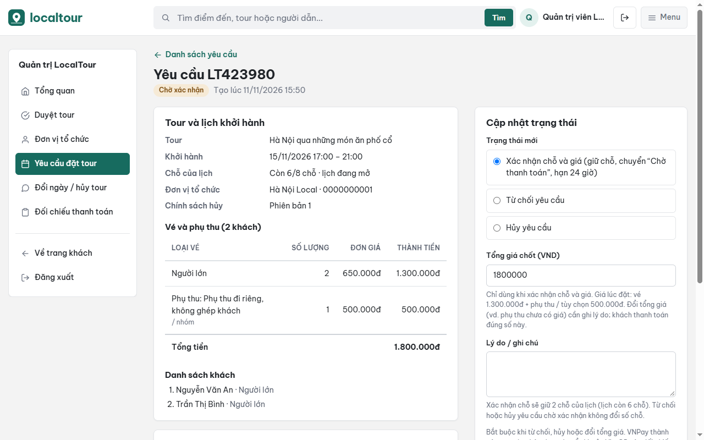

# Hướng dẫn sử dụng LocalTour

| Mục | Nội dung |
| --- | --- |
| Sprint | Sprint 6 – Chuẩn bị demo, hướng dẫn và nghiệm thu UAT (13/11 – 19/11/2026) |
| WBS | 6.2 – User Guide đặt tour |
| Người phụ trách | Hồ Duy Hải, Đỗ Sơn Thành |
| Căn cứ | Giao diện bản tích hợp cuối Sprint 5; Product Backlog (US-01 → US-24); [Sprint 5 – Yêu cầu và luồng](../sprint5/01-yeu-cau-va-luong-sprint5.md); [Sprint 4 – Yêu cầu và luồng đặt tour](../sprint4/02-yeu-cau-va-luong-dat-tour.md) |
| Tài liệu liên quan | [01 – Kế hoạch Sprint 6](01-ke-hoach-sprint6.md), [02 – Hướng dẫn cài đặt](02-huong-dan-cai-dat.md), [04 – Kế hoạch và checklist UAT](04-uat-checklist.md) |
| Trạng thái | Bản nháp; đối chiếu lại với gói demo 6.3 và chốt ngày 14/11/2026. |

Tên nút, nhãn và thông báo trong tài liệu chép đúng như trên màn hình. Ảnh minh họa dùng dữ liệu thử (tài khoản `khach.a@localtour.test`, đơn LT423980).

## 1. Trước khi bắt đầu

Cài đặt, tạo tài khoản quản trị và điền khóa thanh toán theo [02 – Hướng dẫn cài đặt](02-huong-dan-cai-dat.md). Đường dẫn trong tài liệu (ví dụ `/tours`) viết sau địa chỉ trang web đã cài.

| Vai trò | Làm được | Vào từ |
| --- | --- | --- |
| Khách (chưa đăng nhập) | Xem, tìm, lọc, so sánh tour, xem chi tiết tour. | `/tours` |
| Khách hàng | Thêm: đặt tour, thanh toán, “Đơn của tôi”, voucher, đổi ngày / hủy tour. | “Đăng ký” hoặc “Đăng nhập” ở góc phải |
| Quản trị viên | Trang quản trị. Không đặt tour được. | `/admin/login` |

## 2. Trạng thái và quy tắc cần biết

Trạng thái đơn:

| Trạng thái | Ý nghĩa |
| --- | --- |
| Chờ xác nhận | Khách vừa gửi yêu cầu. LocalTour kiểm tra chỗ; đơn chưa giữ chỗ và chưa thu tiền. |
| Chờ thanh toán | LocalTour đã giữ chỗ và chốt tổng giá. Khách thanh toán bằng VNPay hoặc VietQR trong 24 giờ, quá hạn đơn tự hủy. |
| Đã xác nhận | Đã thanh toán thành công, có voucher. |
| Đã hoàn thành | Tour đã diễn ra. |
| Từ chối | LocalTour không nhận yêu cầu, kèm lý do. |
| Đã hủy | Quản trị viên hủy (kèm lý do), quá hạn thanh toán, hoặc yêu cầu hủy tour được đồng ý. |

Trạng thái khoản thanh toán: Chưa thanh toán, Đang xử lý, Chờ đối chiếu, Thành công, Thất bại.

Quy tắc:

- Giá tính bằng VND. “Tạm tính tiền vé” ở trang tour chưa gồm phụ thu và hoạt động tùy chọn. Khi xác nhận chỗ, LocalTour có thể chốt tổng giá khác giá lúc đặt (phải ghi lý do); khách thanh toán đúng tổng giá đã chốt.
- Hạn thanh toán là 24 giờ tính từ lúc LocalTour xác nhận chỗ; thanh toán lại không gia hạn. Đơn có khoản VietQR đang “Chờ đối chiếu” không bị tự hủy.
- Voucher chỉ có sau khi thanh toán thành công.
- Mỗi đơn chỉ có một yêu cầu đổi ngày / hủy tour đang chờ xử lý. Không gửi được khi tour đã khởi hành hoặc đơn đã đóng (bị từ chối, đã hủy, đã hoàn thành). Đổi ngày giữ nguyên số khách, gói và tổng tiền.
- Tiền hoàn do LocalTour chuyển khoản lại thủ công sau khi đồng ý hủy, chưa hoàn tự động qua VNPay.
- So sánh tối đa 3 tour; danh sách so sánh lưu trên trình duyệt đang dùng.
- Các nút có nhãn “Sắp có” (Ngày đi, Bộ lọc, Thích, Bình luận, Chia sẻ, Lưu tour) chưa dùng được.

## 3. Khách hàng

### 3.1. Xem, tìm và lọc tour

1. Mở `/tours` (trang “Bảng tin du lịch”). Mỗi thẻ tour có đơn vị tổ chức, điểm đến, loại hình, tên tour, “Nơi khởi hành”, lịch khởi hành gần nhất và giá.
2. Tìm: gõ vào ô “Tìm điểm đến, tour hoặc người dẫn...” ở đầu trang, bấm **Tìm**.
3. Lọc: chọn ở “Điểm đến:” và “Loại hình:”, hoặc bấm một điểm đến ở mục “ĐIỂM ĐẾN” bên trái.
4. Sắp xếp: tab **Nổi bật** / **Sắp khởi hành**; ô “Giá”: Mặc định, Thấp đến cao, Cao đến thấp.
5. Không có kết quả: trang ghi “Không có tour phù hợp”, bấm **Xóa bộ lọc** để xem lại tất cả.

### 3.2. Xem chi tiết tour

1. Bấm **Xem chi tiết** trên thẻ tour.
2. Trang chi tiết có các mục: Thông tin tour, Gói tour (nếu tour chia gói), Lịch trình, Lịch khởi hành, Dịch vụ (bao gồm / không bao gồm), Chính sách, Đánh giá. Thông tin đơn vị tổ chức chưa cung cấp ghi “Chưa cập nhật”.
3. Thẻ đặt tour bên phải: chọn “Gói tour” (nếu có), “Ngày tham gia” (mỗi lịch ghi ngày, giờ và số chỗ còn), số khách theo loại vé bằng nút **+** / **−**. “Tạm tính tiền vé” cập nhật theo lựa chọn.
4. Bấm **Quay lại danh sách** để về bảng tin.

### 3.3. So sánh 2–3 tour

1. Bấm **Thêm vào so sánh** trên thẻ tour hoặc ở trang chi tiết. Khung “Tour đang so sánh” bên phải bảng tin hiện “N/3 tour”. Bấm lại nút (nhãn “Đã thêm vào so sánh”) để bỏ tour.
2. Thêm tour thứ 4 sẽ bị chặn với thông báo “Chỉ so sánh tối đa 3 tour. Bỏ bớt một tour trước khi thêm tour khác.”
3. Có từ 2 tour, bấm **So sánh tour** (hoặc mục “So sánh tour” ở menu trái). Trang “So sánh tour” đặt mỗi tour một cột theo 4 nhóm: Giá và lịch, Thông tin tour, Lịch trình và dịch vụ, Chính sách. Ô thiếu dữ liệu ghi “Chưa cập nhật”.
4. Trên trang so sánh: **Xem chi tiết** để mở tour và đặt; **Bỏ** để bỏ một tour; **Xóa danh sách** để bỏ hết.

Không cần đăng nhập để so sánh.

### 3.4. Đăng ký, đăng nhập, đăng xuất

1. Đăng ký: bấm **Đăng ký**, nhập Họ tên, Email, Số điện thoại (không bắt buộc), Mật khẩu (tối thiểu 8 ký tự), Nhập lại mật khẩu, bấm **Tạo tài khoản**. Email đã có tài khoản sẽ báo “Email này đã được dùng.”
2. Đăng nhập: bấm **Đăng nhập**, nhập Email, Mật khẩu, bấm **Đăng nhập**. Sai email hoặc mật khẩu đều báo “Email hoặc mật khẩu không đúng.”
3. Đang xem tour mà chưa đăng nhập: chọn ngày và số khách rồi bấm **Đăng nhập để đặt tour**; đăng nhập xong sẽ vào thẳng trang đặt tour với lựa chọn vừa chọn.
4. Đăng xuất: bấm biểu tượng mũi tên cạnh tên tài khoản ở góc phải.

### 3.5. Đặt tour

1. Ở trang chi tiết tour, chọn gói (nếu có), ngày và số khách, bấm **Đặt tour**.
2. Trang “Hoàn tất thông tin đặt tour” có 4 phần:
   - **1 Thông tin liên hệ:** Họ tên, Email, Số điện thoại.
   - **2 Chuyến đi:** đổi được ngày tham gia, gói, số khách; tích “Phụ thu và hoạt động tùy chọn (không bắt buộc)” nếu cần. Khoản “Phụ thu” / “Tùy chọn” ghi rõ tính theo người hay theo nhóm.
   - **3 Danh sách khách:** nhập họ tên từng khách như trên giấy tờ; “Yêu cầu đặc biệt (không bắt buộc)” tối đa 500 ký tự.
   - **4 Điều kiện đặt tour:** đọc điều kiện, tích “Tôi đồng ý với điều kiện đặt tour và chính sách hủy.”
3. Bấm **Xem lại & xác nhận**. Thiếu thông tin thì ô bị đánh dấu kèm thông báo, ví dụ “Vui lòng nhập họ tên khách 2.”, “Vui lòng đồng ý điều kiện đặt tour và chính sách hủy.”
4. Ở “Xem lại yêu cầu đặt tour”, kiểm tra tour, ngày, giờ, danh sách khách, phụ thu và **Tổng tiền**. Bấm **Sửa thông tin** để quay lại hoặc **Gửi yêu cầu đặt tour**.
5. Trang đơn “Đơn LTxxxxxx” hiện “Đã gửi yêu cầu đặt tour”, trạng thái **Chờ xác nhận**. Chưa thu tiền ở bước này.

### 3.6. Thanh toán VNPay hoặc VietQR

Thanh toán được khi đơn ở **Chờ thanh toán** và còn hạn. Trang đơn ghi hạn (“…trước dd/mm/yyyy hh:mm; quá hạn đơn tự hủy.”) và “Số tiền cần thanh toán”.

1. Bấm **Thanh toán ngay** → trang “Thanh toán đơn LTxxxxxx”, phần “Chọn phương thức thanh toán”.
2. **VNPay:** bấm **Thanh toán qua VNPay** → cổng VNPay sandbox → thanh toán bằng thẻ thử của VNPay sandbox (xem [02 – Hướng dẫn cài đặt](02-huong-dan-cai-dat.md)). VNPay trả về trang đơn với “Thanh toán VNPay thành công. Đơn đã được xác nhận và voucher đã sẵn sàng.” Hủy ở cổng VNPay thì về trang đơn với “Bạn đã hủy giao dịch ở VNPay.”, đơn vẫn **Chờ thanh toán** và thanh toán lại được trong hạn.
3. **VietQR:** bấm **Lấy mã VietQR** → trang “Chuyển khoản VietQR” có mã QR, số tiền và nội dung chuyển khoản (mã thanh toán dạng `LTxxxxxxP1`). Chuyển đúng số tiền và nội dung, rồi bấm **Tôi đã chuyển khoản**. Trang đơn báo “Đã ghi nhận bạn báo chuyển khoản. LocalTour sẽ đối chiếu rồi xác nhận đơn; đơn không bị tự hủy trong lúc chờ.”, khoản ở **Chờ đối chiếu**.
4. Muốn xem lại mã chuyển khoản: bấm **Xem thông tin chuyển khoản** ở trang đơn. Ở trang chuyển khoản, **Chọn phương thức khác** để quay lại chọn VNPay; **Về trang đơn** để về đơn.

Đây là môi trường thử nghiệm. Trong buổi demo và UAT không chuyển tiền thật: bấm **Tôi đã chuyển khoản** rồi quản trị viên đối chiếu (mục 4.3). Không chụp ảnh trang “Chuyển khoản VietQR” (có thông tin tài khoản nhận).

### 3.7. Theo dõi đơn

1. Bấm **Đơn của tôi** ở đầu trang. Danh sách chỉ có đơn của tài khoản đang đăng nhập; chưa có đơn thì ghi “Bạn chưa có đơn đặt tour nào”.
2. Bấm vào một đơn để mở trang đơn. Đầu trang là trạng thái và việc cần làm tiếp; bên dưới có Chuyến đi, Danh sách khách, Người liên hệ, Các lần thanh toán, Lịch sử đơn; bên phải là Chi tiết giá và chính sách hủy của đơn.
3. Đơn bị từ chối hoặc bị hủy ghi “Lý do: …” do LocalTour nhập.
4. “Lịch sử đơn” ghi từng bước kèm thời điểm và người làm (Khách hàng, LocalTour, Hệ thống, VNPay).

### 3.8. Voucher

1. Khi đơn **Đã xác nhận**, trang đơn ghi “Mã voucher: …” và nút **Xem và in voucher**.
2. Trang “Voucher tham gia tour” có mã voucher, mã đơn, ngày, giờ, điểm gặp, đơn vị tổ chức, người liên hệ, danh sách khách, phụ thu đã chọn và số tiền đã thanh toán. Bấm **In voucher** để in hoặc lưu PDF.
3. Đưa mã voucher cho hướng dẫn viên khi tới điểm hẹn; có mặt trước giờ khởi hành 15 phút.

### 3.9. Đổi ngày hoặc hủy tour

1. Ở trang đơn, thẻ “Đổi ngày / hủy tour”, bấm **Đổi ngày / hủy tour**.
2. Bên phải là “Chính sách hủy của đơn”: mốc “Hủy miễn phí đến”, “Hiện tại”, “Đã thanh toán” và “Dự kiến hoàn nếu hủy bây giờ”.
3. Ở “Bạn muốn”, chọn:
   - **Hủy tour:** dòng dưới ghi số tiền dự kiến được hoàn theo chính sách.
   - **Đổi sang ngày khác:** chọn “Ngày muốn đổi sang”; chỉ hiện các lịch cùng tour còn đủ chỗ cho số khách của đơn.
4. Nhập “Lý do” (bắt buộc, tối đa 500 ký tự), bấm **Gửi yêu cầu**. Trang báo “Đã gửi yêu cầu. LocalTour sẽ xử lý và cập nhật kết quả trên trang này. Tiền hoàn (nếu có) được LocalTour chuyển lại thủ công.”
5. Mục “Yêu cầu đã gửi” hiện trạng thái **Chờ xử lý**, sau đó **Đã đồng ý** hoặc **Đã từ chối** kèm “Phản hồi của LocalTour”. Đơn giữ nguyên cho tới khi yêu cầu được đồng ý.

## 4. Quản trị viên

### 4.1. Đăng nhập quản trị

1. Mở `/admin/login` (“Đăng nhập quản trị”), nhập Email, Mật khẩu của tài khoản quản trị tạo lúc cài đặt, bấm **Đăng nhập**.
2. Menu trái: Tổng quan, Duyệt tour, Đơn vị tổ chức, Yêu cầu đặt tour, Đổi ngày / hủy tour, Đối chiếu thanh toán, Về trang khách, Đăng xuất.
3. Tài khoản khách hàng mở trang quản trị sẽ thấy “Bạn không có quyền truy cập trang này.”

### 4.2. Xác nhận, từ chối hoặc hủy yêu cầu đặt tour

1. Bấm **Yêu cầu đặt tour**. Lọc theo tab (Tất cả, Chờ xác nhận, Chờ thanh toán, Đã xác nhận, Đã hoàn thành, Từ chối, Đã hủy) hoặc tìm theo mã đặt chỗ, tên, email, số điện thoại. Bấm **Xem** ở dòng cần xử lý.
2. Trang “Yêu cầu LTxxxxxx” có tour và lịch (“Chỗ của lịch”: số chỗ còn), vé và phụ thu, danh sách khách, các khoản thanh toán, “Lịch sử xử lý”.
3. Sau khi liên hệ đơn vị tổ chức, ở “Cập nhật trạng thái” chọn “Trạng thái mới”:
   - **Xác nhận chỗ và giá (giữ chỗ, chuyển “Chờ thanh toán”, hạn 24 giờ):** kiểm tra “Tổng giá chốt (VND)”; đổi tổng giá thì phải ghi lý do ở “Lý do / ghi chú”. Lịch không đủ chỗ thì hệ thống không cho xác nhận.
   - **Từ chối yêu cầu** hoặc **Hủy yêu cầu:** bắt buộc nhập “Lý do / ghi chú”; khách thấy lý do ở trang đơn.
   - **Xác nhận đã thanh toán (chuyển “Đã xác nhận”):** chỉ dùng khi đơn đã có khoản thanh toán thành công hoặc khoản VietQR chờ đối chiếu; thường làm qua mục 4.3.
   - **Tour đã diễn ra (chuyển “Đã hoàn thành”):** chỉ dùng sau giờ khởi hành.
4. Bấm **Cập nhật trạng thái**. Trang báo “Đã cập nhật trạng thái yêu cầu.”, lịch sử ghi người làm và thời điểm.

### 4.3. Đối chiếu chuyển khoản VietQR

1. Bấm **Đối chiếu thanh toán**. Mục “Chuyển khoản VietQR chờ đối chiếu” liệt kê nội dung chuyển khoản, số tiền, đơn, tour, lúc khách báo và hạn giữ chỗ.
2. Bấm **Đối chiếu** → trang yêu cầu, phần khoản thanh toán. Kiểm tra sao kê tài khoản nhận tiền: đúng số tiền và nội dung `LTxxxxxxP1`.
3. Khớp: bấm **Đã nhận tiền** → “Đã xác nhận nhận tiền: đơn chuyển “Đã xác nhận” và khách nhận được voucher.”
4. Không khớp: nhập “Lý do (bắt buộc khi không khớp)”, bấm **Không khớp** → đơn vẫn chờ thanh toán tới hết hạn giữ chỗ cũ; khách thanh toán lại.

### 4.4. Xử lý giao dịch VNPay chưa rõ kết quả

Khi chạy ở máy cục bộ, VNPay không gọi được IPN; kết quả chỉ ghi khi khách quay về từ cổng VNPay. Khoản VNPay không có kết quả sau 15 phút hiện ở mục “Giao dịch VNPay chưa rõ kết quả” của **Đối chiếu thanh toán**.

1. Bấm **Đối chiếu** ở khoản đó, tra mã thanh toán (`LTxxxxxxPn`) trên cổng VNPay sandbox.
2. Có giao dịch thành công: nhập “Mã giao dịch VNPay (khi có giao dịch thành công)” (chỉ chữ số), bấm **Có giao dịch thành công**. Đơn còn chờ thanh toán thì chuyển “Đã xác nhận” và có voucher; đơn đã hủy thì hệ thống tạo yêu cầu hoàn tiền.
3. Không có giao dịch: nhập “Ghi chú (bắt buộc khi không có giao dịch)”, bấm **Không có giao dịch**. Đơn còn hạn giữ chỗ thì khách thanh toán lại được.

### 4.5. Xử lý yêu cầu đổi ngày / hủy tour

1. Bấm **Đổi ngày / hủy tour**. Tab: Chờ xử lý, Đã đồng ý, Đã từ chối, Tất cả. Bấm **Xử lý** ở yêu cầu cần làm.
2. Trang yêu cầu có lý do của khách, đơn, ngày đang đặt, ngày muốn đổi sang (kèm số chỗ còn), chính sách hủy áp dụng, số tiền đã thanh toán. Bấm **Xem đơn** để mở đơn.
3. Ở “Xử lý”, chọn “Kết quả”:
   - **Đồng ý hủy tour:** nhập “Số tiền hoàn (đ)”. Đơn chuyển “Đã hủy”, trả chỗ, ghi khoản hoàn; LocalTour chuyển khoản lại thủ công. Đơn còn khoản VietQR chờ đối chiếu thì phải đối chiếu trước.
   - **Đồng ý đổi ngày:** đơn chuyển sang lịch mới, giữ số khách, gói và tổng tiền.
   - **Từ chối, giữ nguyên đơn.**
4. Nhập “Ghi chú gửi khách (bắt buộc)”, bấm **Lưu kết quả**. Mỗi yêu cầu chỉ xử lý một lần; khách thấy kết quả và ghi chú ở trang đơn.

### 4.6. Quản lý tour, lịch, giá, gói và nội dung

Tour chỉ hiện cho khách khi tour đã được duyệt và đơn vị tổ chức đang hợp tác.

1. Bấm **Duyệt tour**. Tab: Chờ duyệt, Đã duyệt, Bị từ chối, Ngừng hiển thị, Tất cả. Bấm **Xem và duyệt** / **Xem** để mở chi tiết tour.
2. **Thêm tour:** bấm **Thêm tour**, nhập Tên tour, Đơn vị tổ chức, Điểm đến, Loại hình, Ngôn ngữ hướng dẫn, Thời lượng (phút), Số khách tối đa mỗi yêu cầu đặt, Mô tả, điểm hẹn, điều kiện tour, nguồn và xác minh; bấm **Thêm tour**. Tour mới ở “Chờ duyệt”.
3. Ở trang chi tiết tour:
   - **Sửa thông tin:** sửa các trường ở bước 2, bấm **Lưu thay đổi**.
   - **Lịch khởi hành và giá vé:** “Thêm lịch khởi hành” (Khởi hành, Kết thúc, Sức chứa (chỗ) từ 1 đến 500, Giá vé người lớn (đ), Giá vé trẻ em (đ)) → **Thêm lịch**. Bấm **Sửa** ở một lịch để đổi giờ, sức chứa, giá hoặc “Trạng thái” (Mở bán / Hủy lịch) → **Lưu thay đổi**. Giá mới chỉ áp dụng cho yêu cầu gửi sau khi lưu; chỉ hủy được lịch khi không còn yêu cầu đang xử lý.
   - **Gói tour:** “Thêm gói” (Tên gói, Thứ tự hiển thị, Giá người lớn (đ), Giá trẻ em (đ), Mô tả) → **Thêm gói**. Bỏ chọn “Đang bán” để ngừng bán gói; đơn đã đặt không bị ảnh hưởng. Tour có gói thì giá vé lấy theo gói.
   - **Ảnh, lịch trình, dịch vụ, chính sách:**
     - Ảnh: **Tải ảnh lên** (JPG, PNG hoặc WebP, tối đa 2 MB; tối đa 12 ảnh) hoặc dán đường dẫn ảnh, nhập “Mô tả ảnh”, bấm **Thêm ảnh**; **Đặt làm ảnh bìa**, **Xóa**.
     - Lịch trình: Giờ, Thứ tự, Nội dung → **Thêm mục**; **Sửa**, **Xóa** từng mục.
     - Dịch vụ: Tên dịch vụ, Loại (Đã bao gồm / Không bao gồm) → **Thêm dịch vụ**.
     - Chính sách hủy: “Hủy miễn phí trước (giờ)”, “Hoàn sau mốc đó (%)”, “Nội dung chính sách cho khách” → **Lưu phiên bản mới**. Đơn đã đặt giữ phiên bản lúc đặt.
4. Duyệt: bấm **Phê duyệt tour**, hoặc nhập “Lý do từ chối (bắt buộc)” rồi bấm **Từ chối tour**. Lịch sử xử lý ghi người làm và thời điểm.
5. Xóa tour (tab “Xóa tour” ở trang nội dung): tích “Tôi hiểu tour sẽ bị xóa hoặc ngừng hiển thị với khách.”, bấm **Xóa tour**. Tour chưa có đơn bị xóa hẳn; tour đã có đơn chuyển “Ngừng hiển thị”; không xóa được khi còn đơn chờ xác nhận, chờ thanh toán hoặc đã xác nhận.
6. Hiển thị lại tour đang “Ngừng hiển thị”: ở tab “Hiển thị lại”, bấm **Chuyển về Chờ duyệt**, rồi phê duyệt lại.

### 4.7. Quản lý đơn vị tổ chức

1. Bấm **Đơn vị tổ chức** để xem danh sách (tên, số điện thoại, email, trạng thái hợp tác, số tour).
2. Thêm: bấm **Thêm đơn vị**, nhập Tên đơn vị, Số điện thoại liên hệ, Email liên hệ, “Trạng thái hợp tác” (Đang hợp tác / Chờ duyệt / Ngừng hợp tác), bấm **Thêm đơn vị**.
3. Sửa: bấm **Sửa**, đổi thông tin, bấm **Lưu thay đổi**. Chuyển “Ngừng hợp tác” thì tour của đơn vị không hiện cho khách.
4. Xóa (chỉ đơn vị chưa có tour): ở trang sửa, tích “Tôi hiểu đơn vị sẽ bị xóa hẳn.”, bấm **Xóa đơn vị**.

### 4.8. Tổng quan và thống kê doanh thu

1. Bấm **Tổng quan**. Ba ô đầu trang: “Tài khoản khách hàng” (số đang hoạt động / bị khóa), “Tour” (chờ duyệt / đã duyệt / bị từ chối), “Yêu cầu chờ xác nhận”. Bảng “Yêu cầu đặt tour theo trạng thái” đếm đơn theo từng trạng thái.
2. Ở “Thống kê”, chọn Theo ngày / Theo tháng / Theo năm, “Từ ngày”, “Đến ngày”, bấm **Xem thống kê**. Để trống ngày: theo ngày = 30 ngày gần nhất, theo tháng = 12 tháng gần nhất, theo năm = toàn bộ.
3. “Số yêu cầu đặt tour theo ngày tạo” đếm đơn theo kỳ. “Doanh thu theo ngày thanh toán” ghi Lượt thanh toán, Doanh thu gộp, Hoàn tiền, Doanh thu thuần (= tiền đã thanh toán thành công − tiền đã hoàn).
4. Bấm vào một kỳ để mở “Khoản thanh toán theo kỳ” và đối chiếu từng khoản.

## 5. Lỗi thường gặp khi sử dụng

| Hiện tượng | Nguyên nhân | Cách làm |
| --- | --- | --- |
| Tài khoản mẫu luôn báo “Email hoặc mật khẩu không đúng.” | Tài khoản mẫu không có mật khẩu. | Đăng ký tài khoản mới ở `/register`. |
| Trang đặt tour báo “Tài khoản này không đặt tour được” | Đang đăng nhập bằng tài khoản quản trị. | Đăng xuất, đăng nhập bằng tài khoản khách hàng. |
| Nút ghi “VNPay đang tạm ngưng” / “VietQR đang tạm ngưng” | Máy chưa điền khóa thanh toán. | Điền khóa theo [02 – Hướng dẫn cài đặt](02-huong-dan-cai-dat.md). |
| Ảnh tour chỉ là ô xám có biểu tượng ảnh | File ảnh tải lên không có trên máy này. | Chép thư mục ảnh tải lên theo 02. |
| Đơn “Chờ thanh toán” chuyển “Đã hủy” | Quá 24 giờ chưa thanh toán. | Đặt lại tour. |
| Không gửi được yêu cầu đổi ngày / hủy | Đơn đang có một yêu cầu chờ xử lý, tour đã khởi hành hoặc đơn đã đóng. | Chờ kết quả yêu cầu trước, hoặc liên hệ LocalTour. |
| Không thấy lịch muốn đổi sang | Lịch đó không còn đủ chỗ cho số khách của đơn. | Chọn ngày khác. |
